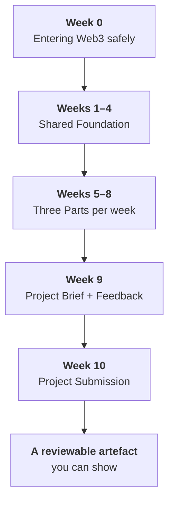

# Week 0 · Part 1 — Welcome to Blockchain@NTU Academy

Welcome to Blockchain@NTU Academy, a beginner-first path through Web3. New
vocabulary can feel overwhelming and avoidable mistakes can be costly. This
Handbook is the public, canonical source for the Academy's complete W0–W10
learning path. You are welcome to read or follow it independently too.

Today is a short setup and orientation. It explains where Academy cohort
participants access the programme, submit work and get updates, and gives every
learner a safe vocabulary and tool map before the Foundation asks you to reason
about blockchains or use a wallet.

::: important Following the Academy or reading independently
**If you are an Academy cohort participant**, complete the setup below and use
the Academy platform for formal submissions, reviewer feedback, points and
progress. The relevant Telegram group is used for cohort questions and
announcements.

**If you are reading independently**, the Handbook and its task criteria remain
public. You can read every lesson and complete the same missions and projects,
but WCB submissions, cohort review, formal points/progress tracking and access
to a cohort Telegram group are not included. You can use the published criteria
for self-review. The Handbook is canonical if any platform copy differs.
:::

## Learning objectives

- Explain how GitHub, WCB and Telegram are used by Academy participants
- Find the learning material, task instructions and completion criteria in this Handbook
- Explain how Academy submissions are reviewed and revised
- Apply the testnet-only and no-keys safety rules

## Core

### How the Academy works



==**Weeks 1–4 build a shared foundation.**== They build a shared map of blockchains,
wallets, Ethereum, smart contracts and the wider industry. You do not choose a
specialism yet, because you cannot sensibly choose one before you know what is
out there.

**Weeks 5–8 are the Deep Dive.** At the end of Week 4,
you select Builder or Researcher and stay on that capability path through W10,
building transferable skills through three reviewable Part tasks each week.
Your domain, research question or project idea can evolve during W5–W8. In W9,
you scope the Project Brief and seek feedback; in W10, you produce the final
reviewable project.

### The weekly rhythm

Each Foundation week has a handful of short pages and **one Anchor Mission**.
The Deep Dive then adds three 100-point tasks per week in W5–W8,
followed by the W9 Project Brief + Feedback Session and W10 Project Submission.
There is no extra weekly Deep Dive deliverable: the three Part tasks are the
reviewable work for each week. Academy participants submit them through the
official workflow.

| Item | Details |
|---|---|
| Anchor Missions | One per Foundation week, Weeks 1–4; 100 points each |
| Deep Dive tasks | Three Part tasks per week in W5–W8; 100 points each |
| Project checkpoints | W9 Project Brief + Feedback Session 200, W10 Project Submission 200 |
| Total | **2,000 points** for the full curriculum |
| Week 0 | No mission, no points |
| Review outcome | Each task is either **Complete** or **Revise**; there is no partial-score rubric |
| Revision | Reviewers give actionable feedback; revise the work and resubmit |
| Deadlines | **None.** The weekly pace is a recommended rhythm |

::: important How Academy review works
The Handbook states what complete work demonstrates. Academy cohort
participants submit work through WCB for a **Complete** or **Revise** outcome.
Revise means actionable feedback and another submission, not failure. Readers
outside the cohort may use the same criteria for self-review, but points and
progress are formally tracked only through organised Academy participation.
:::

The Foundation pages are longer than their missions require. That is on purpose:
==**richer content, lighter assessment.**== Read the Core sections properly,
skim Landscape, and treat Further Exploration as optional. In Deep Dive, each
Part task is embedded in the learning rather than added as extra homework.

### Reading levels

| Level | What it means | Assessed? |
|---|---|---|
| <Badge type="danger" text="Core" /> | You should be able to explain or demonstrate this | Yes |
| <Badge type="warning" text="Landscape" /> | You should recognise it and roughly place it | No |
| <Badge type="info" text="Further Exploration" /> | Optional depth | No |

If you are short on time, Core is the part that matters.

### The three accounts and places

:::: tabs
@tab <Icon name="simple-icons:github" /> GitHub

GitHub is where developers share repositories, code and project history. The
curriculum uses it for GitHub workflows and Builder work; it can also preserve
reproducible Researcher work or project evidence. An account is needed to
create or push your own repository, and Academy participants use GitHub to sign
in to WCB. Not every Researcher final project needs to be a repository.

Reading the Handbook or cloning a public repository does not require an
account. The walkthrough below is useful for Academy participants and
hands-on learners; read-only learners may skip it.

@tab Academy platform / WCB

WCB sign-in uses GitHub. The platform supports Academy cohort operations,
including application and access, formal task submissions, reviewer feedback,
points and progress. The Handbook
contains the canonical lessons, task instructions, completion criteria and
project requirements. Use the [Blockchain@NTU Academy page on WCB](https://web3career.build/en/programs/blockchain-ntu-academy)
for Academy access and participation information.

::: tip If the Handbook and WCB differ
The Handbook is the canonical source for what a task requires.
:::

@tab <Icon name="simple-icons:telegram" /> Telegram

Academy cohort participants use the relevant Telegram group for questions,
stuck moments and announcements. Cohort members receive the appropriate group
link through Academy onboarding. Community access may differ outside the
cohort; Telegram is not needed to read the Handbook.

::: danger Web3 chat groups attract impersonators
Never share a seed phrase or private key, connect a wallet, pay money or follow
an urgent verification link because of a direct message. Check announcements
through an official Blockchain@NTU channel before acting. See
[Part 4](./safety.md) for the general safety guidance.
:::
::::

### The two rules

::: danger These rules apply throughout Academy learning
==**1. Testnet only for required transactions and wallet actions.**== Any required
activity that sends a transaction, deploys a contract, performs a state-changing
wallet action, or otherwise requires funds or an on-chain signature must use
testnet only. Some lessons may ask you to inspect public mainnet data in a block
explorer without connecting a wallet or sending anything. Testnet coins are free
and worth nothing. No learning task requires real money or a wallet holding
real assets. If an instruction appears to ask this, do not proceed.

==**2. Nobody in the Academy should ask for your keys.**== Never share your
seed phrase or private key with a person, website or support service. Anyone
who asks is unsafe, regardless of their role or profile. Verify unexpected
messages through a known official channel.
:::

## Landscape

Terms you will see on GitHub this week. Week 4 covers GitHub properly.

| Term | What it is |
|---|---|
| **Repository ("repo")** | A project folder with its full history. It gives collaborators one place to read, change and review the work |
| **Commit** | One saved change, with a message explaining what and why. Commits let you inspect how the project reached its current state |
| **README** | The front page of a repository, written in Markdown. It tells a new reader what the project is and how to use it |
| **Markdown** | Plain text with light formatting marks — this handbook is written in it. GitHub turns those marks into readable pages |
| **Issue** | A tracked task, bug or question. It keeps context and discussion attached to the work |
| **Pull request** | A proposed change, opened for review before it is merged. Reviewers can discuss and test it in one place |
| **Fork** | Your own copy of somebody else's repository. It lets you experiment or propose changes without directly changing the original |

## GitHub setup for Academy and hands-on work

If you are only reading, skip this walkthrough. Academy cohort participants
need a GitHub account for WCB sign-in. Independent hands-on learners can create
one now or wait until an exercise asks them to create or push a repository.
Creating the practice repository below is useful, but is not required just to
sign in to WCB.

:::: steps
1. **Create your GitHub account**

   Go to [github.com](https://github.com) and choose **Sign up**. Use an email
   address you will still have after you graduate.

   Pick a username you would be comfortable sharing: it appears in your
   repository URLs.

   Verify your email. *You should now be able to reach your profile at
   `github.com/your-username`.*

2. **Turn on two-factor authentication**

   Open **Settings → Password and authentication → Two-factor authentication**.
   An authenticator app is stronger than SMS. Two-factor authentication is
   recommended for account security.

   ::: tip Students
   The [GitHub Student Developer Pack](https://education.github.com/pack) is
   optional and not needed for this curriculum.
   :::

3. **Make a practice repository**

   From your profile choose **Repositories → New**. Name it
   `web3-learning-notes`, set it **Public**, tick **Add a README file**, and
   choose **Create repository**.

4. **Edit the README and commit**

   Open `README.md`, choose the pencil icon, and replace the contents:

   ```markdown
   # My Web3 Learning Notes

   Notes and evidence from my Web3 learning.

   ## What I want to learn

   - Understand how blockchains actually work
   - Build something small I can show
   ```

   Choose **Commit changes**, write a short message such as `docs: add README`,
   and commit. *You should now see the formatted text and a commit count of 2.*

   That is the basic GitHub loop: **edit, describe the change, commit.**

::::

## Worked example

Here is what a good first week of setup looks like, and what it is worth.

An Academy participant or hands-on learner can create a GitHub account, turn
on 2FA and make a first commit to a README. The account supports WCB sign-in and
later GitHub tasks; the practice repository is preparation, not an Academy
submission requirement.

**By W10,** if you choose a repository-based project, that repository can hold
your code, reproducible work and project evidence, with a README explaining
what was built and what remains to do. Its commit history shows how the work
developed over time.

::: important GitHub is a tool, not the project format
A repository is useful for Builder work and for Researcher work that benefits
from reproducible code or data. A Researcher project may also be an article,
report or another reviewable format.
:::

::: details Further exploration — optional, not assessed
- [GitHub Skills](https://skills.github.com/) — short interactive courses. "Introduction to GitHub" takes about 20 minutes
- [GitHub Docs — Hello World](https://docs.github.com/en/get-started/start-your-journey/hello-world) — the official walkthrough, covering branches and pull requests
- [Markdown basic syntax](https://docs.github.com/en/get-started/writing-on-github/getting-started-with-writing-and-formatting-on-github/basic-writing-and-formatting-syntax) — worth ten minutes, because you will write Markdown every remaining week
:::

::: details Sources and attribution
- [GitHub Docs — Creating an account](https://docs.github.com/en/get-started/start-your-journey/creating-an-account-on-github) — Reuse (CC BY 4.0), adapted
- [GitHub Docs — Hello World](https://docs.github.com/en/get-started/start-your-journey/hello-world) — Reuse (CC BY 4.0), adapted
- [GitHub Docs — About README files](https://docs.github.com/en/repositories/managing-your-repositorys-settings-and-features/customizing-your-repository/about-readmes) — Reuse (CC BY 4.0), adapted
- [GitHub Skills](https://skills.github.com/) — Link, referenced only
:::
