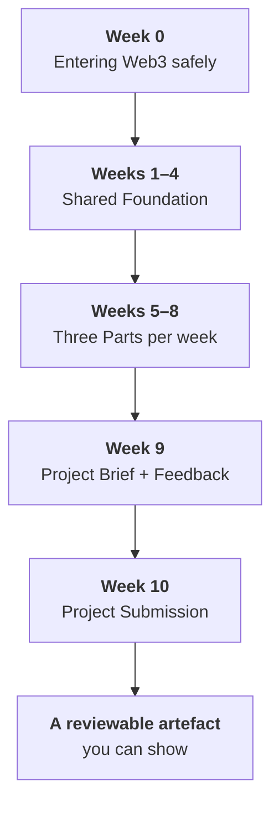

# Week 0 · Part 1 — Welcome and setup

Welcome to a beginner-first path through Web3, a subject where new vocabulary
can feel overwhelming and avoidable mistakes can be costly. This Handbook is
public and self-paced. You can follow it from W0 through W10 independently.

Today is a short setup and orientation. It gives you a safe vocabulary and a
tool map before the Foundation asks you to reason about blockchains or use a
wallet.

## Learning objectives

- Create a GitHub account and explain what a repository, commit and README are for
- Find the learning material, tasks and completion criteria in this Handbook
- Use completion criteria to self-check work or request feedback
- Apply the testnet-only and no-keys safety rules

## Core

### How the curriculum works



==**Weeks 1–4 build a shared foundation.**== They build a shared map of blockchains,
wallets, Ethereum, smart contracts and the wider industry. You do not choose a
specialism yet, because you cannot sensibly choose one before you know what is
out there.

**Weeks 5–8 are the Deep Dive.** At the end of Week 4,
you select Builder or Researcher and stay on that capability path through W10,
building transferable skills through three reviewable Part tasks each week.
Your domain, research question or project idea can evolve during W5–W8. In W9,
you scope the Project Brief and seek feedback; in W10, you produce the final
reviewable project.

### The weekly rhythm

Each Foundation week has a handful of short pages and **one Anchor Mission**.
The Deep Dive then adds three 100-point tasks per week in W5–W8,
followed by the W9 Project Brief + Feedback Session and W10 Project Submission.
There is no separate weekly Deep Dive submission: each Part task is that week's
progress evidence.

| Item | Details |
|---|---|
| Anchor Missions | One per Foundation week, Weeks 1–4; 100 points each |
| Deep Dive tasks | Three Part tasks per week in W5–W8; 100 points each |
| Project checkpoints | W9 Project Brief + Feedback Session 200, W10 Project Submission 200 |
| Total | **2,000 points** for the full curriculum |
| Week 0 | No mission, no points |
| Completion | Each task is either **Complete** or **Revise**; there is no partial-score rubric |
| Revision | Compare the work with the stated criteria, make needed changes and check again |
| Deadlines | **None.** The weekly pace is a recommended rhythm |

::: important Use the criteria as a self-check
The Handbook states what complete work demonstrates. You can check your work
yourself or ask another learner, a peer, mentor or educator for feedback. No
particular reviewer is required to follow the curriculum.
:::

The Foundation pages are longer than their missions require. That is on purpose:
==**richer content, lighter assessment.**== Read the Core sections properly,
skim Landscape, and treat Further Exploration as optional. In Deep Dive, each
Part task is embedded in the learning rather than added as extra homework.

### Reading levels

| Level | What it means | Assessed? |
|---|---|---|
| <Badge type="danger" text="Core" /> | You should be able to explain or demonstrate this | Yes |
| <Badge type="warning" text="Landscape" /> | You should recognise it and roughly place it | No |
| <Badge type="info" text="Further Exploration" /> | Optional depth | No |

If you are short on time, Core is the part that matters.

### Your learning setup

:::: tabs
@tab <Icon name="simple-icons:github" /> GitHub

Where developers and researchers keep work in public. Later lessons use it to
read project code and documentation, and you can use it to publish project
evidence.

It is also, bluntly, a portfolio. A GitHub profile with real work on it is worth
more to an employer in this industry than most certificates.

::: tip GitHub is optional
The Handbook contains the lessons, task instructions and completion criteria.
GitHub is recommended for code and project evidence; the curriculum itself is
available without a GitHub account.
:::
::::

### The two rules

::: danger These rules apply throughout the curriculum
==**1. Testnet only for required transactions and wallet actions.**== Any required
activity that sends a transaction, deploys a contract, performs a state-changing
wallet action, or otherwise requires funds or an on-chain signature must use
testnet only. Some lessons may ask you to inspect public mainnet data in a block
explorer without connecting a wallet or sending anything. Testnet coins are free
and worth nothing. No learning task requires real money or a wallet holding
real assets. If an instruction appears to ask this, do not proceed.

==**2. Nobody asks for your keys.**== Never share your seed phrase or private
key with a person, website or support service. Anyone who asks is unsafe,
regardless of what their profile says.
:::

## Landscape

Terms you will see on GitHub this week. Week 4 covers GitHub properly.

| Term | What it is |
|---|---|
| **Repository ("repo")** | A project folder with its full history. It gives collaborators one place to read, change and review the work |
| **Commit** | One saved change, with a message explaining what and why. Commits let you inspect how the project reached its current state |
| **README** | The front page of a repository, written in Markdown. It tells a new reader what the project is and how to use it |
| **Markdown** | Plain text with light formatting marks — this handbook is written in it. GitHub turns those marks into readable pages |
| **Issue** | A tracked task, bug or question. It keeps context and discussion attached to the work |
| **Pull request** | A proposed change, opened for review before it is merged. Reviewers can discuss and test it in one place |
| **Fork** | Your own copy of somebody else's repository. It lets you experiment or propose changes without directly changing the original |

## Guided walkthrough

:::: steps
1. **Create your GitHub account**

   Go to [github.com](https://github.com) and choose **Sign up**. Use an email
   address you will still have after you graduate.

   Pick a username you would be comfortable putting on a CV — it appears in
   every URL of every project you touch, and changing it later breaks existing
   links.

   Verify your email. *You should now be able to reach your profile at
   `github.com/your-username`.*

2. **Turn on two-factor authentication**

   **Settings → Password and authentication → Two-factor authentication.** An
   authenticator app is stronger than SMS. GitHub requires 2FA for accounts that
   contribute code, so doing it now avoids being locked out later.

   ::: tip Students
   The [GitHub Student Developer Pack](https://education.github.com/pack) is
   optional and not needed for this curriculum.
   :::

3. **Make your first repository**

   From your profile choose **Repositories → New**. Name it
   `web3-learning-notes`, set it **Public**, tick **Add a README file**, and
   choose **Create repository**.

4. **Edit the README and commit**

   Open `README.md`, choose the pencil icon, and replace the contents:

   ```markdown
   # My Web3 Learning Notes

   Notes and evidence from my Web3 learning.

   ## What I want to learn

   - Understand how blockchains actually work
   - Build something small I can show
   ```

   Choose **Commit changes**, write a short message like `docs: add README`, and
   commit. *You should now see your text rendered as a formatted page, and a
   commit count of 2.*

   That is the whole GitHub loop: **edit, describe the change, commit.**
   Everything else is a variation on it.

::::

## Worked example

Here is what a good first week of setup looks like, and what it is worth.

Someone joining with no technical background creates a GitHub account under a
sensible username, turns on 2FA, and pushes one commit to a README. Total time:
about fifteen minutes. Nothing about it is impressive.

**By W10,** that same repository can hold a Week 3 contract, a Week 4 Track
Selection Card, Deep Dive work and final project evidence, with a README
explaining what was built and what remains to do. The commit history shows the
work accumulating over time.

::: important The value is not any single commit
It is that there is a visible, dated trail of someone learning in public — which
is the thing this industry actually reads.
:::

::: details Further exploration — optional, not assessed
- [GitHub Skills](https://skills.github.com/) — short interactive courses. "Introduction to GitHub" takes about 20 minutes
- [GitHub Docs — Hello World](https://docs.github.com/en/get-started/start-your-journey/hello-world) — the official walkthrough, covering branches and pull requests
- [Markdown basic syntax](https://docs.github.com/en/get-started/writing-on-github/getting-started-with-writing-and-formatting-on-github/basic-writing-and-formatting-syntax) — worth ten minutes, because you will write Markdown every remaining week
:::

::: details Sources and attribution
- [GitHub Docs — Creating an account](https://docs.github.com/en/get-started/start-your-journey/creating-an-account-on-github) — Reuse (CC BY 4.0), adapted
- [GitHub Docs — Hello World](https://docs.github.com/en/get-started/start-your-journey/hello-world) — Reuse (CC BY 4.0), adapted
- [GitHub Docs — About README files](https://docs.github.com/en/repositories/managing-your-repositorys-settings-and-features/customizing-your-repository/about-readmes) — Reuse (CC BY 4.0), adapted
- [GitHub Skills](https://skills.github.com/) — Link, referenced only
:::
