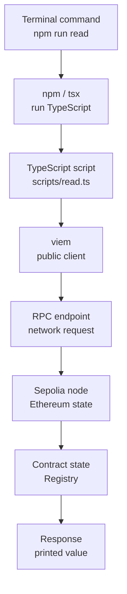

<!--
Author note (Education team): every output on this page comes from a real run
of the public Builder starter. The model answer and reviewer notes are kept
outside the public handbook.
-->

# Week 5 · Part 1 — Run the stack

> **Core question — what actually happens between typing a command and seeing
> a value from the blockchain?**

In [Week 3](../../../foundation/week-3/part-3-remix-lab.md) you wrote,
deployed and called a contract inside Remix. Remix did a lot for you: it held
the code, compiled it, picked a network and showed you buttons.

**No programming background beyond Foundation is assumed.** From now on you
will work with code in a folder on your laptop, tools in a terminal and scripts
that talk to the chain. This Part introduces those tools and shows how their
pieces connect; you do not need to arrive comfortable with a terminal or
JavaScript.

::: tip Picture a restaurant kitchen
Remix is a meal kit: everything arrives measured and boxed. A real kitchen
has separate stations (prep, stove, pass) and you need to know which one does
what.

Where the picture stops: a kitchen keeps working if you forget where the salt
is. A project does not. One missing setting, such as the network address in
`.env`, stops everything, so you learn exactly where each setting is read.
:::

## The hard skill

**Run a real Web3 project locally, and trace how a script gets from your
terminal to a value on the chain.**

After this Part you can:

- clone, install, compile and test a Foundry + TypeScript project;
- run a TypeScript script that reads live Sepolia data;
- point to the file and line where the RPC address enters the code;
- explain why a setting lives in `.env` and not in the code.

## Core / reference material

### Before you run the stack

These names identify the stations you are about to connect. This is an
orientation, not a second installation guide.

**Time note:** The 35-minute Part estimate assumes the required tools are
already installed. First-time Node.js, Foundry or Windows/WSL setup may take
additional time. It is one-time setup, not Academy task work.

| Tool or file | What it does here |
|---|---|
| **Terminal** | Runs text commands inside a current folder on your laptop. A command is what you type; output is what the tool prints back. |
| **Git** | Tracks project changes and shares them through GitHub. The Git CLI is its terminal-based form. |
| **Node.js** | Runs JavaScript and TypeScript tools on your laptop. |
| **npm** | Installs JavaScript packages and runs project shortcuts. |
| **`package.json`** | Lists project packages and the shortcuts available through `npm run`. |
| **TypeScript** | JavaScript with optional type labels that help tools catch mistakes. |
| **Foundry / `forge`** | Foundry is the Solidity toolkit; `forge` compiles and tests contracts. |
| **viem** | A TypeScript library that talks to Ethereum through an RPC endpoint. |
| **Vite** | Runs and builds the React frontend. |
| **`.env`** | A local file for settings such as an RPC URL; it is not committed. |
| **RPC endpoint** | The network address a program uses to ask a blockchain node for data or submit a request. |
| **Application Binary Interface (ABI)** | The machine-readable description of a contract's functions and events, including how inputs and results are encoded. |

#### Terminal: command, folder, output

Commands act in the **current folder**, the directory your terminal is
currently working in. Use these to check or move between folders:

```bash
pwd                       # show the current folder
ls                        # list its files
cd academy-builder-starter # move into the project folder
cd ..                     # move up one folder
```

If a command starts a server and keeps the terminal occupied, press **Ctrl+C**
to stop that process. On Windows, use [Microsoft's official WSL installation
guide](https://learn.microsoft.com/en-us/windows/wsl/install) to set up the
Linux-compatible terminal environment these tools expect.

#### Git CLI: the terminal form of GitHub collaboration

These commands cover the operations used in Builder; you do not need advanced
Git:

| Command | Meaning |
|---|---|
| `git clone --recurse-submodules <url>` | Copy the project and its test-library submodule to your laptop. |
| `git status` | Show which files changed. |
| `git switch -c <name>` | Create and move to your own branch. |
| `git fetch` | Download the latest remote history without merging it into your branch. |
| `git add <file>` | Select a changed file for the next saved change. |
| `git commit -m "message"` | Save the selected change in your local history. |
| `git push -u origin <name>` | Upload your branch to GitHub. |

The same action crosses several of these stations. The visual below is an
explanatory map of the path; the later file trace gives the exact code.



In plain English: npm finds the shortcut, `tsx` starts the script, the script
uses viem to form a request, the RPC endpoint carries it to a Sepolia node, and
the node answers from the contract's current state. The response then travels
back through the same client and is printed by the script. A failure at any
station is useful evidence about which layer to inspect next.

### The starter, folder by folder

The [Builder starter](https://github.com/Blockchain-NTU-SG/academy-builder-starter)
is the project you use for all of Week 5 and Week 6.

| Folder or file | What lives there | Tool that uses it |
|---|---|---|
| `contracts/src/` | The Solidity contract (`Registry.sol`) | Foundry (`forge`) |
| `contracts/test/` | Foundry tests | `forge test` |
| `out/` | Compiled contract and ABI, created by `forge build` | Scripts, export step |
| `shared/contract.ts` | Address, chain and ABI in one file, generated from `out/` | Scripts and frontend |
| `scripts/` | TypeScript scripts that talk to Sepolia | `tsx`, run by `npm run …` |
| `src/` | The React frontend | Vite (`npm run dev`) |
| `.env` | Your local settings, such as `RPC_URL` | Read by `scripts/client.ts` |
| `package.json` | The `npm run` shortcuts | npm |

### Four commands you will use every day

| Command | What it does |
|---|---|
| `npm run compile` | `forge build`, then exports the ABI into `shared/contract.ts` |
| `forge test` | Runs the Solidity tests on a local, throwaway chain. No Sepolia, no gas |
| `npm run read` | Runs `scripts/read.ts` against Sepolia |
| `npm run dev` | Starts the frontend on your laptop |

Open `package.json` and find the `"scripts"` section. Every `npm run x` is a
shortcut for the command written next to `x`. When something breaks, that is
the first place to look.

### Settings live in `.env`

`.env` is configuration, not magic. When `scripts/client.ts` starts, it
explicitly calls `process.loadEnvFile('.env')`. Node then loads the file's
`NAME=value` entries into the process environment, and the script reads
`process.env.RPC_URL`. Node does not automatically load `.env` in every
project; this starter chooses to load it explicitly. An RPC address can
contain a private API key, and different people use different providers, so it
is never written into the code. Instead:

1. `.env.example` is committed and shows which settings exist.
2. You copy it to `.env` and fill in your own values.
3. `.gitignore` helps prevent an **untracked** `.env` from being added through
   normal Git workflows. It does not erase a secret that was already
   committed, and a file can still be force-added.
4. `scripts/client.ts` explicitly loads the file and reads the value when it
   starts.

Some values are sensitive. `.env.example` documents names and safe defaults;
it must not contain your private key or a provider credential.

### Programming survival kit

You do not need to memorise syntax or become a TypeScript developer. You need
to follow where data comes from, which function is called, what goes in, what
comes back and where an error is handled. For example:

```ts
const learner = { name: 'Ari' }

function greeting(name: string): string {
  if (!name) return 'Hello'
  return `Hello, ${name}`
}

const message = greeting(learner.name)
console.log(message)
```

- A **variable** (`learner`) stores a value. An **object** groups named values;
  `learner.name` reads its `name` property.
- A **function** is reusable behaviour. Calling `greeting(...)` passes an
  **argument** (`learner.name`) into its parameter (`name`); the **return
  value** is the result it gives back. `if` chooses what to do when a condition
  is true.
- `: string` is a TypeScript type label saying this value should be text.
- An **array** is an ordered list. `.map()` is a common way to turn each item
  into a displayed row; you will recognise it in the frontend Parts.
- `import` uses code another file exports. `async` marks a function that can
  wait for a slow operation; `await` waits for it. `try … catch` handles an
  error rather than letting it stop the whole script.

You only need to read and adapt these patterns. For `npm run read`, for
example, follow the address and RPC into the function, see what it returns and
notice which `catch` reports a failure. Ask AI to explain unfamiliar syntax,
then run and verify the result.

### Worked example: trace `npm run read`

Run it first, from the repository root, after `cp .env.example .env`:

```bash
npm run read
```

```text
Network: Sepolia (11155111)
Contract: 0xf3eea9aa5a43846490a638f1b2bebb29ac2938b1
Owner: 0xE234F67EaB4638Cb6C7f93D1bfcD0bb9DCE09252
Record read from Sepolia: Hello from NTU Blockchain Builder Lab
```

This is illustrative output from a checked run, not a permanent promise about
the owner's record. The contract address and network are the useful fixed
context; live state can change.

Now follow it through the files.

**1. `package.json`** maps `read` to `tsx scripts/read.ts`. `tsx` runs a
TypeScript file directly.

**2. `scripts/read.ts`** starts with two imports:

```ts
import { address, abi, chain } from '../shared/contract.js'
import { client, requireSepolia } from './client.js'
```

So the address, ABI and chain come from the generated `shared/contract.ts`,
and the connection comes from `client.ts`.

**3. `scripts/client.ts`** is where the settings enter:

```ts
if (existsSync('.env')) process.loadEnvFile('.env')
const rpcUrl = process.env.RPC_URL
if (!rpcUrl) throw new Error('Set RPC_URL in .env first (copy .env.example).')

export const client = createPublicClient({ chain, transport: http(rpcUrl) })
```

It loads `.env`, takes `RPC_URL`, and builds a viem **public client**: an
object that sends read requests to that RPC.

**4. Back in `read.ts`,** `main()` uses that client in order:
`requireSepolia()` asks the RPC for its chain ID, `getCode` checks a contract
exists at the address, then two `readContract` calls read `owner` and that
owner's `records` entry. Each one is a request to the RPC, and each answer
comes from Sepolia's current state.

**Prove it by breaking it.** Empty `RPC_URL` in `.env` and run again:

```text
/…/scripts/client.ts:7
if (!rpcUrl) throw new Error('Set RPC_URL in .env first (copy .env.example).')

Error: Set RPC_URL in .env first (copy .env.example).
```

The error names the exact file and line where the setting is read. Now set
`RPC_URL` to an Ethereum **mainnet** RPC such as
`https://ethereum-rpc.publicnode.com`:

```text
RPC_URL must point to Ethereum Sepolia (11155111).
```

The connection worked, but `requireSepolia()` caught the wrong network before
any contract read. Put the Sepolia value back before you continue.

**The execution path in one line:** `npm run read` → `tsx` →
`scripts/read.ts` → imports `shared/contract.ts` (address, ABI, chain) and
`scripts/client.ts` (reads `RPC_URL` from `.env`) → viem → RPC → Sepolia →
answer printed.

## Hands-on task

1. **Run the stack.** Clone the starter (follow its README), then run
   `npm run compile`, `forge test` and `npm run read`.
2. **Read one more value.** Add one line to `scripts/read.ts` that prints a
   new piece of live Sepolia data, for example the latest block number or the
   owner's ETH balance. Use a function from the viem public client. Run it
   and commit the change.
3. **Explain the path.** In five to eight sentences, explain what happens when
   you run `npm run read`, from the command to the printed value. Name the
   file and line where `RPC_URL` enters, and say why it is in `.env` rather
   than in the code.

**Out of scope:** deploying anything, changing the contract and changing the
frontend. Those come in Parts 2 to 4.

::: tip If something fails
Read the error first. Most first-run problems are the wrong Node version
(the starter needs Node 22: run `nvm use`), a missing `.env`, or forgetting
`--recurse-submodules` when cloning (fix it with
`git submodule update --init --recursive`).
:::

## Evidence required

- Terminal output of `forge test` and of your changed `npm run read`.
- A link to your commit that adds the new line.
- Your short explanation of the execution path.

## Completion and revision

This Part is worth **100 points**. Completed / approved earns the full points;
incomplete or materially incorrect work is returned with specific feedback for
revision. There is no partial-score rubric.

::: details Further exploration — optional, not assessed
- Open the browser developer tools while `npm run dev` is running and compare
  how the frontend reaches its settings with how the script does.
- Run `forge test -vvvv` and read the trace of one test.
- Swap the public RPC in `.env` for one from a provider account, and compare
  the speed of `npm run read`.
:::

::: details Sources and attribution
- [Foundry Book — Projects](https://getfoundry.sh/projects/project-layout) — Link, referenced only
- [viem — Getting started](https://viem.sh/docs/getting-started) — Link, referenced only
- [Node.js — process.loadEnvFile](https://nodejs.org/api/process.html#processloadenvfilepath) — Link, referenced only
- [Blockchain@NTU Academy Builder starter](https://github.com/Blockchain-NTU-SG/academy-builder-starter) — Reuse (MIT), code excerpts from `scripts/read.ts` and `scripts/client.ts`
:::
