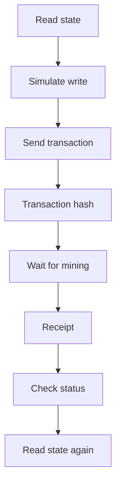

<!--
Author note (Education team): the worked-example script was tested against the
starter Registry on a local copy (fork) of Sepolia, so the outputs are real but
the transaction hash is shown as a placeholder. The model answer and reviewer
notes are kept outside the public handbook.
-->

# Week 5 · Part 3 — Programmatic contract interaction

> **Core question — how do I operate a contract from code, and know for sure
> that my transaction did what I meant?**

In Remix you clicked a button and watched a result appear. A script has to do
every one of those steps itself: read, check, send, wait and confirm.

In this Part you write that script, first against the shared starter
Registry, then against your own contract with the feature you built in
[Part 2](./part-2-contract-engineering.md).

::: tip Picture sending a parcel
You check the address, ask the counter whether the parcel is allowed, pay and
hand it over, get a tracking number, then check it arrived.

Where the picture stops: a blockchain lets you ask "would this be accepted?"
for free before you send anything. That check, called a simulation, is the
step most beginners skip, and the one that saves them most.
:::

## The hard skill

**Write a script that reads a contract, simulates a change, sends it, waits
for the receipt, handles a failure by name and verifies the result on-chain.**

After this Part you can:

- tell a public client (reads) from a wallet client (signs and sends);
- catch a contract error before it costs gas;
- explain why a transaction hash is not proof of success;
- confirm a change on-chain and on Etherscan.

## Core / reference material

### Three things make a contract callable

To call any contract from code you need its **address**, its **chain** and its
**Application Binary Interface (ABI)**. The ABI is the machine-readable
description that tells viem which functions and events exist and how their
arguments and results are encoded. In the starter, all three come from
`shared/contract.ts`, which `npm run compile` and `npm run deploy` generate for
you. If any one is wrong, calls fail in confusing ways, as you will see in Week
6.

The arguments and function name are packed into **calldata**, the encoded input
carried by a contract call. You do not hand-encode it here: viem uses the ABI
to build it, which is why the address, chain and ABI must agree.

### Two clients

A **client** is the code object that knows how to talk to a chain. The public
client asks questions and simulates; the wallet client uses an account to
authorise writes.

| Client | What it does | Needs a key? |
|---|---|---|
| **Public client** (`createPublicClient`) | Reads state, simulates calls, waits for receipts | No |
| **Wallet client** (`createWalletClient`) | Signs and sends transactions | Yes, an account |

In a script, the account comes from a private key in `.env`, through
`privateKeyToAccount`. In Part 4, the browser wallet signs instead, and your
code never sees a key.

::: warning Use a disposable test account
The key in `.env` should belong to an account made only for Sepolia, holding
nothing but free test ETH. Never use an account that has ever held real money,
and never commit `.env`.
:::

### The five steps

The same write has a lifecycle. The visual is a compact map; the table below
names the viem function and the evidence produced at each stage.



Simulation is a read-only rehearsal against the state visible at that moment;
the transaction is the later state-changing action. The receipt is the
execution result recorded after inclusion in a block, including its status,
block number and logs.

| Step | viem function | What you get back |
|---|---|---|
| 1. Read | `readContract` | The current value |
| 2. Simulate | `simulateContract` | A ready-to-send `request`, or the contract's error, before anything is sent |
| 3. Send | `writeContract` | A transaction **hash**, straight away |
| 4. Wait | `waitForTransactionReceipt` | The **receipt**: block, `status` (`success` or `reverted`), event logs |
| 5. Verify | `readContract` again, and Etherscan | Proof the state changed |

Two details that catch people out:

- **A transaction hash is only an identifier, not success.**
  `writeContract` returns the hash as soon as the wallet submits the
  transaction. It can still revert when mined. Only the receipt's `status`
  tells you what happened on-chain.
- **Simulate first.** If the contract would reject the call at the state used
  for simulation, the simulation fails with the error's name. No on-chain
  transaction is sent and no on-chain gas is paid. Your RPC service may still
  count or limit the simulation request. Passing its `request` to
  `writeContract` also means you send the call you just simulated.

### Errors by name

When a contract reverts with a custom error, viem decodes it using the ABI. The
error arrives wrapped inside other errors, so you search for it:

```ts
const revert = error.walk((e) => e instanceof ContractFunctionRevertedError)
// revert.data?.errorName is, for example, "EmptyRecord"
```

This is why custom errors from Part 2 matter: your script can react to
`AlreadyEndorsed` differently from `RecordNotFound`.

### Worked example: update your record from a script

The starter Registry lets any account set its own record. Save this as
`scripts/write.ts`. It reads, simulates, sends, waits, verifies and handles a
contract error:

```ts
import { BaseError, ContractFunctionRevertedError, createWalletClient, isHex } from 'viem'
import { privateKeyToAccount } from 'viem/accounts'
import { address, abi, chain } from '../shared/contract.js'
import { client, transport, requireSepolia } from './client.js'

// Usage: npx tsx scripts/write.ts "your new record"
const value = process.argv[2] ?? ''

async function main() {
  await requireSepolia()
  if (!address) throw new Error('No contract address in shared/contract.ts.')
  const key = process.env.PRIVATE_KEY
  if (!key || !isHex(key) || key.length !== 66) throw new Error('Set a disposable Sepolia PRIVATE_KEY in .env.')
  const account = privateKeyToAccount(key)
  const wallet = createWalletClient({ account, chain, transport })

  // 1. Read the current state
  const before = await client.readContract({ address, abi, functionName: 'records', args: [account.address] })
  console.log(`Account: ${account.address}`)
  console.log(`Before: "${before}"`)

  // 2. Simulate: run the call against current state without sending it
  const { request } = await client.simulateContract({
    account, address, abi, functionName: 'setRecord', args: [value],
  })
  console.log('Simulation passed')

  // 3. Send the transaction
  const hash = await wallet.writeContract(request)
  console.log(`Sent: ${hash}`)

  // 4. Wait for the receipt
  const receipt = await client.waitForTransactionReceipt({ hash })
  console.log(`Mined in block ${receipt.blockNumber}, status: ${receipt.status}`)

  // 5. Verify against on-chain state
  const after = await client.readContract({ address, abi, functionName: 'records', args: [account.address] })
  console.log(`After: "${after}"`)
  console.log(`Check it: ${chain.blockExplorers.default.url}/tx/${hash}`)
}

main().catch((error: unknown) => {
  // 6. Handle the expected failure: a revert from the contract, by name
  if (error instanceof BaseError) {
    const revert = error.walk((e) => e instanceof ContractFunctionRevertedError)
    if (revert instanceof ContractFunctionRevertedError) {
      console.error(`Rejected by the contract: ${revert.data?.errorName ?? revert.reason}`)
    } else {
      console.error(error.shortMessage)
    }
  } else {
    console.error(error instanceof Error ? error.message : error)
  }
  process.exitCode = 1
})
```

Put your test account's key in `.env` as `PRIVATE_KEY`, make sure it has a
little Sepolia ETH, then run it. The output below is from a test run; your
account, hash and block number will be different.

```bash
npx tsx scripts/write.ts "gm from my first script"
```

```text
Account: 0x9b72A74f04016025F492DadBD59771758b1f5B30
Before: ""
Simulation passed
Sent: 0x<your transaction hash>
Mined in block 11926675, status: success
After: "gm from my first script"
Check it: https://sepolia.etherscan.io/tx/0x<your transaction hash>
```

Now the expected failures. An empty record and one over 140 bytes:

```bash
npx tsx scripts/write.ts ""
```

```text
Account: 0x9b72A74f04016025F492DadBD59771758b1f5B30
Before: "gm from my first script"
Rejected by the contract: EmptyRecord
```

A 141-character record prints `Rejected by the contract: RecordTooLong`. In
both cases the simulation stopped the call, so no transaction was sent and no
gas was spent.

**Verify on Etherscan.** Open your "Check it" link. The transaction page
should show **Success**, the `setRecord` call, and under **Logs** one
`RecordUpdated` event with your address and the new value. That is the chain's
own record of what happened, independent of your script.

## Hands-on task

Operate **your own** contract from a script.

1. **Deploy your Part 2 contract.** With your test key in `.env`, run
   `npm run deploy`. It compiles, deploys to Sepolia, waits for two
   confirmations, and writes the new address and ABI into
   `shared/contract.ts`.
2. **Write a script** in `scripts/` that uses the function you added in
   Part 2. It must:
   1. read the state your feature changes;
   2. simulate the call;
   3. send it;
   4. wait for the receipt and check its `status`;
   5. handle one expected failure from your feature, printing the custom
      error's name;
   6. read the state again and print the Etherscan link.
3. **Run it twice:** once so it succeeds, once so it hits your expected failure.

If your feature needs a second account (for example, someone else's record),
make a second test account in MetaMask and send it a little Sepolia ETH.

**Out of scope:** the frontend (Part 4), events beyond what Etherscan shows
(Part 5), and verifying source code on Etherscan (Week 6).

## Evidence required

- Your script (a link to the file or commit).
- The Sepolia transaction hash of your successful run.
- The output of both runs, and two or three sentences on what changed on-chain
  and where on Etherscan you confirmed it.

## Completion and revision

This Part is worth **100 points**. Completed / approved earns the full points;
incomplete or materially incorrect work is returned with specific feedback for
revision. There is no partial-score rubric.

::: details Further exploration — optional, not assessed
- Send a transaction **without** simulating it first, using a value you know
  will fail. Compare what happens and what it costs.
- Print `receipt.gasUsed` and `receipt.logs`, and match the log to the event
  you see on Etherscan.
- Use `cast send` to make the same call from the terminal, and compare it with
  your script.
:::

::: details Sources and attribution
- [viem — readContract](https://viem.sh/docs/contract/readContract) — Link, referenced only
- [viem — simulateContract](https://viem.sh/docs/contract/simulateContract) — Link, referenced only
- [viem — writeContract](https://viem.sh/docs/contract/writeContract) — Link, referenced only
- [viem — waitForTransactionReceipt](https://viem.sh/docs/actions/public/waitForTransactionReceipt) — Link, referenced only
- [viem — Error handling](https://viem.sh/docs/error-handling) — Link, referenced only
- [viem — privateKeyToAccount](https://viem.sh/docs/accounts/local/privateKeyToAccount) — Link, referenced only
- [Blockchain@NTU Academy Builder starter](https://github.com/Blockchain-NTU-SG/academy-builder-starter) — Reuse (MIT), `scripts/client.ts` and the `Registry` used in the worked example
:::
