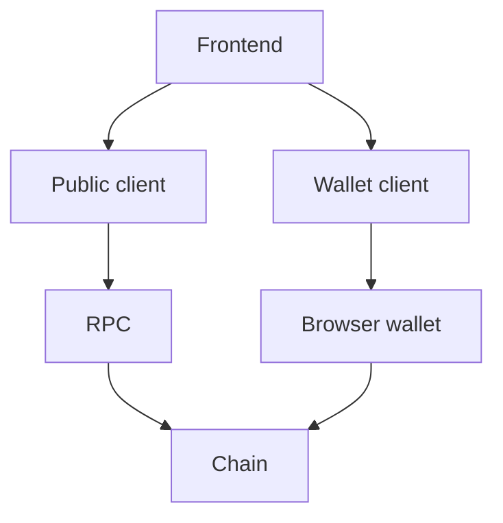
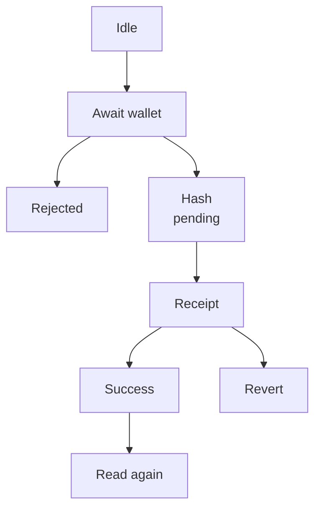

<!--
Author note (Education team): the worked example (a read-only section with
loading and error states) was run in a browser against Sepolia, including the
error state with a broken RPC URL. The task's model answer is the working app
kept with the private reviewer notes, outside the public handbook.
-->

# Week 5 · Part 4 — Wallet and frontend integration

> **Core question — how do I let a real person, with their own wallet, use my
> contract from a web page?**

Your script from [Part 3](./part-3-programmatic-contract-interaction.md)
signed with a key from `.env`. A real user will never give you their key.
Instead, their wallet signs, and your page asks it to.

This Part fills in the starter frontend's empty sections: connect a wallet,
read from the contract, write to it, and keep the user informed while they
wait.

::: tip Picture a card terminal at a café
The café's till builds the bill. The customer's own card and PIN approve it.
The till never sees the PIN, and the customer can always say no.

Where the picture stops: a card payment takes seconds. A transaction can take
much longer, and fail after it was approved. Your page has to show every stage
honestly.
:::

## The hard skill

**Connect a browser wallet to your app, read and write contract state from
the page, and show the user what is happening at every step.**

After this Part you can:

- request an account from a browser wallet and react when it changes;
- detect the wrong network and offer to switch;
- read contract data in the browser without a connected wallet;
- send a transaction through the wallet and handle every outcome.

## Core / reference material

### How the page talks to the wallet

MetaMask and similar wallets expose a **provider**: a JavaScript object that
passes a page's Ethereum requests to the wallet and its connected node. Many
wallets make it available as `window.ethereum`.

[EIP-1193](https://eips.ethereum.org/EIPS/eip-1193) is the standard browser-
wallet provider interface. It gives a page a `request({ method, params })`
entry point plus events for changes such as the selected account or chain. It
does not give the page the user's private key; the wallet remains the signer.

| You want to… | Call or listen for |
|---|---|
| Ask for the user's account | `request({ method: 'eth_requestAccounts' })` |
| Know which network the wallet is on | `request({ method: 'eth_chainId' })` |
| Ask the wallet to switch to Sepolia | `request({ method: 'wallet_switchEthereumChain', params: [{ chainId: '0xaa36a7' }] })` |
| Notice the user changed account | `on('accountsChanged', …)` |
| Notice the user changed network | `on('chainChanged', …)` |

`0xaa36a7` is 11155111, Sepolia's chain ID, written in hexadecimal.

TypeScript does not know `window.ethereum` exists until you tell it. Add this
to `src/vite-env.d.ts`:

```ts
interface Window {
  ethereum?: import('viem').EIP1193Provider
}
```

### Two clients again

| | Reads | Writes |
|---|---|---|
| **Client** | Public client | Wallet client |
| **Created with** | `createPublicClient({ chain, transport: http(VITE_RPC_URL) })` | `createWalletClient({ account, chain, transport: custom(window.ethereum) })` |
| **Needs a wallet?** | No, so reads work before anyone connects | Yes, the wallet signs |

The public client needs an RPC address in the browser. Add it to `.env` with
the `VITE_` prefix, because Vite only exposes variables with that prefix to
the page:

```bash
VITE_RPC_URL=https://ethereum-sepolia-rpc.publicnode.com
```

Restart `npm run dev` after changing `.env`. Only public values ever go in a
`VITE_` variable, since every visitor can read them.

### Two paths through the frontend

The page uses a public client for questions and a wallet client for
user-authorised writes. The two paths share the contract address, chain and
ABI, but they have different trust boundaries:



The public client asks and can work before anyone connects a wallet. The wallet
client requests a user-authorised signature; it does not silently receive the
key or turn a rejected request into a success.

### The stages of a write

A write from a page has more ways to end than a script:



The page should reflect these states honestly: a popup still waiting for the
user is not a pending transaction, and a hash is not a mined success. Refresh
displayed state only after the receipt says the write succeeded.

| Stage | What the user sees | How you know |
|---|---|---|
| Waiting for the wallet | "Confirm in your wallet" | You called `writeContract` and it has not returned |
| Rejected | "You cancelled" | The wallet throws a `UserRejectedRequestError` |
| Rejected by the contract | The error's name | `simulateContract` throws, as in Part 3 |
| Pending | "Pending…" and a link to the transaction | `writeContract` returned a hash |
| Success | "Saved", and the new value | Receipt `status` is `success` |
| Reverted | "The transaction reverted" | Receipt `status` is `reverted` |

After success, **read again**. The page should show the new value without the
user reloading.

### Just enough React

Two React tools cover everything here:

- `useState` holds a value the page shows, such as the account or the current
  stage. Changing it redraws the page.
- `useEffect` runs code after the page draws, such as loading data or
  subscribing to wallet events. Return a clean-up function to stop listening
  when the page goes away.

### Worked example: a read with loading and error states

Before touching the wallet, make section 2 show the **owner's** record. It
needs no wallet, so it works as soon as the page opens.

**`src/lib/clients.ts`** (new file):

```ts
import { createPublicClient, http } from 'viem'
import { chain } from '../../shared/contract'

// Reads go through the RPC in .env, so they work before any wallet is connected.
export function getPublicClient() {
  const rpcUrl = import.meta.env.VITE_RPC_URL
  if (!rpcUrl) throw new Error('VITE_RPC_URL is not set. Add it to .env, then restart npm run dev.')
  return createPublicClient({ chain, transport: http(rpcUrl) })
}
```

**`src/vite-env.d.ts`**, so TypeScript knows the variable exists:

```ts
/// <reference types="vite/client" />

interface ImportMetaEnv {
  readonly VITE_RPC_URL?: string
}
```

**`src/App.tsx`**: three possible states, one effect that loads, and a
section that shows whichever state you are in:

```tsx
import { useEffect, useState } from 'react'
import { BaseError, type Address } from 'viem'
import { address, abi, chain } from '../shared/contract'
import { getPublicClient } from './lib/clients'

type OwnerRecord =
  | { kind: 'loading' }
  | { kind: 'ok'; owner: Address; record: string }
  | { kind: 'error'; message: string }

function App() {
  const [ownerRecord, setOwnerRecord] = useState<OwnerRecord>({ kind: 'loading' })

  useEffect(() => {
    let cancelled = false
    async function load() {
      try {
        if (!address) throw new Error('No contract address in shared/contract.ts.')
        const client = getPublicClient()
        const owner = await client.readContract({ address, abi, functionName: 'owner' })
        const record = await client.readContract({ address, abi, functionName: 'records', args: [owner] })
        if (!cancelled) setOwnerRecord({ kind: 'ok', owner, record })
      } catch (error) {
        const message = error instanceof BaseError ? error.shortMessage : String(error)
        if (!cancelled) setOwnerRecord({ kind: 'error', message })
      }
    }
    load()
    return () => { cancelled = true }
  }, [])

  // … inside the returned JSX, replacing the section 2 placeholder:
  //   <section>
  //     <h2>2. Read a record</h2>
  //     {ownerRecord.kind === 'loading' && <p>Loading…</p>}
  //     {ownerRecord.kind === 'error' && <p role="alert">Could not read: {ownerRecord.message}</p>}
  //     {ownerRecord.kind === 'ok' && (
  //       <p>Owner <code>{ownerRecord.owner}</code> says: <output>{ownerRecord.record || '(empty)'}</output></p>
  //     )}
  //   </section>
```

With the starter's shared Registry, the section shows:

```text
2. Read a record
Owner 0xE234F67EaB4638Cb6C7f93D1bfcD0bb9DCE09252 says: Hello from NTU Blockchain Builder Lab
```

Now break it on purpose: set `VITE_RPC_URL=https://example.invalid` and
restart. After a few seconds of retries, the section shows:

```text
Could not read: HTTP request failed.
```

The page did not go blank or freeze. Every network call can fail, so every
section that loads data needs all three states. The `cancelled` flag stops a
slow answer from updating the page after it has moved on.

## Hands-on task

Finish the starter frontend against your own contract from Part 3
(`shared/contract.ts` already points at it).

1. **Section 1, account and network.** A "Connect wallet" button. Once
   connected, show the account and the wallet's network. If it is not Sepolia,
   show a warning with a button that asks the wallet to switch. React to
   account and network changes without a reload.
2. **Section 2, read.** Show the **connected account's** record, with loading
   and error states.
3. **Section 3, write.** Let the user save a new record through their wallet.
   Simulate first, then show: waiting for the wallet, pending with a link to
   the transaction, success, and at least one failure (a cancelled signature
   or a contract error such as `EmptyRecord`). After success, section 2 shows
   the new value without a reload.

Leave section 4 for Part 5.

**Out of scope:** UI libraries, wagmi, RainbowKit or other wallet kits,
styling beyond what the starter has, and supporting more than one network.

::: tip Use AI as a pair, not a replacement
An assistant can write a lot of React quickly. Check every stage in the table
above by actually triggering it in your browser: cancel a signature, send an
empty record, switch MetaMask to another network.
:::

## Evidence required

- A link to your commit.
- Screenshots or a short screen recording showing: the connected account and
  network, your record loaded, a pending transaction, the success state with
  the new value, and one failure state.

## Completion and revision

This Part is worth **100 points**. Completed / approved earns the full points;
incomplete or materially incorrect work is returned with specific feedback for
revision. There is no partial-score rubric.

::: details Further exploration — optional, not assessed
- Disable the Save button while the input is empty or longer than 140 bytes,
  and compare that with letting the contract reject it.
- Show the user's Sepolia ETH balance, and warn them before they try to send
  with none.
- Read about wagmi, a popular React library that wraps these steps. Which of
  the stages above does it handle for you?
:::

::: details Sources and attribution
- [EIP-1193 — Ethereum Provider JavaScript API](https://eips.ethereum.org/EIPS/eip-1193) — Link, referenced only
- [viem — Wallet client](https://viem.sh/docs/clients/wallet) — Link, referenced only
- [viem — simulateContract](https://viem.sh/docs/contract/simulateContract) — Link, referenced only
- [viem — Error handling](https://viem.sh/docs/error-handling) — Link, referenced only
- [React — Synchronizing with effects](https://react.dev/learn/synchronizing-with-effects) — Link, referenced only
- [Vite — Env variables and modes](https://vite.dev/guide/env-and-mode) — Link, referenced only
- [Blockchain@NTU Academy Builder starter](https://github.com/Blockchain-NTU-SG/academy-builder-starter) — Reuse (MIT), the frontend completed in this Part
:::
