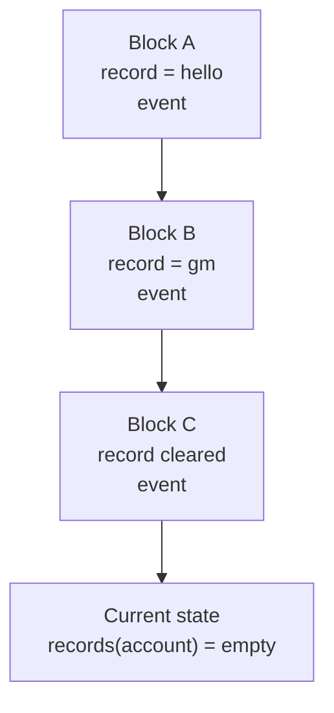

<!--
Author note (Education team): this Part completes the "4. Events" section of
src/App.tsx in the Builder starter. It assumes Parts 1 to 4 are done. The
worked example was run on Sepolia on 21 October 2026 against the shared
Registry. RPC behaviour in the table was tested the same day: the starter's
default publicnode RPC returned "pruned history unavailable" for logs about
108,000 blocks old, dRPC's free endpoint rejected 10,000-block ranges, and
Tenderly's public gateway served the full range. The model answer is kept
outside the public handbook.
-->

# Week 5 · Part 5 — Events as data

> **Core question — how does an app show what already happened on a
> contract, before the user even arrived?**

So far your app can read the present: `records(account)` tells you what a
record is now. It cannot tell you who changed it, when, or what it said
before. That history is not kept in readable state. It is in the contract's
**events**.

This Part turns those events into an activity history your frontend can show,
and teaches you to check that the history is right.

::: tip Picture a shop's receipt roll
The shelf shows what is in stock today. The receipt roll shows every sale that
got it there. You rebuild "what happened" from the receipts, not from the
shelf.

Where the picture stops: receipts belong to the shop. Event logs are part of
the chain, and anyone can read them. But not every node keeps the old ones, so
which node you ask matters.
:::

## The hard skill

**Turn contract events into a typed, ordered activity history with viem, and
verify it against the contract's current state.**

After this Part you can:

- read past events from a contract, starting at its deployment block;
- cope with an RPC that rejects a wide block range, or has dropped old logs;
- order events correctly and attach times to the ones you show;
- check that your history agrees with what the contract says now.

## Core / reference material

### Events are history; state is the present

The Registry stores each account's current record in `records`. It also
**emits** an event every time one changes, including once in the constructor:

```solidity
event RecordUpdated(address indexed account, string value);
```

Two details matter for the code you will write:

- `account` is **indexed**, so a node can filter by it for you. `value` is not
  indexed, so you can only read it after the event is decoded.
- `setRecord` rejects an empty string, so the only way a `RecordUpdated`
  carries an **empty value** is when the owner called `clearRecord`. Treat an
  empty value as "cleared", not as "set to nothing".

An event is returned as a log with a block number, transaction hash and
**`logIndex`**. `logIndex` is the position of a log within its block. Because
it is block-wide, sorting logs by `blockNumber` and then `logIndex` preserves
their chain order even when several transactions in the same block emitted
logs. If you see **`transactionIndex`**, that is the transaction's position
within the block; it does not replace `logIndex`. The `account` field is
**indexed**: the node stores it in a filterable topic so a query can find logs
for one account efficiently. `value` is not indexed, so it is decoded from the
log data after the match is found.

The core distinction is:



State answers **what is true now?** Events answer **what did the contract
announce happened over time?** Events are useful history, not a substitute for
reading the current state.

If you changed the event in Part 2, use your version. Everything below works
the same way.

You read events from outside the chain with
[`getContractEvents`](https://viem.sh/docs/contract/getContractEvents). Under
the hood it is an `eth_getLogs` request to your RPC. **JSON-RPC** is the
request/response protocol used between Ethereum software; `eth_getLogs` is the
standard method for asking a node for matching event logs.

`bigint` is JavaScript's integer type for exact whole numbers larger than the
safe range of `Number`. viem uses it for block numbers and token-like values,
so render it with `.toString()` instead of converting it through `Number`.

### Where to start: the deployment block

A contract cannot have events from before it existed. `npm run deploy` saved
your contract's deployment block in `deployments/sepolia.json`, next to its
address. If you are still on the shared Registry, the file holds its block,
11853110.

### Five things that go wrong

| Problem | Why it happens | What to do |
|---|---|---|
| Scanning from block 0 is slow or rejected | The contract did not exist before its deployment block | Start at `blockNumber` from `deployments/sepolia.json` |
| The RPC rejects a wide range | Free RPCs cap how many blocks one `eth_getLogs` call may cover, and the cap differs by provider. On 21 October 2026, one allowed under 10,000 blocks per call, another only 50 | Read in windows of a fixed size. If a window is rejected, halve it and retry from the same start |
| `pruned history unavailable` | Some free RPCs keep only recent logs, sometimes just the last day or two. Smaller windows do not help | Stop shrinking at a floor and show the error. Then switch to an RPC that keeps history (below) |
| The list looks shuffled | Provider response order is not the ordering your UI needs, and several logs can share a block | Sort by `blockNumber`, then `logIndex`, newest first |
| No timestamps | A log has a block number, not a time | Fetch each distinct block once with `getBlock`, only for the rows you show |

Recent blocks can also be reorganised, so the newest few rows are the least
settled part of the list. For an activity list that is usually fine.

### Provider-specific history behaviour

The table above describes provider behaviour, not a protocol guarantee. In a
current provider example checked on **21 October 2026**, the starter's
PublicNode endpoint returned `pruned history unavailable` for logs about
108,000 blocks old, dRPC rejected a 10,000-block range, and Tenderly's public
gateway served the full range. These observations can change. The durable
lesson is that RPC providers may limit block ranges and historical retention,
so the code must handle those limits rather than depend on one endpoint.

### An RPC that keeps history

The starter's default RPC, `https://ethereum-sepolia-rpc.publicnode.com`, is
quick for reads and writes but keeps only recent logs. If your contract is
more than a day or two old, you will hit `pruned history unavailable`. Switch
both lines in `.env`:

```bash
RPC_URL=https://sepolia.gateway.tenderly.co
VITE_RPC_URL=https://sepolia.gateway.tenderly.co
```

Restart `npm run dev` afterwards. At the time of that check, Tenderly's public
gateway was free, needed no account and served every block from the shared
Registry's deployment onwards. Any Sepolia provider that keeps full history
works as well; verify the current limits before relying on it.

### Worked example: your first look

Read one window of events, starting at the deployment block. Save this as
`scripts/events-first-look.ts`:

```ts
import { readFileSync } from 'node:fs'
import { abi, address } from '../shared/contract.js'
import { client, requireSepolia } from './client.js'

await requireSepolia()
const deployment = JSON.parse(readFileSync('deployments/sepolia.json', 'utf8'))
const from = BigInt(deployment.blockNumber)
const logs = await client.getContractEvents({
  address: address!,
  abi,
  eventName: 'RecordUpdated',
  fromBlock: from,
  toBlock: from + 1_999n,
})
console.log(`Blocks ${from} to ${from + 1_999n}: ${logs.length} event(s)`)
for (const log of logs) {
  console.log(log.blockNumber, log.logIndex, log.args.account, JSON.stringify(log.args.value))
}
```

Run it:

```bash
npx tsx scripts/events-first-look.ts
```

Against the shared Registry, with Tenderly's gateway as `RPC_URL`:

```text
Blocks 11853110 to 11855109: 1 event(s)
11853110n 412 0xE234F67EaB4638Cb6C7f93D1bfcD0bb9DCE09252 "Hello from NTU Blockchain Builder Lab"
```

That one line is the constructor's event: the owner and the starting text.
With your own contract you will see your deployer address instead, plus
anything you wrote in the first 2,000 blocks. With the default publicnode RPC,
the same script fails with `pruned history unavailable`.

Why each part is there:

1. **`fromBlock` is the deployment block.** Nothing earlier can contain this
   contract's events.
2. **`toBlock` bounds the window.** One call covers 2,000 blocks. Your code
   repeats this until it reaches the latest block.
3. **`log.args.account` and `log.args.value` are already decoded.** viem uses
   the ABI in `shared/contract.ts`, so you write no decoding yourself.
4. **`blockNumber` is a `bigint`.** Use `.toString()` when you render it.

## Hands-on task

Complete section **4. Events** in `src/App.tsx`, for the contract
`shared/contract.ts` points at (your own, after Part 3).

1. **Load the history.** Write a function that returns every `RecordUpdated`
   event from the deployment block to the latest block, as typed rows
   (account, value, kind `set` or `cleared`, block number, log index,
   transaction hash), newest first. It must read in windows, and halve the
   window when the RPC rejects one. Below a floor (for example 50 blocks), stop
   and report the error instead of retrying forever.
2. **Show it.** Render the newest 25 rows: the account shortened, what happened
   (set to a value, or cleared), the block and its time, and a link to the
   transaction on Sepolia Etherscan. Show clear **loading**, **empty** and
   **error** states.
3. **Verify it.** For one account, check that the value in its **newest**
   event equals what `records(account)` returns now. Then open one transaction
   from your list on Etherscan and confirm it matches the row.

Reuse the public client from [Part 4](./part-4-wallet-and-frontend-integration.md).
A public RPC address in a `VITE_` variable is fine. A private key never is.

**Out of scope:** live updates, pagination controls, indexers and subgraphs,
and styling.

::: tip Use AI as a pair, not a replacement
An assistant can draft the loop quickly. Before you keep it, check four
things: does it start at the deployment block, does it halve the window on an
error, does it stop at a floor, and does it sort by block and log index? Then
run your verification step.
:::

## Evidence required

- A link to your commit for the events code.
- A screenshot of the Events section showing your list (or the empty state).
- Your verification output: the account, its newest event value, and
  `records(account)`.
- Two or three sentences: what does your code do when the RPC rejects a range,
  what does it do when history is pruned, and what does a "cleared" row mean?

## Completion and revision

This Part is worth **100 points**. Completed / approved earns the full points;
incomplete or materially incorrect work is returned with specific feedback for
revision. There is no partial-score rubric.

Your work is complete when:

- [ ] events are read from the deployment block to the latest block, not from 0;
- [ ] a rejected range shrinks the window, and a floor stops endless retries;
- [ ] rows are typed, sorted newest first, and an empty value shows as "cleared";
- [ ] the Events section shows loading, empty and error states;
- [ ] your verification shows the newest event matches `records(account)`;
- [ ] one transaction from your list matches Etherscan.

::: details Further exploration — optional, not assessed
- Filter by one account with the `args` option: `args: { account }`. Why does
  this work for `account` but not for `value`?
- Point `RPC_URL` back at publicnode and run your loader. Does your error
  message tell a user what to do?
- Think about what this approach cannot do for a contract with millions of
  events, and why teams use indexers for that.
:::

::: details Sources and attribution
- [viem — getContractEvents](https://viem.sh/docs/contract/getContractEvents) — Link, referenced only
- [viem — getBlock](https://viem.sh/docs/actions/public/getBlock) — Link, referenced only
- [Ethereum JSON-RPC API — eth_getLogs](https://ethereum.org/developers/docs/apis/json-rpc/#eth-getlogs) — Link, referenced only
- [Blockchain@NTU Academy Builder starter](https://github.com/Blockchain-NTU-SG/academy-builder-starter) — Reuse (MIT), the `Registry` contract, `scripts/client.ts` and `deployments/sepolia.json`
:::
