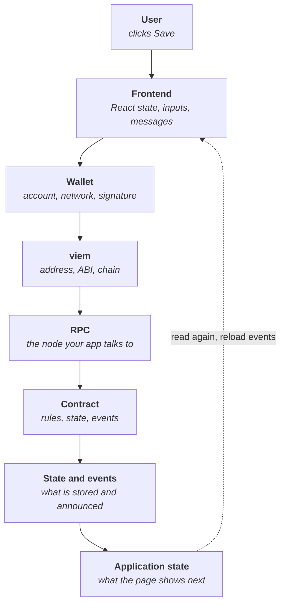

<!--
Author note (Education team): the request trace in the worked example was
captured from a working Week 5 app on a local fork of Sepolia, by recording
every request the page sent during one save. The model answer and reviewer
notes are kept outside the public handbook.
-->

# Week 5 · Part 6 — End-to-end vertical slice

> **Core question — can I put every piece together into one small app that
> works from click to chain and back?**

Parts 1 to 5 each built one piece: the setup, the contract feature, the
script, the wallet and the activity list. Separately, each one works. This
Part joins them into one app a person can actually use, and checks that the
joins hold.

::: tip Picture a relay race
Four fast runners still lose if they drop the baton. Most race failures happen
at the handovers, not on the straights.

Where the picture stops: in a relay you only pass forward. In an app, the
result has to come back: after the transaction, the page must update what the
user sees.
:::

## The hard skill

**Compose a contract, scripts, a wallet and a frontend into one working
application, and trace a single action through every layer.**

After this Part you can:

- name every layer a click passes through and what each one adds;
- spot the joins where apps usually break;
- write a README that lets someone else run your app;
- judge when one complete slice beats several half-built features.

## Core / reference material

### The layers, end to end



The dotted line is the part people forget. A transaction changes the chain,
not your page. The page only changes when you read again.

### Where slices usually break

| Join | What goes wrong | How to check |
|---|---|---|
| Frontend → wallet | Wrong network, no account, popup blocked | Show the account and network on screen |
| viem → contract | Address or ABI from an old deployment | Both come from `shared/contract.ts`, which `npm run deploy` rewrites |
| Wallet → transaction | Hash treated as success | Wait for the receipt and check `status` |
| Chain → page | Page shows the old value after success | Read again and reload events after the receipt |
| Events → page | Activity list empty or very slow | Query from your deployment block, not from block 0 |
| RPC → events | `pruned history unavailable` | Use an RPC that keeps old logs, as in Part 5 |

### What "one slice" means

A vertical slice is one feature that works through every layer, rather than
many features that each stop halfway. For this Part, the slice is **your
contract's main write**, plus everything around it: the wallet, a read before
and after, the transaction stages and the activity list.

One complete slice is better than three features that only half work.

### Worked example: trace one click

We took a working Week 5 app (the starter with Parts 4 and 5 completed),
connected a test wallet, typed `one click, traced` and pressed **Save
record**. Then we recorded every request the page sent, in order. Repeated polling requests are grouped into one row:

| # | Sent to | Request | Why |
|---:|---|---|---|
| 1 | RPC | `eth_call` with selector `0x3e0a0099` | `simulateContract`: would `setRecord` succeed? |
| 2 | Wallet | `eth_chainId` | viem checks the wallet is on Sepolia before asking it to sign |
| 3 | Wallet | `eth_sendTransaction` | The wallet pops up, the user signs, the wallet sends |
| 4 | RPC | `eth_getTransactionReceipt`, `eth_blockNumber`, `eth_getTransactionByHash` | `waitForTransactionReceipt` polling until the transaction is mined |
| 5 | RPC | `eth_call` with selector `0x469e9067` | Read `records(account)` again |
| 6 | RPC | `eth_blockNumber`, then `eth_getLogs` | Reload the activity list from events |

You can confirm what the selectors mean yourself:

```bash
cast sig "setRecord(string)"     # 0x3e0a0099
cast sig "records(address)"      # 0x469e9067
```

Then the page showed:

```text
2. Your record
one click, traced

4. Activity
0xf39F…2266 set “one click, traced” in block 11926682 tx
```

Every layer in the diagram appears in that list. Request 1 is the simulation
from Part 3. Requests 2 and 3 are the wallet from Part 4. Request 4 is the wait
for the receipt. Requests 5 and 6 are the dotted line coming back: without
them, the page would still show the old record.

You can record the same list in your own app: open the browser's developer
tools, go to the **Network** tab, filter by your RPC's address, and click Save.
Requests to the wallet do not appear there, because MetaMask handles them
itself.

### A README someone else can follow

Your README needs only five short parts:

1. **What it is**, in one sentence.
2. **Contract:** network and address, with an Etherscan link.
3. **Run it:** the exact commands, from `git clone` to `npm run dev`.
4. **Use it:** what to click, and what should happen.
5. **Limits:** what it does not do yet.

## Hands-on task

Build your **Week 5 mini dApp**: one working slice of your own contract from
Part 3. It must have:

- wallet connection, with the account and network shown;
- at least one contract read;
- your contract's main write, with pending, success and failure states;
- the page updating after success, without a reload;
- an activity list built from your contract's events (Part 5);
- your contract deployed on Sepolia (from Part 3);
- a README with the five parts above.

Then **trace one click** in your own app, as in the worked example, using the
Network tab. List the requests in order and say which layer each one belongs
to.

**Out of scope:** extra features, styling, putting the app online (Week 6
Part 5 does that) and writing tests (Week 6 Part 1).

## Evidence required

- A link to your repository.
- Your contract's Sepolia address.
- A short screen recording (two minutes or less) or screenshots of one full
  action: connect, write, pending, success, and the new entry in the activity
  list.
- Your one-click trace: the list of requests and the layer each belongs to.

## Completion and revision

This Part is worth **100 points**. Completed / approved earns the full points;
incomplete or materially incorrect work is returned with specific feedback for
revision. There is no partial-score rubric.

::: details Further exploration — optional, not assessed
- Make the activity list update by itself when anyone writes, using viem's
  `watchContractEvent`, and think about what happens if the page is left open
  for an hour.
- Time each stage of your trace. Which one does the user spend longest
  waiting for?
- Ask a friend to use your app with no instructions except the README. Note
  where they get stuck.
:::

::: details Sources and attribution
- [Ethereum JSON-RPC API](https://ethereum.org/developers/docs/apis/json-rpc/) — Link, referenced only
- [viem — waitForTransactionReceipt](https://viem.sh/docs/actions/public/waitForTransactionReceipt) — Link, referenced only
- [GitHub Docs — About READMEs](https://docs.github.com/en/repositories/managing-your-repositorys-settings-and-features/customizing-your-repository/about-readmes) — Link, referenced only
- [Blockchain@NTU Academy Builder starter](https://github.com/Blockchain-NTU-SG/academy-builder-starter) — Reuse (MIT), the app traced in the worked example
:::
