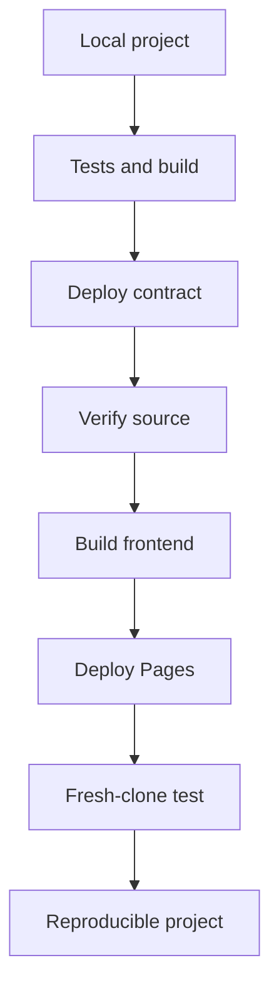

<!--
Author note (Education team): the worked example ships the public Builder
starter itself, so every output on this page comes from a real run against
that repository. The model answer and reviewer notes are kept outside the
public handbook.
-->

# Week 6 · Part 5 — Deployment and reproducibility

> **Core question — can someone who has never seen my project run it, find
> the contract, and check that it does what I say?**

So far your app has lived on your laptop. That proves it works for you. It
does not prove anyone else can use it, review it or trust it.

This Part turns your project into something a stranger can open, run and
check without asking you a single question.

::: tip Picture handing over a recipe
Cooking a dish for a friend shows the dish works. Handing them a recipe they
can cook alone is harder: every ingredient and step has to be written down,
because you will not be in the kitchen.

Where the picture stops: you can test a recipe only in someone else's
kitchen. You can test your project in a "fresh kitchen" yourself, by cloning
it into an empty folder and following your own README word for word.
:::

## The hard skill

**Publish a Web3 project so another person can run it, inspect the deployed
contract, and reproduce the main interaction from the README alone.**

After this Part you can:

- verify a contract's source code on a public explorer;
- keep private keys out of your repository and out of the browser;
- deploy a Vite frontend to GitHub Pages with a workflow;
- test your own README the way a stranger would.

## Core / reference material

### What "shipped" means

A reviewer should be able to do four things without contacting you:

| They want to… | You give them… |
|---|---|
| Run it | A README that works from a fresh clone |
| Find it | The deployed contract address and network |
| Inspect what was deployed | A verified/source-matched contract |
| Use it | A live frontend they can open in a browser |

Each section below covers one row.



This is a handoff pipeline, not a promise that one command performs every
step. Each arrow produces evidence for the next person: a passing build, a
contract address, a source match, a generated frontend artifact, a live URL,
and finally a clean-room run from the README.

### Verify the contract

On-chain, a contract is only **bytecode**: the machine-level code produced by
the compiler and stored at the deployed address. **Verification** publishes
your source code and compiler settings so a service can compile it again and
confirm it produces exactly that bytecode. After that, anyone can read the
code and call functions from the explorer.

Verification proves source correspondence for that address and build settings;
it does not prove that the code is safe, useful or free of economic bugs.

Foundry reads your compiler settings from `foundry.toml`, so one command is
enough. There are two common verifiers:

```bash
# Sourcify: no account needed
forge verify-contract <address> contracts/src/Registry.sol:Registry \
  --chain sepolia --verifier sourcify --watch

# Etherscan: needs a free API key (free tier covers Sepolia)
forge verify-contract <address> contracts/src/Registry.sol:Registry \
  --chain sepolia --verifier etherscan --etherscan-api-key $ETHERSCAN_API_KEY --watch
```

Either is fine for this Part. For Etherscan, create a key with
[Etherscan's guide](https://docs.etherscan.io/set-up-your-api-key), put it in
your local `.env` as `ETHERSCAN_API_KEY`, and run `source .env` first. A wrong
key fails with `Invalid API Key`.

If your contract's constructor takes arguments,
add `--constructor-args` with the same values you deployed with, or the
bytecode will not match.

### Keep secrets where they belong

Every value your project uses has one correct home.

| Value | Where it lives | Why |
|---|---|---|
| `PRIVATE_KEY` | Your local `.env` only | Anyone with it controls the account. Never commit it, never prefix it with `VITE_` |
| `ETHERSCAN_API_KEY` | Your local `.env` only | It is tied to your account |
| `RPC_URL` for scripts | Your local `.env` | It may contain a provider key |
| `VITE_…` values for the frontend | A GitHub **repository variable** | Vite copies them into the built site, so every visitor can read them. Only ever public values |

The rule to remember: **anything that starts with `VITE_` is public.** Vite
pastes it into the JavaScript it sends to every visitor. If a value must stay
private, it cannot be in the frontend at all.

You can check this yourself. Put an obvious dummy value in your local `.env`
only—never use a real private key:

```text
PRIVATE_KEY=academy_secret_must_not_ship
```

Build the site, then search the output for that value:

```bash
npm run build
grep -R "academy_secret_must_not_ship" dist/
```

Expected result: no matches. You search for the secret's value because that
is what would be dangerous if it appeared in the frontend bundle. This is one
practical check, not a formal proof that the bundle contains no sensitive
information.

### Put the frontend on GitHub Pages

GitHub Pages hosts static sites for free. Your Vite app builds into plain
files in `dist/`, which is exactly what Pages serves.

Two things trip people up:

1. **The base path.** A project site lives at
   `https://<username>.github.io/<repo>/`, not at the root. Vite has to know
   that, through its `base` setting.
2. **Hard-coded paths.** Vite rewrites paths in `index.html` and CSS for you.
   It does not touch a path you typed into your own code, such as
   `src="/logo.png"`. Build those from `import.meta.env.BASE_URL` instead.

A workflow in `.github/workflows/` builds the site and publishes it on every
push to `main`. Then, in your repository on GitHub:

- **Settings → Pages → Build and deployment → Source:** choose **GitHub Actions**.
- **Settings → Secrets and variables → Actions → Variables:** add any public
  `VITE_` values your frontend needs.

### A README that matches reality

A good project README answers, in this order:

1. What is this, in one or two sentences?
2. Where is it? Live frontend link, contract address and network, verified
   source link.
3. How do I run it? Exact commands from `git clone` onwards.
4. How do I try the main interaction?
5. What does it not do yet? Known limitations.

Then test it with a **fresh-clone test**: clone the repository into a new
folder, follow the README exactly as written, and note every step that does
not work. Fix the README or the project until nothing fails.

### Worked example: ship the Builder starter

We ship the public
[Builder starter](https://github.com/Blockchain-NTU-SG/academy-builder-starter)
itself. Every output below comes from a real run.

**1. Verify the contract.** The starter's Registry is at
`0xf3eea9aa5a43846490a638f1b2bebb29ac2938b1` on Sepolia. From the repository
root, we submitted it to Sourcify:

```bash
forge verify-contract 0xf3eea9aa5a43846490a638f1b2bebb29ac2938b1 \
  contracts/src/Registry.sol:Registry --chain sepolia --verifier sourcify
```

```text
Submitting verification for [Registry] "0xF3EeA9aa5a43846490a638F1B2BEbB29ac2938B1".
Submitted contract for verification:
	Verification Job ID: `e28d2789-a09a-4fb8-9da5-5c511e2f5e0e`
```

Then asked for the result with the job ID it printed:

```bash
forge verify-check e28d2789-a09a-4fb8-9da5-5c511e2f5e0e --chain sepolia --verifier sourcify
```

```text
Contract successfully verified:
Status: `exact_match`
```

`exact_match` means the source and settings reproduce the deployed bytecode
exactly. Adding `--watch` to the first command does both steps in one go. Run
it again on a verified contract and Foundry says it `is already verified`.

**2. Add the base path.** In `vite.config.ts`:

```ts
import { defineConfig } from 'vite'
import react from '@vitejs/plugin-react'

// GitHub Pages serves a project site from /<repo>/, so the build needs that base.
// Locally BASE_PATH is unset and the app is served from /.
export default defineConfig({
  base: process.env.BASE_PATH ?? '/',
  plugins: [react()],
})
```

**3. Preview it the way Pages will serve it.** Build and preview with the
same base path the workflow will use:

```bash
BASE_PATH=/academy-builder-starter/ npm run build
BASE_PATH=/academy-builder-starter/ npx vite preview
```

Opening `http://localhost:4173/academy-builder-starter/` shows the page, but
the club logo is broken. The browser's Network tab shows why:

```text
404 /brand/blockchain-ntu-logo-dark.png
```

The scripts and styles moved under `/academy-builder-starter/`, but the logo's
path was typed into `App.tsx`, so Vite left it alone. The fix is to build the
path from the base:

```tsx

```

After rebuilding, the logo loads from `/academy-builder-starter/brand/…`, and
it still works from `/` when you run `npm run dev` locally.

**4. Check for secrets.** `.env` is already in `.gitignore`. Put the dummy
`PRIVATE_KEY=academy_secret_must_not_ship` in `.env`, then run `npm run build`
and `grep -R "academy_secret_must_not_ship" dist/`. It should print no
matches because the key has no `VITE_` prefix and the frontend never reads it.

**5. Add the workflow.** A **workflow** is an automated sequence GitHub runs
after an event such as a push. The build output passed to the Pages action is
an **artifact**: generated files, not source code. `.github/workflows/pages.yml`
below is based on the workflow in Vite's GitHub Pages guide:

::: details Full GitHub Pages workflow
```yaml
# Builds the frontend and publishes it to GitHub Pages on every push to main.
name: Deploy frontend to Pages

on:
  push:
    branches: ['main']
  workflow_dispatch:

permissions:
  contents: read
  pages: write
  id-token: write

concurrency:
  group: 'pages'
  cancel-in-progress: true

jobs:
  deploy:
    environment:
      name: github-pages
      url: ${{ steps.deployment.outputs.page_url }}
    runs-on: ubuntu-latest
    steps:
      - name: Checkout
        uses: actions/checkout@v7
      - name: Set up Node
        uses: actions/setup-node@v7
        with:
          node-version-file: '.nvmrc'
          cache: 'npm'
      - name: Install dependencies
        run: npm ci
      - name: Build
        run: npm run build
        env:
          # A project site lives at https://<user>.github.io/<repo>/
          BASE_PATH: /${{ github.event.repository.name }}/
          # Public values only. Anything starting with VITE_ ends up in the browser.
          VITE_RPC_URL: ${{ vars.VITE_RPC_URL }}
      - name: Set up Pages
        uses: actions/configure-pages@v6
      - name: Upload the build
        uses: actions/upload-pages-artifact@v5
        with:
          path: './dist'
      - name: Deploy to GitHub Pages
        id: deployment
        uses: actions/deploy-pages@v5
```
:::

Delete the `VITE_RPC_URL` line if your frontend does not read any `VITE_`
values. Once Pages is set to **GitHub Actions**, every push to `main` shows a
run under the **Actions** tab, and the finished run prints the site's URL.

**6. Fresh-clone test.** A new folder, the README followed word for word:

| README step | Result |
|---|---|
| `git clone --recurse-submodules …`, `npm ci`, `cp .env.example .env` | Worked |
| `forge test` | `6 tests passed, 0 failed` |
| `npm run read` | `Record read from Sepolia: Hello from NTU Blockchain Builder Lab` |
| `npm run dev` | Served at `http://127.0.0.1:5173/` |

Nothing failed, so the README matches reality. If a step had failed, the fix
goes into the README or the project before you ship.

## Hands-on task

Ship your Week 5 app, including anything you added to it this week.

1. **Public repository.** Your project is in a public GitHub repository. If
   you started from a clone of the starter, create your own repository and
   push to it, as in [Week 4 Part 4](../../../foundation/week-4/part-4-github-in-practice.md).
2. **Deployed and verified contract.** Your contract is on Ethereum Sepolia
   and verified on Sourcify or Etherscan. If you changed the contract in
   Week 5 Part 2, deploy your own copy first (the starter's `npm run deploy`
   does this with a disposable test account).
3. **Live frontend.** The app is on GitHub Pages, deployed by a workflow. A
   reviewer can open it, connect a wallet on Sepolia and do your app's main
   write.
4. **README that matches reality**, covering the five questions above,
   including the live link, the contract address and the verified source
   link.
5. **No secrets shipped.** No private key or API key in the repository's
   history or in the built site.
6. **Fresh-clone test.** Clone your repository into a new folder, follow your
   README exactly, and fix anything that fails.

**Out of scope:** custom domains, paid hosting, mainnet, and redesigning your
app. Your Pages workflow does not need to run tests.

::: warning If a key ever reaches GitHub
Deleting the file is not enough, because it stays in the history. Treat the
key as leaked: move any test funds out, stop using that account, and make a
new one. Then remove the key from your project.
:::

## Evidence required

- Links to your repository, your live frontend and your verified contract.
- Your fresh-clone test as a short table: each README step and its result.
- One sentence on anything you had to fix to make the fresh-clone test pass.

## Completion and revision

This Part is worth **100 points**. Completed / approved earns the full points;
incomplete or materially incorrect work is returned with specific feedback for
revision. There is no partial-score rubric.

::: details Further exploration — optional, not assessed
- Add a second job to your workflow that runs `forge test` and blocks the
  deploy if a test fails.
- Verify on both Sourcify and Etherscan, and compare what each explorer shows.
- Ask a classmate to follow your README cold while you watch silently. Note
  every place they hesitate.
:::

::: details Sources and attribution
- [Foundry Book — forge verify-contract](https://getfoundry.sh/forge/reference/verify-contract) — Link, referenced only
- [Sourcify](https://sourcify.dev/) — Link, referenced only
- [Etherscan — Set up your API key](https://docs.etherscan.io/set-up-your-api-key) — Link, referenced only
- [Vite — Deploying a static site (GitHub Pages)](https://vite.dev/guide/static-deploy) — Link, the Pages workflow is adapted from Vite's example (MIT)
- [Vite — Env variables and modes](https://vite.dev/guide/env-and-mode) — Link, referenced only
- [GitHub Docs — Using custom workflows with GitHub Pages](https://docs.github.com/en/pages/getting-started-with-github-pages/using-custom-workflows-with-github-pages) — Link, referenced only
- [Blockchain@NTU Academy Builder starter](https://github.com/Blockchain-NTU-SG/academy-builder-starter) — Reuse (MIT), shipped in the worked example
:::
