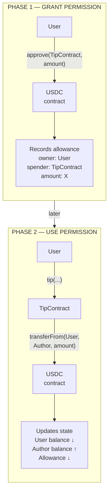

<!--
Author note (Education team): this Part is a functional spec, not a tutorial.
Do not add contract code, frontend code or step-by-step instructions to this
page. The model answer (contract, tests and app changes, verified on a Sepolia
fork with real USDC) and the reviewer notes are kept outside the public
handbook.
-->

# Week 6 · Part 6 — Independent builder challenge

> **Core question — given a spec and no tutorial, can I build, test, ship and
> explain a working feature on my own?**

Every Part so far taught you something and then asked you to use it. This one
only gives you a spec. You decide the design, find what you do not know, and
put the pieces together yourself.

It is also the readiness check for Weeks 7 and 8, where you choose and build
your own project. If you can finish this, you are ready for that.

::: tip Picture a driving test
Your lessons taught you to steer, brake and check mirrors. On the test, the
examiner gives you a destination, not a list of turns. You already have the
skills. The test is whether you can combine them without help.

Where the picture stops: in a driving test you cannot look anything up. Here
you can and should: docs, your own earlier Parts, and an AI assistant as a
pair. What you cannot do is hand in something you cannot explain.
:::

## The hard skill

**Turn a functional spec into a working, tested and shipped feature that
uses an unfamiliar component, and explain how it works and where it falls
short.**

After this Part you can:

- break a spec into pieces and decide what to build first;
- integrate a token you did not write into your own contract and app;
- handle the failure cases a real user will hit;
- write a short architecture note another builder can follow.

## Core / reference material

### A way to attack any spec

1. **List what "done" means.** Turn each requirement into a check you could
   tick. If you cannot tell when it is met, ask before you build.
2. **Find the unknowns.** Mark anything you have not used before, then answer
   the five questions from [Part 4](./part-4-docs-driven-integration.md) for
   each one.
3. **Sketch the flow.** Draw the boxes (wallet, app, your contract, other
   contracts) and the calls between them for one complete action.
4. **Build the thinnest slice first.** Get one action working end to end,
   even if it is ugly, before you add checks and polish.
5. **Break it on purpose.** Try every failure you can think of, then make
   sure each one fails clearly.
6. **Ship and explain.** Ship the new slice through the existing workflow from
   [Part 5](./part-5-deployment-and-reproducibility.md), then write down what
   you built and what it does not do.

### You already have most of the pieces

| You need to… | You learned it in… |
|---|---|
| Add state, a rule, an event and a failure case to a contract | Week 5 Part 2 |
| Read and write from TypeScript and a frontend | Week 5 Parts 3 and 4 |
| List past events | Week 5 Part 5 |
| Prove behaviour with Foundry tests | Week 6 Part 1 |
| Find a fault layer by layer | Week 6 Part 2 |
| Order checks, effects and interactions safely | Week 6 Part 3 |
| Handle token units and check docs against the chain | Week 6 Part 4 |
| Verify, deploy and document | Week 6 Part 5 |

### The new piece: approve, then pull

Native ETH can be attached directly to a contract call as transaction `value`.
ERC-20 balances live inside the token contract's state, so tokens are not
attached to another contract call in the same way. To let another contract
move ERC-20 tokens on the user's behalf, the token owner usually grants an
allowance first. The usual pattern has two transactions:

1. The user calls **`approve`** on the token, giving a spender (your contract)
   permission to take up to a set amount.
2. The user calls your contract, and your contract calls
   **`transferFrom`** on the token to move the tokens.

You met the risky side of this in
[Week 3 Part 5](../../../foundation/week-3/part-5-security-and-approvals.md):
an unlimited approval stays open long after the user has forgotten it. As the
builder, you now decide how much your app asks for.

The functions involved are described in the
[ERC-20 interface reference](https://docs.openzeppelin.com/contracts/5.x/api/token/erc20#IERC20).
The rest is up to you.

The **approval** is the user's instruction to the token contract to grant a
spender permission. The **allowance** is state stored by the token contract
describing how much `spender` may still move from `owner`; conceptually, it is
`allowance[owner][spender]`, without implying that every token uses this exact
storage layout. In this flow the tip contract is the spender: it calls
**`transferFrom`** to use the allowance on the user's behalf, while the USDC
contract performs the balance update. The TipContract does not custody the
USDC in this design.

Approve only the exact amount needed for this tip. That is an intentionally
conservative Academy requirement. Production apps may use different allowance
strategies, permit-based approvals or carefully bounded reusable allowances;
this exercise uses exact approval so the remaining permission is easy to
reason about.

Reuse the public repository, contract deployment, verification and Pages setup
you completed in Part 5. This challenge still requires a deployed and usable
result, but it is not a second deployment engineering assignment: extend the
existing pipeline and provide fresh evidence for the new contract and app
through it. Do not redesign or re-document the Pages workflow, repeat the
fresh-clone shipping proof, or create a second workflow when the Part 5 setup
is unchanged.

## Hands-on task

### The spec: tip a record's author in USDC

> *As a reader of the Registry, I want to send a small tip in USDC to someone
> whose record I like, so that good records are rewarded.*

**Contract**

1. A new contract, deployed to Ethereum Sepolia and verified, that lets anyone
   tip the author of a Registry record in Sepolia USDC.
2. Tips can only go to accounts whose record is currently not empty.
3. Zero-amount tips and tipping yourself are rejected, each with its own
   custom error.
4. Tokens go straight from the tipper to the author. Your contract never
   holds USDC.
5. Every tip emits an event, and anyone can read the total an author has
   received.

**Tests**

6. Foundry tests for the normal path, at least two failure paths and the
   event.

**App**

7. Shows the connected account's USDC balance and the tips it has received,
   formatted with the token's decimals.
8. Lets the user pick an author who has a record, enter an amount and send
   the tip, including any approval needed.
9. Never asks for an unlimited approval. Approve only what the tip needs.
10. Shows pending, success and error states, with a link to each
    transaction.
11. Handles at least one failure a real user will hit, with a message that
    tells them what to do. For example: not enough USDC, a rejected
    signature, or a contract error.

**Proof and explanation**

12. One real tip on Sepolia between two of your own test accounts. The
    author account needs a record first, and a little Sepolia ETH to set it.
13. A short **architecture note** (one diagram plus approximately 100–150
    words): the pieces, the flow of one tip from click to confirmed transfer,
    and the known limitations.

**Given:** Sepolia USDC comes from
[Circle's faucet](https://faucet.circle.com/) (20 USDC every two hours per
address). Finding the token's address and units is part of the task.

**Out of scope:** other tokens, refunds or withdrawals, signature-based
approvals (EIP-2612 permit), mainnet, and a backend.

::: tip Questions worth answering before you code
Which address calls `transferFrom`, and who must have approved whom? What is
"1 USDC" in the token's own units? What should happen if an author clears
their record between page load and the tip? Which of your checks belong in
the contract, and which only in the app?
:::

::: tip Use AI as a pair, not a replacement
You may build substantially with an AI assistant. Your architecture note must
still explain why your contract checks what it checks, in what order, and
what each failure state protects against. If you cannot explain a line, it is
not finished.
:::

## Evidence required

- Your repository link, with the tests. Point to the Part 5 repository and
  shipping evidence where it is unchanged; make the new integration changes
  clear.
- Your verified contract link for the new contract, using the existing Part 5
  verification workflow.
- A link to your real Sepolia tip transaction.
- A link to your live frontend (as in Part 5), or a demo clip of two minutes
  or less showing one tip and one handled failure.
- Your architecture note. Do not repeat the Part 5 fresh-clone or Pages
  workflow proof when that infrastructure is unchanged.

## Completion and revision

This Part is worth **100 points**. Completed / approved earns the full points;
incomplete or materially incorrect work is returned with specific feedback for
revision. There is no partial-score rubric.

::: details Further exploration — optional, not assessed
- Sepolia USDC supports signature-based approvals (EIP-2612 `permit`). Use one
  to turn approve-and-tip into a single transaction.
- Show each author's tip history from your contract's events, not only the
  total.
- Compare your design with the ETH tipping contract in Part 3. Which
  weaknesses can a USDC tip contract still have, and which ones disappear?
:::

::: details Sources and attribution
- [OpenZeppelin Contracts — IERC20](https://docs.openzeppelin.com/contracts/5.x/api/token/erc20#IERC20) — Link, referenced only
- [Circle — USDC contract addresses](https://developers.circle.com/stablecoins/usdc-contract-addresses) — Link, referenced only
- [Circle — Testnet faucet](https://faucet.circle.com/) — Link, referenced only
- [viem — writeContract](https://viem.sh/docs/contract/writeContract) — Link, referenced only
- [Blockchain@NTU Academy Builder starter](https://github.com/Blockchain-NTU-SG/academy-builder-starter) — Reuse (MIT), the `Registry` this challenge builds on
:::
