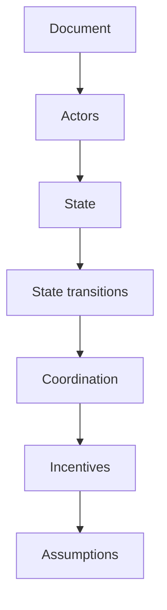

# Week 5 · Part 1 — Whitepaper → System Model

> **Core question — can someone reconstruct the system from your notes without reading the whitepaper?**

Foundation gave you a shared map. Now use it to read an unfamiliar technical
document. A paragraph summary follows the author's order; a **system model**
shows what exists, who changes it, and why participants might follow the rules.
That method transfers to a rollup, a game, a lending market or a future protocol.

## The hard skill

**Turn a primary technical document into a compact, source-backed model of
actors, state, transitions, coordination and assumptions.**

Use Bitcoin's original whitepaper as the training case. You are analysing its
proposal, not learning every detail of today's Bitcoin implementation. Work
read-only: no wallet, funds, mining software or transactions are needed.

## Core / reference material

### Primary source: Bitcoin's original whitepaper

**Bitcoin: A Peer-to-Peer Electronic Cash System** is the case document for
this Part. Start with the abstract and sections 1–6; then read section 8 and
sections 11–12 for the lighter verification model and adversarial argument.
You do not need to read every paragraph before building the model.

- [Open the original Bitcoin whitepaper (PDF)](https://bitcoin.org/bitcoin.pdf)

### A method for reading a whitepaper

This is a reading method, not a diagram of Bitcoin's architecture. Follow the
document's claims outward: identify who acts, what shared state exists, what
changes it, how participants coordinate, why they participate, and what the
argument assumes.

**Academy reading-method schematic:** each step turns a claim in the paper
into a question you can answer and source; the model-layer table below makes
those questions precise.

### Read for questions, not quotable sentences

First skim the abstract and section headings. Then read sections 1–6 for the
problem and mechanism, section 8 for the lighter verification model, and
sections 11–12 for the adversarial claim and conclusion. Refer to other sections
when your model needs them; do not paraphrase all nine pages.

| Model layer | Question to answer | Evidence to locate |
|---|---|---|
| Problem | What coordination problem remains after signatures? | Introduction and double-spending discussion |
| Actors | Who sends, verifies, orders or receives? | Transactions and network sections |
| State | What shared record must participants agree on? | Transaction history and accepted chain |
| Transitions | What input changes the record, and who checks it? | Transaction broadcast, validation and block acceptance |
| Coordination | How are competing histories resolved? | Proof of work and cumulative work |
| Incentives | Why incur the cost of participating? | Issuance, fees and attack incentives |
| Assumptions | What must hold for the security argument? | Honest hash power, propagation and adversary model |

The paper's “longest chain” shorthand refers to proof of work, not a rule that
the history with the most blocks automatically wins regardless of work or
validity. Full nodes still enforce validity rules. Distinguish miners proposing
blocks from nodes independently validating them, even when one operator does both.

### Worked example: reconstruct one transition

**Input:** a signed payment is broadcast. **Actor/action:** nodes check it;
miners may include it in a candidate block. **State effect:** once accepted in
the followed history, the payment changes which outputs can subsequently be
spent. **Limit:** inclusion alone does not make reversal impossible.

“Changes which outputs can be spent” is our reconstruction of the state model,
not a quotation from the paper. Linking that interpretation to sections 2 and 5
lets another reader challenge it. This is more useful than “section 5 discusses
the network”.

### Keep three evidence labels

- **Document claim:** what the primary document actually says, with section/page.
- **Your inference:** how you interpret or connect its claims; explain the step.
- **Implementation check / unknown:** what requires later code, deployment or
  independent evidence. A whitepaper cannot verify today's operator set or parameters.

For example, the original paper treats a chain of signatures as the ownership
story; the Developer Guide describes transaction outputs and validation more
precisely. Date your implementation check rather than treating a 2008 design
document as a live network specification.

## Hands-on task

Create **one page**, using short cells or a small labelled diagram:

1. State the problem in one sentence, then fill the seven model layers above.
   Give each row a section/page reference; separate claims from your inferences.
2. Reconstruct one state transition as **input → actor/check → state change**.
3. Name one adversarial assumption and what fails if it does not hold. Avoid
   claiming that a majority of work can make an invalid spend valid.
4. Use the Developer Guide to check one detail against the original document.
   Record the check date, the distinction, and one question still unresolved.

**Out of scope:** a whitepaper essay, Bitcoin code review, mining economics
forecasts, or reproducing the paper's probability calculations.

## Evidence required

- One model page, including the transition and assumption.
- Section/page links, clearly labelled claims/inferences, and the dated
  implementation check with one unknown.

## Completion and revision

This Part is worth **100 points**. Completed / approved earns the full points;
incomplete or materially incorrect work is returned for revision. There is no
partial-score rubric and no separate weekly submission.

Complete means another learner can follow the actors and transition, every
document claim is locatable, and assumptions/inferences are not presented as
verified implementation facts. In Part 2, apply this model to a live architecture
where power, recourse and delay matter.

::: details Further Exploration — optional, not assessed
Choose one modern protocol paper and ask which model layer it leaves least
clear. Identify the implementation evidence needed to close that gap.
:::

::: details Sources and attribution
- [Bitcoin — original whitepaper](https://bitcoin.org/bitcoin.pdf) — Link, primary design document; original Academy reconstruction, no copied figures
- [Bitcoin Developer Guide — Block chain](https://developer.bitcoin.org/devguide/block_chain.html) — Link, implementation reference; checked 26 October 2026
:::
