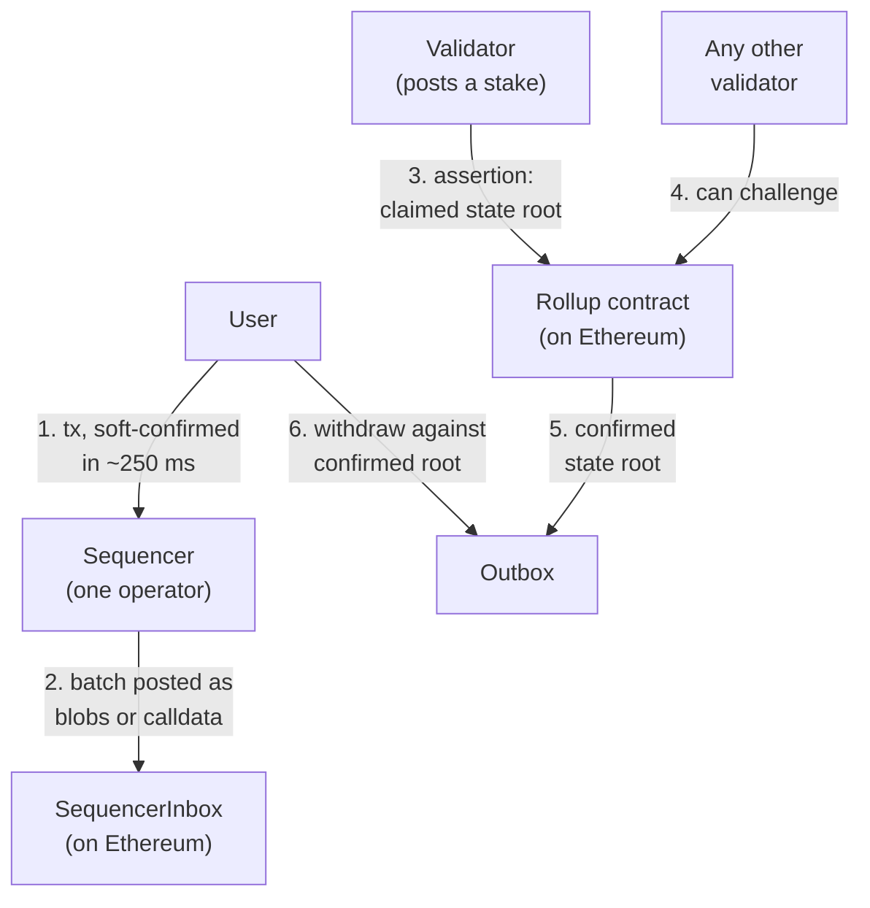

<!--
Author note (Education team): case and figures from L2BEAT's Arbitrum One page,
checked 10 October 2026 and rechecked 21 October 2026 (Stage 1; 1d forced
inclusion; 6d 8h challenge period; 8d L2 and 3d L1 timelocks, 17d 8h in
total; 10d exit window on the regular path, none on the emergency path; 9/12
Security Council). The model answer and reviewer notes are kept outside the
public handbook.
-->

# Week 5 · Part 2 — Architecture and trust reconstruction

> **Core question — if every operator of this rollup turned hostile, what
> could they do to me, and what could I do about it?**

You already know what a layer 2 is. This Part takes one real rollup, Arbitrum
One, and turns it into a **trust map**: who has power over your funds, what
you can do if they misuse it, and how long that takes.

"Trustless" is not an answer. A trust map has an actor in every row and a
number of days in the last column.

::: tip Picture renting a flat
The landlord can change the locks, raise the rent or sell the building. What
protects you is the notice period in your contract: time to find somewhere
else before the change lands.

Where the picture stops: a landlord is one person you can name. In a rollup,
the "landlord" is a mix of software, a company running the sequencer, a DAO
vote and a 12-person council, each with different powers and different notice
periods. Some of them can act with no notice at all.
:::

## The hard skill

**Reconstruct a real rollup's architecture from its documentation, and show
how trust passes from component to component down to the user.**

After this Part you can:

- trace a transaction from the user through sequencing, data, state claims
  and withdrawal;
- describe each actor by its power, your recourse and the time involved;
- calculate an exit window from upgrade delays;
- read an L2BEAT stage as a statement about maturity, not about safety.

## Core / reference material

### Four questions for every actor

For each actor in the system, write down:

1. **Who** it is.
2. **Power:** what it can do to your funds or transactions.
3. **Recourse:** what you can do if it misbehaves.
4. **Time:** how long your recourse takes, and whether you must start before
   the actor acts.

### The architecture: the path of a transaction

Read it as a story. The sequencer orders your transaction quickly (1) and
publishes the data on Ethereum (2). A validator claims what the resulting
state is (3). Anyone can challenge that claim (4). If nobody does for long
enough, the root becomes final (5) and you can withdraw against it (6).

Challenges use **BoLD** fraud proofs. Two rival claims split their
disagreement in half again and again until they disagree about a single
instruction, which Ethereum then executes itself to decide who is right.

### The five questions L2BEAT asks

L2BEAT summarises every rollup in five areas. Read each as a question, then
find Arbitrum's answer on its page.

| Area | The question |
|---|---|
| Sequencer failure | If the sequencer ignores me, can I still get a transaction in? |
| State validation | How is a wrong state root caught? |
| Data availability | Can anyone rebuild the state from public data? |
| Exit window | If a bad upgrade is queued, can I leave before it lands? |
| Proposer failure | If the usual proposers stop, can anyone else propose roots? |

L2BEAT also offers a plain-text version of every project page: add `.md` to
the address, for example `https://l2beat.com/scaling/projects/arbitrum.md`.
It is easier to search than the interactive page.

### Who can change the rules: two upgrade paths

Every critical contract can be upgraded, so the most important trust question
is who can upgrade, and with what delay.

- **Regular path:** a change passes a DAO vote (or comes from the
  non-emergency Security Council), then goes through several timelocks in a
  row before it runs.
- **Emergency path:** the **Security Council**, a 9-of-12 multisig, can
  upgrade **instantly**.

What matters is the **exit window**:

> Exit window = time before an upgrade goes live − time you need to get out

A long delay only protects you if you can finish leaving before the upgrade
lands. A delay of zero means a window of zero.

### Reading stages carefully

L2BEAT's stages measure maturity, not security. Arbitrum One is **Stage 1**:
it passes the "walkaway test", meaning users can exit even if the Security
Council disappears. L2BEAT lists two things missing for Stage 2: upgrades
that are not fixing provable bugs give less than 30 days to exit, and the
Security Council's powers are not limited to provable bugs.

These details change. On 23 September 2026 Arbitrum replaced its Timeboost
ordering auction with priority gas auctions. That is why your trust map needs
a date.

### Worked example: when the sequencer ignores you

Here is one row of the trust table and one failure path, so you can see the
method before you do the rest.

| | Sequencer failure |
|---|---|
| Who | The single sequencer operator |
| Power | Orders transactions and posts batches. It can delay or ignore your transaction, and can use its position to front-run users |
| Recourse | **Force inclusion** through Ethereum |
| Time | Up to **1 day** |
| Limit | No real-time censorship resistance, as L2BEAT states |

The failure path, step by step:

1. You send a transaction. The sequencer does not include it.
2. You send it to the Inbox contract **on Ethereum** instead. That is your
   first Ethereum transaction, and it puts yours in a delayed queue.
3. You wait. The sequencer has up to **1 day** to include it.
4. If it still has not, anyone can call `forceInclusion` on the
   SequencerInbox. That second Ethereum transaction fixes its place in the
   order for good.

**Conclusion:** your funds are safe from permanent censorship, but you pay
for two Ethereum transactions and wait up to a day. Anything time-sensitive
can still fail.

Notice the method: actor → power → recourse → time → limit. You do the same
for the rest of the system.

## Hands-on task

Use the live [L2BEAT page for Arbitrum One](https://l2beat.com/scaling/projects/arbitrum),
and write down the date you checked it.

1. **Extend the diagram.** Copy the diagram above and add the **upgrade
   paths**: the Arbitrum DAO, the Security Council, the L2 Timelock, the L1
   Timelock and the UpgradeExecutor. Add the **forced-inclusion route** around
   the sequencer. Label every arrow with who controls it and any delay.
2. **Complete the trust table.** The worked example did sequencer failure.
   Fill in the other four rows: state validation, data availability, exit
   window and proposer failure. Columns: who or what you trust, what goes
   wrong if it fails, your recourse, and the time.
3. **Trace a hostile upgrade.**
   1. Add up every delay on the **regular** path. What is the total before the
      upgrade goes live?
   2. Work out the **exit window** two ways and check they agree. First from
      the timelock delays and the forced-inclusion delay. Then start from the
      total in step 1 and subtract what a user needs to actually get out
      (forced inclusion plus the challenge period).
   3. What changes on the **emergency** path?
   4. Who can stop a hostile upgrade, and how?
4. **Judge it.** In 80 words or fewer: what separates Arbitrum One from
   Stage 2, and what would you want to know before trusting it with a large
   amount?

**Out of scope:** comparing rollups, gas costs, reading contract code and
predicting governance votes.

## Evidence required

- Your extended diagram.
- Your trust table with five rows.
- Your hostile-upgrade working, with both exit-window methods shown.
- Your judgment paragraph and the date you checked L2BEAT.

## Completion and revision

This Part is worth **100 points**. Completed / approved earns the full points;
incomplete or materially incorrect work is returned with specific feedback for
revision. There is no partial-score rubric.

Your work is complete when:

- [ ] the diagram shows both upgrade paths and forced inclusion, and every arrow has a controller and a delay;
- [ ] the trust table has all five rows, each with a specific recourse and time;
- [ ] the regular-path total is correct and both exit-window methods agree;
- [ ] the emergency path and who can stop an upgrade are covered;
- [ ] the judgment is specific, uses your evidence and stays within 80 words;
- [ ] the L2BEAT check date is stated.

::: details Further exploration — optional, not assessed
- L2BEAT says a challenge can take up to 12d 17h if both sides play as
  slowly as possible. Redo your exit-window working for that case. Does a
  user still have time to leave?
- Do the same trust map for OP Mainnet and compare the exit windows.
- Read who sits on the [Security Council](https://docs.arbitrum.foundation/security-council-members).
  Does knowing the members change your judgment?
:::

::: details Sources and attribution
- [L2BEAT — Arbitrum One](https://l2beat.com/scaling/projects/arbitrum) — Link, all figures on this page (checked 21 October 2026)
- [L2BEAT — Stages framework](https://l2beat.com/stages) — Link, referenced only
- [Arbitrum docs — The Sequencer and censorship resistance](https://docs.arbitrum.io/how-arbitrum-works/deep-dives/sequencer) — Link, referenced only
- [Arbitrum docs — L2 to L1 messaging](https://docs.arbitrum.io/how-arbitrum-works/deep-dives/l2-to-l1-messaging) — Link, referenced only
- [Arbitrum DAO Constitution](https://docs.arbitrum.foundation/dao-constitution) — Link, referenced only
- [BoLD: Fast and Cheap Dispute Resolution](https://arxiv.org/pdf/2404.10491) — Link, referenced only
:::
