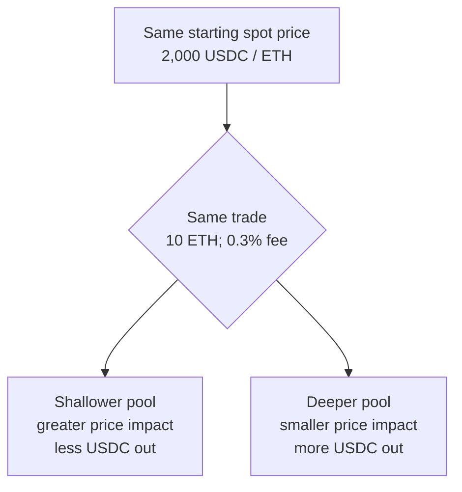

<!--
Author note (Education team): every figure in the worked example, the deeper
pool comparison and the model answer was recalculated on 21 October 2026. The
model answer is kept outside the public handbook.
-->

# Week 5 · Part 3 — Mechanism and market design

> **Core question — what does a swap actually do to a Uniswap-style pool,
> and why does the size of the pool change the price you get?**

An **automated market maker (AMM)** is a contract that calculates a swap from
the tokens held in a pool instead of matching a buyer's order with a seller's
order. A **decentralised exchange (DEX)** can use different designs; this Part
works through one constant-product example. A **liquidity provider (LP)**
deposits the pool's tokens and may receive a share of trading fees. You will
calculate what one swap does to the reserves, payout and execution price, and
why a deeper pool changes the result.

::: tip Picture a see-saw with two buckets
One bucket holds ETH, the other USDC. Pour ETH into one side and the pool
pays you out of the other, keeping the two in balance by its rule. The more
you pour in, the more the balance tilts against you.

Where the picture stops: a see-saw tilts back by itself. A pool does not. It
only moves back when someone trades the other way, usually an arbitrageur who
profits from the gap.
:::

## The hard skill

**Derive what a trade does to a constant-product pool from its rule, rather
than from a product description.**

After this Part you can:

- calculate the payout of a swap, including the fee;
- tell the starting spot price from the average price a trade actually gets;
- explain where liquidity providers' fee income comes from;
- explain why deeper pools give better prices, and what arbitrageurs do next.

## Core / reference material

### The rule

A simplified Uniswap v2-style pool holds reserves of token X and token Y.
Let $x$ be the pool's reserve of X and $y$ its reserve of Y, measured in
their respective token units. An **invariant** is a rule the mechanism uses
to preserve or target while calculating an action. Here, the reserve product
is the target used to calculate a swap's payout:

$$
xy = k
$$

The product $k$ is the reserve-product invariant used in the payout
calculation. To see why the reserve ratio gives a price, imagine a pool with
100 ETH and 200,000 USDC: it holds 2,000 USDC for every 1 ETH. Before a very
small trade moves the reserves, that ratio is the pool's starting marginal
price—its price for an infinitesimally small trade. Because the pool follows
$xy\approx k$, adding a tiny amount of X must be matched by a small decrease
in Y; the local change is about $y/x$ units of Y for each unit of X:

$$
P_X \approx \frac{y}{x}
$$

Here $P_X$ is measured in units of Y per unit of X. A finite trade changes
both reserves, so its average execution price differs from the starting spot
price. This is the simplified constant-product v2 model, not a formula for
every AMM or DEX design.

For an input of $\Delta x$ X (measured in token X units) and fee rate $f$
(a fraction, such as $0.003$ for 0.3%), the fee-adjusted amount used in the
payout calculation is:

$$
\Delta x_{\mathrm{eff}} = \Delta x(1-f)
$$

The trader sends all of $\Delta x$, but the fee portion is not used to compute
the immediate output. In v2, that fee remains in the pool, so the pool's real
reserve product after the trade can be slightly larger than $k$; this is one
source of liquidity-provider fee income.

If the pool starts with reserves $x$ and $y$, then after the effective X input
the simplified new Y reserve and trader output are:

$$
y' = \frac{xy}{x+\Delta x_{\mathrm{eff}}}
\qquad\qquad
\Delta y = y-y'
$$

Here $y'$ is the remaining Y reserve, while $\Delta y$ is the amount of Y
paid to the trader. The rule keeps the reserve product at $k$ for the payout
calculation: once the X reserve increases, divide $k$ by that new reserve to
find the Y that must remain; the difference is the output. The units of
$\Delta x_{\mathrm{eff}}$ are token X and the units of $y'$ and $\Delta y$ are
token Y. These expressions assume a two-reserve constant-product pool, a
stated fee, and no other route or market impact.

### Primary source: Uniswap v2 Core whitepaper

Read **§2.1, “Constant Product Market Maker”** for the reserve rule. Section
2.2 on price oracles is optional context; the calculation below is the focus.

- [Open the Uniswap v2 Core whitepaper](https://app.uniswap.org/whitepaper.pdf)
- For protocol-authored pool and swap diagrams, see [Uniswap's “How Uniswap Works”](https://developers.uniswap.org/docs/get-started/concepts/how-uniswap-works).

### Worked example: selling 10 ETH

A pool holds **100 ETH** and **200,000 USDC**, with a **0.3%** fee.

- $k=100\times200{,}000=20{,}000{,}000$
- Starting spot price = $200{,}000/100=$ **2,000 USDC per ETH**

A trader sells **10 ETH** to the pool.

1. **Take out the fee** for the payout calculation:
   $\Delta x_{\mathrm{eff}}=10(1-0.003)=9.97$ ETH. The pool keeps the 0.03 ETH
   fee, but it is not included in the effective input.
2. **Find the new USDC reserve.**
   $y'=20{,}000{,}000/(100+9.97)=181{,}867.78$ USDC.
3. **The trader receives** what leaves the pool:
   $\Delta y=200{,}000-181{,}867.78=$
   **18,132.22 USDC**.
4. **Average execution price** = $18{,}132.22/10=$ **1,813.22 USDC per ETH**,
   about **9.34%** below the starting spot price:
   $(2{,}000-1{,}813.22)/2{,}000\times100$.
   Without the fee the payout would be 18,181.82 USDC, so the fee itself cost
   the trader about 49.60 USDC. Most of the gap comes from the trade moving
   the price, not from the fee.
5. **K after the trade.** The pool keeps the full 10 ETH, so its real
   reserves are 110 ETH and 181,867.78 USDC:
   110 × 181,867.78 ≈ 20,005,456. That is above 20,000,000 because the
   0.03 ETH fee stayed in the pool.
6. **The pool's new spot price** is 181,867.78 ÷ 110 ≈ **1,653.34 USDC per
   ETH**. If ETH still trades at about 2,000 USDC elsewhere, anyone can buy
   cheap ETH from this pool and sell it elsewhere. Those arbitrage trades put
   USDC back in and take ETH out, pushing the pool price back towards the
   market. Arbitrage can therefore bring the pool price back toward the
   external market without an oracle; it is not instantaneous or guaranteed.

### Why deeper pools give better prices

Repeat the same 10 ETH trade in a pool twice as deep: 200 ETH and 400,000
USDC. The starting price is still 2,000 USDC per ETH.

- K = 200 × 400,000 = 80,000,000
- Effective input is still 9.97 ETH, so the ETH reserve becomes 209.97
- New USDC reserve = 80,000,000 ÷ 209.97 = 381,006.81
- USDC received = 400,000 − 381,006.81 = 18,993.19
- Average execution price = 1,899.32 USDC per ETH, about **5.03%** below 2,000

| Pool | USDC received | Average execution price | Below 2,000 by |
|---|---:|---:|---:|
| 100 ETH / 200,000 USDC | 18,132.22 | 1,813.22 | 9.34% |
| 200 ETH / 400,000 USDC | 18,993.19 | 1,899.32 | 5.03% |

**Academy schematic — same initial price and 10 ETH trade; illustrative
comparison, not a live quote:**

A deeper pool absorbs this same trade with a smaller change in its reserve
ratio. The illustration holds starting price, trade size and fee constant;
pool TVL alone is not always active executable depth, especially when
liquidity is concentrated into selected price ranges.

### Where the v2 model stops

V2 allocates liquidity across the entire positive price range: providers do not
choose an interval. V3 lets them concentrate liquidity near a selected price,
so the same capital can support deeper execution **within that interval**.
Outside it, the position becomes inactive, stops earning trading fees and may
be entirely one asset. Pool TVL alone therefore does not reveal active depth.

An LP's changing asset mix also creates **impermanent (divergence) loss**:
the position can underperform simply holding the original assets when their
relative price changes. It is an opportunity-cost comparison, not necessarily
a negative dollar return. Fees may offset it; “impermanent” does not promise
recovery. These concepts explain the boundary of our v2 arithmetic; they add
no second calculation task.

## Hands-on task

A pool holds **150 ETH** and **300,000 USDC**, with a **0.3%** fee. A trader
sells **12 ETH** for USDC.

1. Calculate the starting K and the starting ETH price.
2. Calculate the fee and the effective ETH input.
3. Calculate the USDC the trader receives.
4. Calculate the average execution price, and how far below the starting
   spot price it is, as a percentage.
5. Calculate the real K after the trade, and explain why it is higher than
   the starting K.
6. Calculate the pool's new spot price. If ETH still trades at 2,000 USDC
   elsewhere, who would trade with the pool next, in which direction, and
   what would that do to the pool's price?
7. In one or two sentences, explain why the same trade would move the price
   less in a deeper pool.

**Out of scope:** concentrated-liquidity maths, impermanent-loss formulas,
gas costs and multi-hop routes.

## Evidence required

- Your working for each step, with the numbers you used.
- Your short answers to steps 6 and 7.

## Completion and revision

This Part is worth **100 points**. Completed / approved earns the full points;
incomplete or materially incorrect work is returned with specific feedback for
revision. There is no partial-score rubric.

Your work is complete when:

- [ ] the fee is taken off before the payout is calculated, not after;
- [ ] the payout, average price and percentage difference are correct to the cent;
- [ ] the post-trade K uses the full 12 ETH, and you explain why it rose;
- [ ] the arbitrage answer names the direction of the next trade and its effect;
- [ ] the depth explanation refers to the reserve ratio, not just "more money".

::: details Further exploration — optional, not assessed
- How large a trade, in ETH, would move the 150 ETH pool's spot price by 1%?
  Why do aggregators split big trades across pools?
- A liquidity provider owns 10% of the pool. How much of this trade's fee is
  theirs, and in which token?
- Read section 2.2 of the Uniswap v2 whitepaper on price oracles. Why does
  Uniswap average prices over time rather than use the spot price?
- Compare an LP's fee income with divergence loss under a stated price path;
  range maths and the IL formula are optional depth.
:::

::: details Sources and attribution
- [Uniswap v2 Core whitepaper](https://app.uniswap.org/whitepaper.pdf) — Link, referenced only
- [Uniswap docs — v2 pricing](https://developers.uniswap.org/docs/protocols/v2/concepts/pricing) — Link, referenced only
- [Uniswap — Concentrated liquidity](https://developers.uniswap.org/docs/get-started/concepts/liquidity-providers/concentrated-liquidity) — Link, protocol documentation; checked 26 October 2026
- [Uniswap v2 — Understanding returns](https://developers.uniswap.org/docs/protocols/v2/concepts/understanding-returns) — Link, protocol documentation
:::
