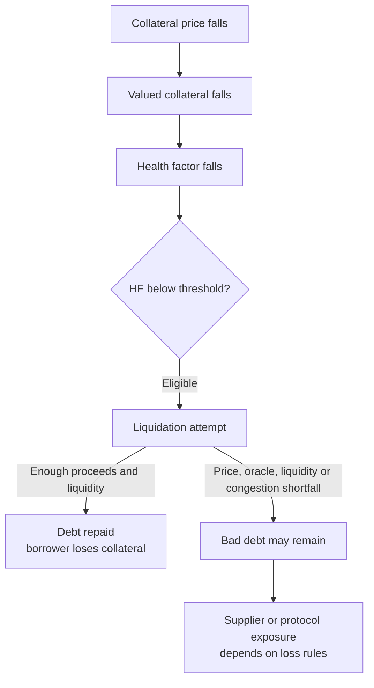
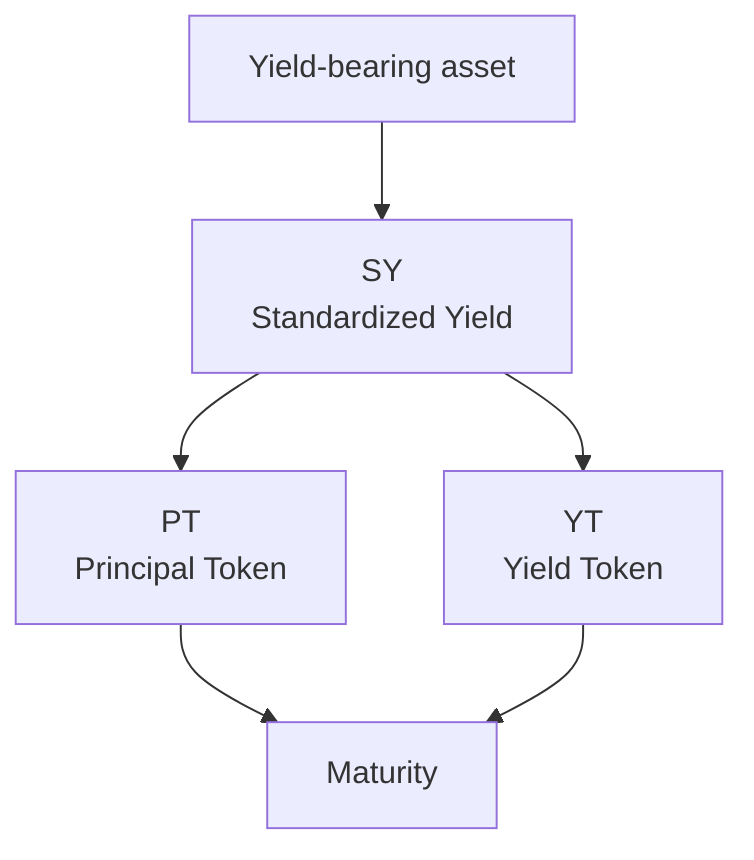

<!--
Author note (Education team): every figure in the worked example, the price
table and the model answer was recalculated on 21 October 2026. The model
answer is kept outside the public handbook.
-->

# Week 5 · Part 4 — Collateral, credit and DeFi economics

> **Core question: at what price does a crypto loan get liquidated, and
> what happens to the lender if the market moves faster than that?**

A lending protocol is one kind of decentralised finance (DeFi) system: it lends
to users without a conventional credit check. All it has is the
collateral they deposit and a rule for when to sell it. In this Part you turn
that rule into numbers: how safe a loan is now, the price where it gets
liquidated, and how a wrong price feed can leave the protocol with a loss.

::: tip Picture a pawn shop
You leave a watch and borrow less than it is worth. If the watch's value
falls too close to what you owe, the shop sells it before it is worth less
than the loan.

Where the picture stops: the shop can look at the watch. A protocol cannot.
It relies on a price feed it reads from the chain, and if that feed is late or
wrong, it acts on the wrong number.
:::

## The hard skill

**Model how a lending protocol uses collateral, a liquidation threshold and a
price feed to decide when a loan fails, and trace what happens when it acts
too late.**

After this Part you can:

- calculate a health factor;
- solve for the liquidation price, and the fall needed to reach it;
- tell the liquidation price from the break-even price;
- trace a path from a market move to a possible loss for the protocol.

## Core / reference material

### Primary source: Aave V3 Technical Paper

The paper explains Aave V3's design reasoning and architecture. Read the
sections on health factors, liquidations and interest-rate design alongside
the model below. It is a design paper, not a current runtime specification:
deployments and parameters can change. For present behaviour, check Aave's
current documentation on [health factors and
liquidations](https://aave.com/help/borrowing/liquidations), [interest-rate
strategy](https://aave.com/docs/aave-v3/smart-contracts/interest-rate-strategy),
[reserve parameters](https://www.aave.com/docs/aave-v3/concepts/reserve) and
[E-mode](https://aave.com/help/borrowing/e-mode).

- [Download the Aave V3 Technical Paper (official PDF)](https://raw.githubusercontent.com/aave-dao/aave-v3-origin/main/docs/Aave_V3_Technical_Paper.pdf)
- [View the PDF in the official Aave DAO repository](https://github.com/aave-dao/aave-v3-origin/blob/main/docs/Aave_V3_Technical_Paper.pdf).

::: details Read the Aave V3 Technical Paper inside the Academy
@[pdf 1 height="620px" zoom="90"](/files/researcher/aave-v3-technical-paper.pdf)
:::

The embedded PDF is an unmodified reading copy of the official paper. Use the
current Aave documentation linked above for present behaviour.

### The health factor

A common measure is the **health factor (HF)**. Read it as **safety-adjusted
collateral value divided by debt**. A protocol does not count the full market
value of collateral as safe backing: multiplying by its liquidation threshold
sets the fraction it counts toward the liquidation boundary. In the
simplified single-asset model used here:

$$
HF = \frac{V_{\text{collateral}}\times LT}{D}
$$

Here, $V_{\text{collateral}}$ is the current collateral value in the
protocol's valuation currency (USD in our examples); $LT$ is the **liquidation
threshold**, a fraction (80% is $0.80$); and $D$ is debt value in the same
currency. Thus $HF$ is unitless. A higher HF means more buffer. $HF=1$ is the
simplified boundary; under Aave's model, a position may become eligible for
liquidation below 1. Real multi-asset positions use protocol-specific
valuation and threshold rules.

### Solve for a single-asset liquidation price

If a borrower has $Q_{\text{collateral}}$ units of one collateral asset, fixed
debt $D$, and a fixed threshold $LT$, set $HF=1$ and solve for the price:

$$
P_{\text{liq}} =
\frac{D}{Q_{\text{collateral}}\times LT}
$$

$P_{\text{liq}}$ is the **liquidation price**, in currency per collateral unit
(USD per ETH here); $Q_{\text{collateral}}$ is the collateral quantity, so
multiplying it by the per-unit price gives a value in currency. The formula assumes
one collateral asset, unchanged debt and threshold, and that the protocol's
oracle price matches the price used in the calculation. It omits interest,
liquidation bonuses, fees and changing collateral. It is not the break-even
price: break-even is where collateral value equals debt.

### Where the price comes from

To value the collateral, the protocol needs an ETH price. It does not ask
the borrower. It reads an on-chain price feed, often from an oracle network
such as Chainlink.

If that price is stale, delayed or wrong, the health factor is wrong too. A
price that is too high delays liquidation and can increase the chance of
**bad debt**: a loan balance that remains unpaid because available collateral
is worth too little, cannot be sold for enough, or cannot be realised in
time. A liquidation may repay a loan in full; the borrower's loss of
collateral is not itself protocol or supplier bad debt. A price that is too
low makes a healthy position look weak. Protocols watch how fresh the feed
is and build in safeguards.

### Worked example: 10 ETH backing a 12,000 USD loan

A borrower deposits **10 ETH** at **2,000 USD** per ETH, owes **12,000 USD**,
and the liquidation threshold is **80%**.

1. **Collateral value** = 10 × 2,000 = 20,000 USD.
2. **Health factor** = (20,000 × 0.80) ÷ 12,000 = **1.33**. Above 1, so there
   is a buffer.
3. **Liquidation price:**
   $P_{\text{liq}}=12{,}000/(10\times0.80)=\mathbf{1{,}500\ USD/ETH}$.
4. **The fall needed** = $(2{,}000-1{,}500)/2{,}000\times100=$ **25%**.

### Why liquidate before the collateral is worth less than the debt?

At 1,500 USD the 10 ETH is still worth 15,000 USD, more than the 12,000 USD
debt. The protocol acts early on purpose.

The **break-even price** is 12,000 ÷ 10 = **1,200 USD**. There the collateral
is worth exactly the debt. Below it, selling all the collateral would not
repay the loan. If the market falls through 1,200 before a liquidation
completes, for example because the price moves too fast, the oracle lags or
the network is congested, unpaid debt may remain.

| ETH price | Collateral value | Health factor | What it means |
|---:|---:|---:|---|
| 2,000 | 20,000 | 1.33 | Above the threshold |
| 1,500 | 15,000 | 1.00 | At the boundary |
| 1,200 | 12,000 | 0.80 | Collateral = debt |
| 1,100 | 11,000 | 0.73 | Collateral < debt |

**Academy schematic: a conditional lending failure path, not a claim that
every liquidation produces bad debt:**

The diagram separates a borrower's liquidation loss from protocol bad debt.
Eligibility does not guarantee that a liquidator acts in time; a liquidation
shortfall can expose suppliers or the protocol only if its accounting and loss
rules leave debt uncovered.

The liquidation price is not a second market price. The market price moves;
the liquidation price is the trigger level set by the position's collateral,
debt and threshold.

### The economic feedback: utilisation and interest

**Utilisation** asks what share of supplied assets is currently borrowed. In
the simplified reserve model here, the utilisation rate $U$ is:

$$
U = \frac{\text{Total Borrowed}}{\text{Total Supplied}}
$$

Both quantities refer to the same reserve and asset; $U$ is a fraction, often
shown as a percentage. If 80 of 100 units supplied are borrowed, $U=0.80$ and
20 units remain as the simple withdrawal buffer. High utilisation means less
immediately available liquidity relative to supplied assets; borrowers pay
for access to scarcer liquidity. Supplier yield generally depends on borrow
rates, utilisation and the protocol's retained share. Extra token rewards are
a separate subsidy.

Aave V3's [official interest-rate strategy](https://aave.com/docs/aave-v3/smart-contracts/interest-rate-strategy)
models the variable borrow rate as two linear regions around an
**optimal-utilisation level**. The target and rate parameters are set per
reserve, so the historical figure below illustrates the shape rather than
today's settings for a particular market.

<figure class="academy-reference-visual academy-reference-visual--wide">
  

    
  

  <figcaption>Historical mechanism illustration from <a href="https://governance.aave.com/t/gauntlet-extending-support-for-interest-rate-curves/10391">Gauntlet's Aave Governance discussion, “Gauntlet extending support for Interest Rate Curves”</a> (25 October 2022). It shows the base rate, utilisation, the optimal-utilisation kink and two slopes; it is not a current Aave parameter chart.</figcaption>
</figure>

The horizontal axis is reserve utilisation; the vertical axis is borrower
interest rate. Aave's current V3 documentation describes this as a
piecewise two-slope model. In these simplified formulas, $R$ is the variable
borrow rate; $U$ is utilisation as a fraction; $U_{\text{optimal}}$ is the
target level; $R_{\text{base}}$ is the starting rate; and the slope terms
describe how much the rate rises in each region. Rates and parameters are
configured separately for each reserve.

**At or below optimal utilisation:**

$$
R = R_{\text{base}} + R_{\text{slope1}}\frac{U}{U_{\text{optimal}}}
$$

Before the target, the borrow rate rises gradually as more supplied liquidity
is borrowed. At the target, this first region has added the full
$R_{\text{slope1}}$ contribution.

**Above optimal utilisation:**

$$
R = R_{\text{base}} + R_{\text{slope1}} +
R_{\text{slope2}}\frac{U-U_{\text{optimal}}}{1-U_{\text{optimal}}}
$$

After the target, the model adds the steeper second slope. As utilisation
approaches 100%, borrowing becomes more expensive much faster because less
liquidity is immediately available. These formulas explain the graph; they
are not parameters to memorise or a live rate quote.

The intended feedback is:

> More borrowing → higher utilisation → less immediately available liquidity
> → higher borrow rates, especially beyond the target → stronger incentives
> to reduce debt and provide liquidity → utilisation may move back toward the
> target.

Higher rates create incentives for borrowers to repay or reduce borrowing,
and higher supplier returns may attract new liquidity after the protocol's
share. These are not guaranteed responses: borrowers and suppliers may react
differently depending on market conditions, alternatives and their
sensitivity to rates. A mechanism is designed to influence behaviour, not
control it.

Recursive borrowing means borrowing against collateral and redepositing or
buying more collateral to borrow again. Gross supplied assets and debt grow
together while initial equity does not. Yield exposure, borrowing cost and
liquidation exposure all grow; a subsidy can disappear before the debt does.
The same HF model still asks what collateral and debt the protocol actually values.

::: details Landscape: Pendle, separating principal and future yield
A **yield-bearing asset** is a position that may earn extra value over time,
for example staking rewards or lending interest. Pendle splits the position
into two claims that end on a set date, called **maturity**. Think of a rental
property: one claim is to the property later, and another is to rent produced
up to a stated date. This is only an analogy; PT and YT are crypto-token claims,
not legal ownership of a house.

Pendle's **Standardized Yield (SY)** is a behind-the-scenes wrapper for handling
different yield-bearing assets. The useful distinction is what the two tokens
let their holder claim.

### PT: principal later, with no payments along the way

A **Principal Token (PT)** can be redeemed at maturity for the amount of the
market's named **accounting asset**. Check the asset in the market label: it
may not be the same as one whole yield-bearing token. PT holders do not receive
the yield earned during the term.

Pendle compares PT to a **zero-coupon bond**. In plain language, that is a bond
that pays no regular interest; if it is repaid as promised, the holder gets a
stated amount at the end. Suppose a Pendle market says one PT can be redeemed
for one unit of its accounting asset, and the PT costs 0.95 units today. If you
hold it until maturity and redemption works, the 0.05 difference is the
possible gain before costs. Nothing is paid while you wait. This is an analogy,
not a guarantee or a claim that PT is a government or company bond: its market
price can move, and redemption still depends on the protocol and asset.
PT can also be sold before maturity, but its market price may be different
from both the price you paid and the later redemption amount.

### YT: whatever yield is actually produced before the date

A **Yield Token (YT)** gives its holder the yield that one unit of the market's
accounting asset actually produces before maturity. Using the rental analogy,
YT is a claim to the rent that really arrives, not a promise that the property
will earn a particular amount. If the yield source produces little or no yield,
the YT claim can also be small or zero.

Pendle uses two APY ideas that are easy to mix up:

- **Underlying APY:** Pendle's recent-yield indicator for the underlying asset.
  Its glossary defines this as a 7-day moving average, so it describes recent
  yield, not exactly what the asset will earn through maturity.
- **Implied APY:** the future average yield rate currently priced by the PT/YT
  market. Pendle derives it from the relative YT and PT prices; it reflects
  current market pricing, not a rate Pendle guarantees.

If the market displays an 8% Implied APY, it does not mean the asset will
definitely earn 8%. The relative PT/YT prices currently reflect a market-priced
view around that future average rate. The actual yield through maturity may be
higher, lower or zero. A YT holder receives only the yield actually produced;
whether the position works out better or worse than its current price suggests
also depends on the purchase cost and time remaining. YT is exposure to
uncertain future yield, not fixed interest.

### The four basic actions

Pendle's linked [beginner guide](https://docs.pendle.finance/pendle-academy/pendle-101/chapter-2-yield-tokenization-basics)
and [minting guide](https://docs.pendle.finance/pendle-v2/ProtocolMechanics/YieldTokenization/Minting)
show the protocol's own lifecycle illustrations. In plain language:

1. **Mint before maturity:** deposit a yield-bearing asset to create PT and YT.
2. **Redeem before maturity:** combine matching PT and YT to recover the
   associated yield-bearing asset.
3. **Claim yield before maturity:** YT holders can claim yield that has
   already accrued; future yield is still uncertain.
4. **Redeem PT after maturity:** PT can be redeemed without YT for the
   accounting asset stated by that market. YT no longer earns new yield.

**Academy schematic: simplified tokenisation flow, not Pendle contract
architecture.** For Pendle's own illustrated beginner explanation, see the
[Pendle Academy chapter on yield tokenization](https://docs.pendle.finance/pendle-academy/pendle-101/chapter-2-yield-tokenization-basics)
and the protocol's [minting documentation](https://docs.pendle.finance/pendle-v2/ProtocolMechanics/YieldTokenization/Minting).
These explain the protocol's lifecycle; the schematic above is only an
orientation aid. Neither PT nor YT removes contract, liquidity, oracle,
maturity or underlying-asset risk.

If a lender accepts PT as collateral, it composes another dependency chain:
underlying asset → yield protocol → SY/PT settlement → lender's valuation and
liquidation rules. Maturity does not remove contract, liquidity, oracle or
underlying-asset risk. This is recognition material, not a borrowing strategy
or a second assessed task.

**Researcher takeaway:** identify which token represents principal and which
represents yield, what changes at maturity, and what extra protocol, liquidity,
oracle and maturity dependencies appear if a yield-derived asset is accepted
as collateral.
:::

## Hands-on task

A borrower deposits **8 ETH** when ETH is **2,500 USD**. The debt is
**10,000 USD** and the liquidation threshold is **80%**.

1. Calculate the collateral value and the current health factor.
2. Calculate the ETH price where HF reaches 1.
3. Calculate the percentage fall from 2,500 USD to that price.
4. Find the ETH price where the collateral is worth exactly the 10,000 USD
   debt.
5. The market price is 1,400 USD, but a stale oracle still reports 1,700 USD.
   Calculate the HF using each price, and explain the risk.
6. Write the failure path in four to six short steps, from "ETH falls fast"
   to "the protocol is left with a loss". Name who bears the loss.

**Out of scope:** live rate calibration, liquidation bonuses, executing leverage
or Pendle strategies, and specific Aave market parameters. All numbers above
are hypothetical; use a worksheet, not funds or wallet actions.

## Evidence required

- Your working for steps 1 to 5.
- Your failure path from step 6.

## Completion and revision

This Part is worth **100 points**. Completed / approved earns the full points;
incomplete or materially incorrect work is returned with specific feedback for
revision. There is no partial-score rubric.

Your work is complete when:

- [ ] the health factor, liquidation price and percentage fall are correct;
- [ ] the break-even price is kept separate from the liquidation price;
- [ ] both health factors in step 5 are correct, and you say which one the protocol acts on;
- [ ] the failure path runs from the price move to a named party bearing the loss.

::: details Further exploration: optional, not assessed
- The borrower adds 1 ETH of collateral at 2,500 USD. What is the new
  liquidation price?
- Look up how often the [Chainlink ETH/USD feed](https://docs.chain.link/data-feeds/price-feeds)
  updates. How far could the price move between two updates?
- Find a real bad-debt event on a lending protocol. Which step of your
  failure path broke?
- Compare a funding-rate/basis trade or a recursive PT lending loop as a
  dependency model only: what borrowing, settlement and funding assumptions
  could fail together? No position, return forecast or trade is required.
:::

::: details Sources and attribution
- [Aave DAO: Aave V3 Technical Paper](https://github.com/aave-dao/aave-v3-origin/blob/main/docs/Aave_V3_Technical_Paper.pdf) (official source for the unmodified local reading copy; design reference, not a current deployment specification)
- [Gauntlet: Extending support for Interest Rate Curves](https://governance.aave.com/t/gauntlet-extending-support-for-interest-rate-curves/10391) (attributed third-party figure; original ownership remains with its rights holder and it is not covered by the Academy content licence; unmodified historical Aave governance illustration, 25 October 2022, not current reserve parameters)
- [Aave: Health factor and liquidations](https://aave.com/help/borrowing/liquidations) (Link, referenced only)
- [Chainlink: Price feeds](https://docs.chain.link/data-feeds/price-feeds) (Link, referenced only)
- [Aave V3: Interest rate strategy](https://aave.com/docs/aave-v3/smart-contracts/interest-rate-strategy) (protocol documentation)
- [Aave: Reserve parameters](https://www.aave.com/docs/aave-v3/concepts/reserve) and [Efficiency Mode](https://aave.com/help/borrowing/e-mode) (current protocol documentation; verify the selected market and date)
- [Pendle: Principal token](https://docs.pendle.finance/pendle-v2/ProtocolMechanics/YieldTokenization/PT) (Link, protocol documentation)
- [Pendle Academy: Yield Tokenization Basics](https://docs.pendle.finance/pendle-academy/pendle-101/chapter-2-yield-tokenization-basics) and [Pendle: Minting](https://docs.pendle.finance/pendle-v2/ProtocolMechanics/YieldTokenization/Minting) (official lifecycle references; illustrations are linked, not reproduced)
- [Pendle: Yield tokenization architecture](https://docs.pendle.finance/pendle-v2-dev/Contracts/YieldTokenization) (protocol reference; the linked Pendle Academy illustrations are not copied)
- [Pendle: Glossary](https://docs.pendle.finance/pendle-v2/ProtocolMechanics/Glossary) (Link, protocol documentation)
:::
