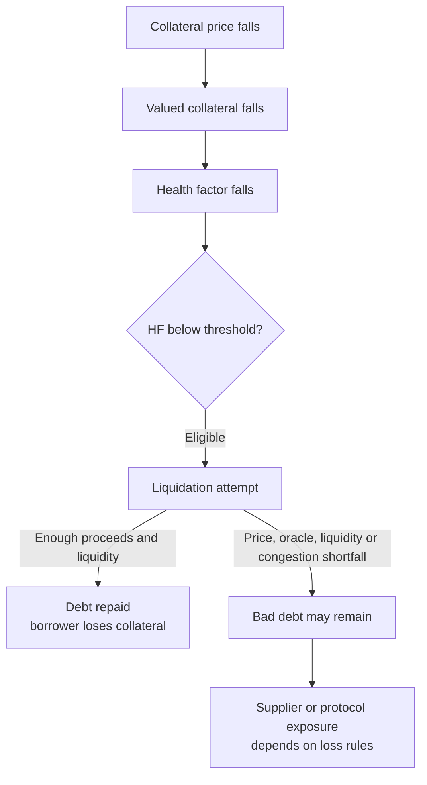
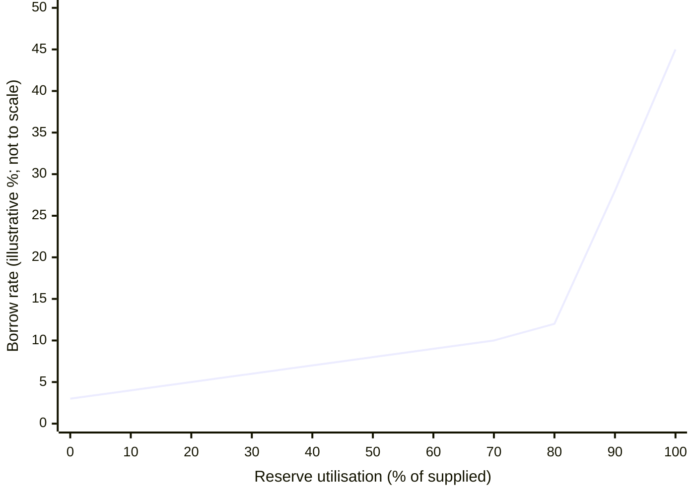
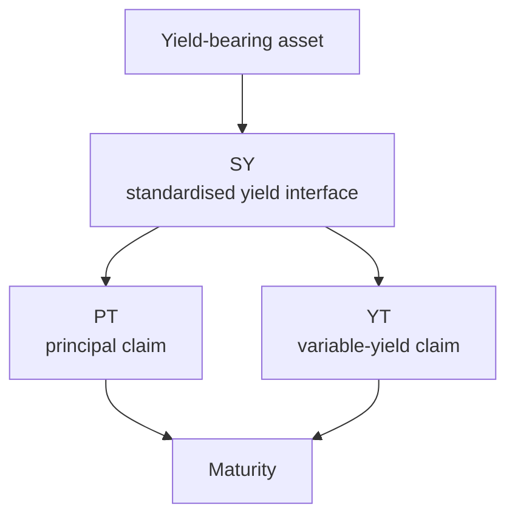

<!--
Author note (Education team): every figure in the worked example, the price
table and the model answer was recalculated on 21 October 2026. The model
answer is kept outside the public handbook.
-->

# Week 5 · Part 4 — Collateral, credit and DeFi economics

> **Core question — at what price does a crypto loan get liquidated, and
> what happens to the lender if the market moves faster than that?**

A lending protocol lends to strangers with no credit check. All it has is the
collateral they deposit and a rule for when to sell it. In this Part you turn
that rule into numbers: how safe a loan is now, the price where it gets
liquidated, and how a wrong price feed can leave the protocol with a loss.

::: tip Picture a pawn shop
You leave a watch and borrow less than it is worth. If the watch's value
falls too close to what you owe, the shop sells it before it is worth less
than the loan.

Where the picture stops: the shop can look at the watch. A protocol cannot.
It relies on a price feed it reads from the chain, and if that feed is late or
wrong, it acts on the wrong number.
:::

## The hard skill

**Model how a lending protocol uses collateral, a liquidation threshold and a
price feed to decide when a loan fails, and trace what happens when it acts
too late.**

After this Part you can:

- calculate a health factor;
- solve for the liquidation price, and the fall needed to reach it;
- tell the liquidation price from the break-even price;
- trace a path from a market move to a possible loss for the protocol.

## Core / reference material

### The health factor

A common measure is the **health factor** (HF). In the simplified single-asset
model used here:

$$
HF = \frac{V_{\text{collateral}}\times LT}{D}
$$

Here, $V_{\text{collateral}}$ is the collateral's current value in the
protocol's valuation currency (USD in our examples), $LT$ is the liquidation
threshold as a fraction (80% is $0.80$), and $D$ is the debt value in the same
currency. Multiplying by $LT$ turns the market value into a safety-adjusted
value: only that fraction counts toward the liquidation boundary. A higher HF
means more buffer. $HF=1$ is the simplified boundary; under Aave's model, a
position may become eligible for liquidation below 1. Real multi-asset
positions use protocol-specific valuation and threshold rules.

### Solve for a single-asset liquidation price

If a borrower has $Q_{\text{collateral}}$ units of one collateral asset, fixed
debt $D$, and a fixed threshold $LT$, set $HF=1$ and solve for the price:

$$
P_{\text{liq}} =
\frac{D}{Q_{\text{collateral}}\times LT}
$$

$P_{\text{liq}}$ is currency per collateral unit (USD per ETH here). The
formula assumes one collateral asset, debt and threshold unchanged, and the
protocol's oracle price matching the price used in the calculation. It omits
interest accrual, liquidation bonuses, fees and changing collateral. It is
not the break-even price: break-even is where collateral value equals debt.

### Where the price comes from

To value the collateral, the protocol needs an ETH price. It does not ask
the borrower. It reads an on-chain price feed, often from an oracle network
such as Chainlink.

If that price is stale, delayed or wrong, the health factor is wrong too. A
price that is too high delays liquidation and raises the chance of bad debt.
A price that is too low makes a healthy position look weak. Protocols watch
how fresh the feed is and build in safeguards.

### Worked example: 10 ETH backing a 12,000 USD loan

A borrower deposits **10 ETH** at **2,000 USD** per ETH, owes **12,000 USD**,
and the liquidation threshold is **80%**.

1. **Collateral value** = 10 × 2,000 = 20,000 USD.
2. **Health factor** = (20,000 × 0.80) ÷ 12,000 = **1.33**. Above 1, so there
   is a buffer.
3. **Liquidation price:**
   $P_{\text{liq}}=12{,}000/(10\times0.80)=\mathbf{1{,}500\ USD/ETH}$.
4. **The fall needed** = $(2{,}000-1{,}500)/2{,}000\times100=$ **25%**.

### Why liquidate before the collateral is worth less than the debt?

At 1,500 USD the 10 ETH is still worth 15,000 USD, more than the 12,000 USD
debt. The protocol acts early on purpose.

The **break-even price** is 12,000 ÷ 10 = **1,200 USD**. There the collateral
is worth exactly the debt. Below it, selling all the collateral would not
repay the loan. If the market falls through 1,200 before a liquidation goes
through, because the price moved too fast, the oracle lagged or the network
was congested, the protocol is left with **bad debt**.

| ETH price | Collateral value | Health factor | What it means |
|---:|---:|---:|---|
| 2,000 | 20,000 | 1.33 | Above the threshold |
| 1,500 | 15,000 | 1.00 | At the boundary |
| 1,200 | 12,000 | 0.80 | Collateral = debt |
| 1,100 | 11,000 | 0.73 | Collateral < debt |

**Academy schematic — a conditional lending failure path, not a claim that
every liquidation produces bad debt:**

The diagram separates a borrower's liquidation loss from protocol bad debt.
Eligibility does not guarantee that a liquidator acts in time; a liquidation
shortfall can expose suppliers or the protocol only if its accounting and loss
rules leave debt uncovered.

The liquidation price is not a second market price. The market price moves;
the liquidation price is the trigger level set by the position's collateral,
debt and threshold.

### The economic feedback: utilisation and interest

In the simplified reserve model here, utilisation $U$ is:

$$
U = \frac{\text{Total Borrowed}}{\text{Total Supplied}}
$$

Both quantities refer to the same reserve and asset; $U$ is a fraction, often
shown as a percentage. If 80 of 100 units supplied are borrowed, $U=0.80$ and
20 units remain as the simple withdrawal buffer. High utilisation means less
immediately available liquidity relative to supplied assets; borrowers pay
for access to scarcer liquidity. Supplier yield generally depends on borrow
rates, utilisation and the protocol's retained share. Extra token rewards are
a separate subsidy.

Aave V3's [official interest-rate strategy](https://aave.com/docs/aave-v3/smart-contracts/interest-rate-strategy)
uses two slopes around an optimal-usage point: above the **kink**, borrowing
becomes more expensive more quickly. This can encourage repayment and new
supply; it cannot guarantee either during stress.
The target and slopes depend on the reserve and deployment. The chart is a
conceptual Academy schematic, not a live Aave curve or parameter quote:

**How to read it:** the horizontal axis is the share of supplied reserve
currently borrowed; the vertical axis is the illustrative borrowing rate.
Before the optimal-use kink the rate rises gradually; beyond it the steeper
slope makes borrowing rise faster, attempting to preserve liquidity. The
shape does not guarantee repayment, new supply or a particular rate.

Recursive borrowing means borrowing against collateral and redepositing or
buying more collateral to borrow again. Gross supplied assets and debt grow
together while initial equity does not. Yield exposure, borrowing cost and
liquidation exposure all grow; a subsidy can disappear before the debt does.
The same HF model still asks what collateral and debt the protocol actually values.

::: details Landscape — Pendle: composing principal, yield and credit
Pendle wraps a yield-bearing asset into a standardised yield token (SY), then
separates principal (PT) from yield entitlement (YT) up to a maturity date.

**Academy schematic — simplified tokenisation flow, not Pendle contract
architecture.** For the protocol's own [PT/YT yield-stream diagram and
architecture](https://docs.pendle.finance/pendle-v2-dev/Contracts/YieldTokenization),
see its official documentation. This sketch only orients the learner to the
token split; consult the protocol's current terms for exact settlement.

PT's maturity claim is denominated in its **accounting asset**, which can
differ from the yield-bearing token delivered through redemption. Buying PT
below that maturity value gives a fixed-return interpretation in that unit
if held to maturity and redemption works. YT exposes the holder to realised
variable yield up to expiry, not a guaranteed return. Contract, liquidity,
oracle and underlying-asset risks remain.

If a lender accepts PT as collateral, it composes another dependency chain:
underlying asset → yield protocol → SY/PT settlement → lender's valuation and
liquidation rules. Maturity does not remove contract, liquidity, oracle or
underlying-asset risk. This is recognition material, not a borrowing strategy
or a second assessed task.
:::

## Hands-on task

A borrower deposits **8 ETH** when ETH is **2,500 USD**. The debt is
**10,000 USD** and the liquidation threshold is **80%**.

1. Calculate the collateral value and the current health factor.
2. Calculate the ETH price where HF reaches 1.
3. Calculate the percentage fall from 2,500 USD to that price.
4. Find the ETH price where the collateral is worth exactly the 10,000 USD
   debt.
5. The market price is 1,400 USD, but a stale oracle still reports 1,700 USD.
   Calculate the HF using each price, and explain the risk.
6. Write the failure path in four to six short steps, from "ETH falls fast"
   to "the protocol is left with a loss". Name who bears the loss.

**Out of scope:** live rate calibration, liquidation bonuses, executing leverage
or Pendle strategies, and specific Aave market parameters. All numbers above
are hypothetical; use a worksheet, not funds or wallet actions.

## Evidence required

- Your working for steps 1 to 5.
- Your failure path from step 6.

## Completion and revision

This Part is worth **100 points**. Completed / approved earns the full points;
incomplete or materially incorrect work is returned with specific feedback for
revision. There is no partial-score rubric.

Your work is complete when:

- [ ] the health factor, liquidation price and percentage fall are correct;
- [ ] the break-even price is kept separate from the liquidation price;
- [ ] both health factors in step 5 are correct, and you say which one the protocol acts on;
- [ ] the failure path runs from the price move to a named party bearing the loss.

::: details Further exploration — optional, not assessed
- The borrower adds 1 ETH of collateral at 2,500 USD. What is the new
  liquidation price?
- Look up how often the [Chainlink ETH/USD feed](https://docs.chain.link/data-feeds/price-feeds)
  updates. How far could the price move between two updates?
- Find a real bad-debt event on a lending protocol. Which step of your
  failure path broke?
- Compare a funding-rate/basis trade or a recursive PT lending loop as a
  dependency model only: what borrowing, settlement and funding assumptions
  could fail together? No position, return forecast or trade is required.
:::

::: details Sources and attribution
- [Aave — Health factor and liquidations](https://aave.com/help/borrowing/liquidations) — Link, referenced only
- [Chainlink — Price feeds](https://docs.chain.link/data-feeds/price-feeds) — Link, referenced only
- [Aave V3 — Interest rate strategy](https://aave.com/docs/aave-v3/smart-contracts/interest-rate-strategy) — Link, protocol documentation
- [Pendle — Principal token](https://docs.pendle.finance/pendle-v2/ProtocolMechanics/YieldTokenization/PT) — Link, protocol documentation
- [Pendle — Glossary](https://docs.pendle.finance/pendle-v2/ProtocolMechanics/Glossary) — Link, protocol documentation
:::
