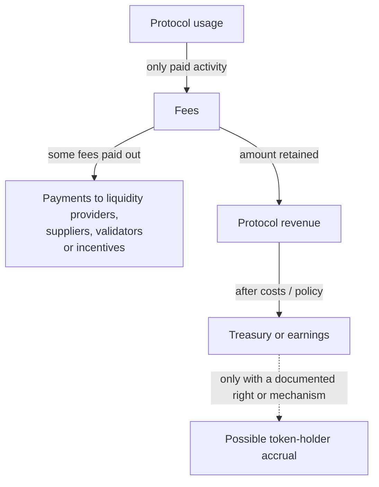

<!--
Author note (Education team): NOVA and ORBIT are made-up tokens. Their figures
were recalculated on 21 October 2026. The Arbitrum allocation and vesting
facts were checked against the Arbitrum DAO docs the same day. The model
answer is kept outside the public handbook.
-->

# Week 5 · Part 5 — Token and incentive economics

> **Core question: how much of a token is really in circulation, what does
> the next unlock change, and who gets the new tokens?**

Token pages quote several supply numbers side by side, and they answer
different questions. In this Part you work out how much of a supply is
actually circulating, what an upcoming unlock adds, who receives it and why,
and whether the protocol's growth reaches token holders at all.

::: tip Picture shares in a start-up
Founders and early investors hold shares they cannot sell for a few years.
When those restrictions lift, the number of shares that could be sold jumps,
even though no new company value was created.

Where the picture stops: a start-up's shares usually carry a claim on
profits. Many tokens carry no such claim. Whether the token benefits from the
protocol's success is a separate question you have to check.
:::

## The hard skill

**Analyse a token's supply, unlocks and recipients, and judge whether
protocol growth has a path to token-holder value, without assuming it does.**

After this Part you can:

- tell max, total and circulating supply apart;
- calculate an unlock's size against what is already circulating;
- map who receives tokens, and why they were allocated them;
- explain why an unlock is not the same as a sale.

## Core / reference material

### Three supply numbers

For a token with a fixed cap, picture the supplies as nested sets:

- **Maximum supply:** the outer limit on how many tokens can ever exist.
  - **Total supply:** the tokens that exist now, after any permanent burns.
    - **Circulating supply:** the subset a provider classifies as available
      to the market.

In this simplified capped-token model:

$$
S_{\text{circ}} \le S_{\text{total}} \le S_{\text{max}}
$$

Not every token has a fixed maximum. Providers may classify treasury, insider
and other allocations differently. Reported circulating supply is a
classification. It does not guarantee that every counted token is realistically
available to trade soon or that all of it could be sold near the quoted price.
Researchers later examine parts of this question using terms such as estimated
**real float** and **executable liquidity**; see [W6P4](../week-6/part-4-token-and-market-evidence.md).

For this Part, use the simplified relationship, with all supply values in
the same token units:

$$
S_{\text{circ}} = S_{\text{total}} - S_{\text{non-circulating}}
$$

This is a teaching relationship, not a universal provider formula. Providers
may classify treasury, foundation, unlocked insider and other allocations
differently, so check the project's disclosures and the provider's dated
methodology before comparing reported supply.

### What an unlock is, and is not

An unlock lifts a vesting or lock-up restriction, so previously restricted
tokens become transferable. A provider may then count them as circulating,
depending on its method. An unlock does not usually create new tokens and does
not prove that recipients sold them.
Unlock schedules are common for team members, investors, contributors and
ecosystem funds.

An unlock is **not** a sale. A recipient can hold, delegate, stake, spend or
sell the tokens. An unlock also does not always add the full amount to
reported circulating supply, for example if the tokens stay in a treasury
wallet that is still counted as non-circulating.

A **supply sink** is a mechanism that removes tokens from active circulation.
A burn is permanent; staking or locking may only restrict transferability for
a time, so these mechanisms do not have the same economic effect.

### Who receives tokens and why

| Recipient | Why projects allocate tokens to them |
|---|---|
| Community and users | Airdrops, governance distribution or rewards for early use |
| Ecosystem | Grants and incentives for builders, apps, liquidity or network growth |
| Team and contributors | Pay and long-term alignment for the people building it |
| Investors | Their share for the early capital and risk they provided |
| Treasury or foundation | A reserve for future grants, operations or governance-approved spending |

The recipient matters because the same-sized unlock can have different
effects. A grant pool may be paid out slowly to many builders, while a team or
investor unlock makes restricted insider tokens transferable all at once. Do
not assume any group will sell. The point is to know who controls the new
supply and what they are paid to want.

### Follow the economics as well as the supply

==Protocol usage ≠ fees ≠ revenue ≠ earnings ≠ token-holder value accrual.==
**Value accrual** means an economic benefit reaches token holders through a
documented mechanism, such as a distribution, buyback or burn, required token
use, or another enforceable right. A **buyback** uses protocol-controlled
assets to purchase the token from the market. Governance rights alone do not
guarantee that benefit. Map the path instead of assuming that an active
protocol makes its token valuable.

Imagine a user pays a simplified **$10 fee**. That $10 is a fee, but it is not
all automatically protocol revenue. The rules may send some to service
providers, such as liquidity providers or suppliers. The amount kept, if any,
may be called protocol revenue under a stated reporting method.
A **treasury** is a pool of assets controlled by a protocol, foundation or DAO
for uses such as operations, grants or incentives. After spending on costs,
some providers report what remains as **earnings**, but each provider must say
which costs it counted. Token holders benefit only if a documented right or
mechanism connects the protocol's economics to the token.

The diagram is an Academy economic-flow schematic: each arrow is a question to
verify, and the final link is conditional.

**Liquidity providers** supply assets to a pool and may receive some trading
fees; protocols can also pay suppliers, validators or incentive recipients.

The dotted final arrow is not automatic. Activity may be free or subsidised;
fees may mostly pay providers; retained revenue may be spent on operations or
incentives; treasury control may not give holders a claim. The table below
keeps the definitions and questions precise.

| Flow | Research question |
|---|---|
| Supply sources and sinks | What mints/emits/unlocks tokens? What permanently burns them? Staking or a lock restricts liquidity but is not necessarily a permanent sink. |
| Demand drivers | A demand driver is a reason someone needs or wants the token. Is it required for a service, collateral, security, governance or another use? Who needs it, and why? |
| Usage → fees | Which activity pays a charge, rather than just moving assets? |
| Fees → revenue | What goes to suppliers or liquidity providers, and what is retained by the protocol or distributed to holders? |
| Revenue → earnings / treasury | What remains after the stated costs or incentives? Does the figure represent assets actually received or spent, an accounting estimate, or newly issued token rewards? |
| Token-holder accrual | Is there an enforceable distribution, buyback/burn or another credible economic link? Who can change it? |

Providers use different definitions; DefiLlama separates supply-side payments,
protocol revenue and token-holder revenue. Name your convention and period
before comparing figures. Governance rights establish decision power, not by
themselves a claim on retained revenue or automatic token demand. An unlock
percentage is context, not a universal danger threshold.

### Worked example: NOVA

NOVA has a max and total supply of 1 billion tokens. For this example, every
unlocked token goes to its recipient and counts as circulating.

| Allocation | Total allocation | Circulating now | Next unlock |
|---|---:|---:|---:|
| Community / airdrops | 300m | 250m | 0 |
| Ecosystem grants / rewards | 250m | 100m | 15m |
| Team / contributors | 200m | 50m | 25m |
| Investors | 150m | 75m | 20m |
| Treasury / foundation | 100m | 0 | 0 |
| **Total** | **1,000m** | **475m** | **60m** |

1. **Circulating now** = 250m + 100m + 50m + 75m = **475m**, which is
   475m ÷ 1,000m = **47.5%** of max supply.
2. **Next unlock** = 15m + 25m + 20m = **60m**, which is 60m ÷ 475m ≈
   **12.63%** of what already circulates.
3. **After the unlock** = 475m + 60m = **535m**, or **53.5%** of max supply.
4. **Who receives the 60m?** Team 25m (41.67%), investors 20m (33.33%),
   ecosystem 15m (25%). Team and investors together get 45m, or **75%**.

Most of the new transferable supply goes to insiders rather than users. That
is worth noting. It still does not tell you whether they will sell.

### A real check: Arbitrum

Arbitrum's decentralised autonomous organisation (DAO) docs list where its
initial 10 billion ARB went: 35.28% to the DAO
treasury, 26.94% to the team, contributors and advisers, 17.53% to investors,
11.62% to users by airdrop, 7.5% to the Arbitrum Foundation and 1.13% to DAOs
building on Arbitrum. User and DAO airdrops were claimable from March 2023.
Team and investor allocations vest over four years: the first unlock came a
year after launch, then monthly unlocks for the remaining three years. So for
most of ARB's life, the supply allocated was far larger than the supply
circulating.

### Reading a real token-unlock chart

Messari's [*State of Pyth Network Q1 2024* report](https://messari.io/report/state-of-pyth-network-q1-2024)
(published 23 May 2024) includes a liquid-supply curve by allocation bucket.
The chart reports data as of **31 March 2024** and illustrates the schedule as
understood then. It is a historical research example, not current PYTH
tokenomics. Open the report's **Token Unlocks** section and read the figure in
this order:

1. **Read the axes.** Time runs horizontally; PYTH liquid supply runs
   vertically. First ask: when does the supply counted as liquid increase?
   The report's liquid-supply measure need not match every provider's
   circulating-supply definition.
2. **Read the stacked categories.** Each coloured layer is an allocation
   bucket, such as Community & Launch, Publisher Rewards, Ecosystem Growth,
   Protocol Development or Private Sales. The full stack shows total liquid
   supply; its layers show how that supply is allocated.
3. **Look for steps.** A jump represents tokens scheduled to become liquid or
   transferable. To judge its scale, compare the unlock amount with the
   circulating supply already counted, as in the NOVA calculation above. Ask
   how much new supply is being added relative to what is already circulating.
4. **Ask who receives it.** The same headline amount can go to different
   stakeholder groups and be subject to different conditions. Ask who receives
   the tokens and what incentives or restrictions apply; do not assume a
   recipient's intent from the category alone.
5. **Separate observation from interpretation.** The chart supports a claim
   about when more supply is scheduled to become liquid. It cannot by itself
   show that recipients transferred or sold those tokens. **Unlock ≠ sale.**

The chart is an example of the reading path **time → amount → recipient →
interpretation → limitation**. This Handbook links to the original figure
rather than reproducing it.

## Hands-on task

ORBIT has a max and total supply of **2 billion** tokens. Every amount in the
next-unlock column is paid out and becomes circulating when it unlocks.

| Allocation | Total allocation | Circulating now | Next unlock |
|---|---:|---:|---:|
| Community / airdrops | 600m | 480m | 10m |
| Ecosystem | 500m | 160m | 20m |
| Team / contributors | 400m | 80m | 40m |
| Investors | 300m | 100m | 30m |
| Treasury / foundation | 200m | 0 | 0 |
| **Total** | **2,000m** | **820m** | **100m** |

1. Calculate current circulating supply, and its share of max supply.
2. Calculate the size of the next unlock.
3. Calculate the unlock as a percentage of current circulating supply.
4. Calculate circulating supply after the unlock, and its share of max supply.
5. Which group receives the largest part of the unlock? Calculate its share of
   the 100m.
6. For community, ecosystem, team and investors, give one reason each was
   allocated tokens.
7. In two or three sentences, explain why a 100m unlock does not
   automatically mean 100m tokens will be sold.
8. ORBIT's protocol charges a fee on every trade, and all fees go to the
   treasury. ORBIT holders vote on how the treasury is spent but receive no
   fees directly. If the protocol's usage doubles, is there a clear path from
   that growth to value for ORBIT holders? Answer in two or three sentences.

**Out of scope:** price predictions, trading strategies and modelling token
prices after an unlock.

## Evidence required

- Your working for steps 1 to 5.
- Your short answers to steps 6, 7 and 8.

## Completion and revision

This Part is worth **100 points**. Completed / approved earns the full points;
incomplete or materially incorrect work is returned with specific feedback for
revision. There is no partial-score rubric.

Your work is complete when:

- [ ] all percentages are correct and state what they are a percentage of;
- [ ] the largest recipient and its share are correct;
- [ ] each of the four groups has a reason, not just a label;
- [ ] the unlock answer separates "transferable" from "sold";
- [ ] the value answer says what the path depends on, rather than assuming growth helps holders.

::: details Further exploration: optional, not assessed
- Look up ARB's circulating supply today on a data site, and compare it with
  the [Arbitrum DAO's own figure](https://docs.arbitrum.foundation/token-supply).
  Why might they differ?
- Pick a token with a large unlock coming up. Find where the unlocked tokens
  go and whether they move to an exchange in the following week.
- What is a "fee switch", and why do some DAOs debate turning one on?
:::

::: details Sources and attribution
- [CoinGecko: Supply methodology](https://support.coingecko.com/articles/6758974979-coingecko-supply-methodology) (Link, referenced only)
- [Arbitrum DAO: Airdrop eligibility and distribution](https://docs.arbitrum.foundation/airdrop-eligibility-distribution) (allocation and vesting figures, checked 21 October 2026)
- [Arbitrum DAO: Token circulating supply](https://docs.arbitrum.foundation/token-supply) (Link, referenced only)
- [DefiLlama: Data definitions](https://docs.llama.fi/analysts/data-definitions) (data-provider methodology, checked 26 October 2026)
- [Messari: State of Pyth Network Q1 2024](https://messari.io/report/state-of-pyth-network-q1-2024) (historical liquid-supply research example, data as of 31 March 2024; chart not reproduced under the report's redistribution terms)
:::
