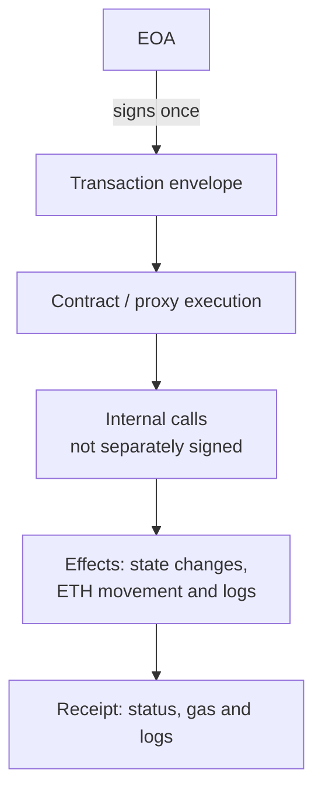
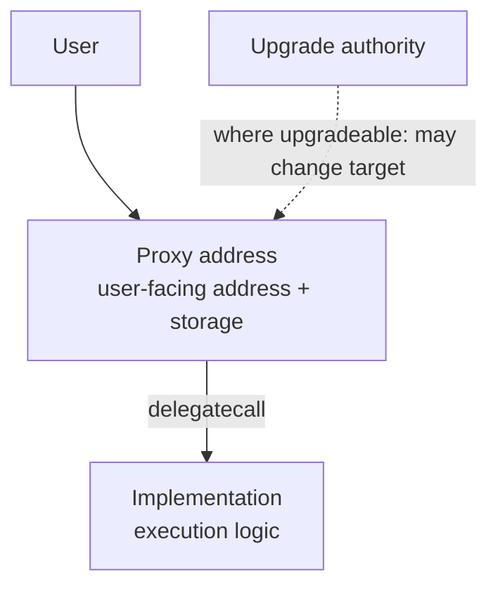

<!--
Author note (Education team): the case transaction was checked against a
mainnet RPC receipt on 21 October 2026 (status, logs, gas used and effective
gas price). The model answer and reviewer notes are kept outside the public
handbook.
-->

# Week 6 · Part 1 — On-chain evidence and trace semantics

> **Core question — what can you prove happened in one transaction, without trusting its sender's story?**

In Week 5 you mapped how systems *should* work. In Week 6 you gather evidence of
what actually happened. A transaction's page may say “Send 6 USDC”, but a
researcher separates the **request**, the **executed result**, and the **claim
that is not supported by the chain**.

Why it matters: a dashboard can label something a swap, payment or withdrawal.
Only the transaction, receipt, logs and block let you test that label.

**Academy schematic — one signed transaction can produce several observable
execution effects; it is not a complete state diff:**

An ERC-20 transfer can appear in a contract log while the transaction's ETH
`value` is zero. Logs are emitted records, not the state itself; the receipt
reports execution outcome and logs, not a complete before/after state snapshot.

::: tip Think of an incident report
The signed transaction is the instruction; the receipt is the outcome; event
logs are records of what contracts emitted during execution. Do not treat a
requested action as proof that it happened.

Where the picture stops: logs are emitted by contracts. A malicious contract
can emit misleading logs. Interpret the emitter and ABI, not just the label.
:::

## The hard skill

**Reconstruct one real Ethereum transaction as a short evidence trail, with
links and a boundary between observation and inference.**

After this Part you can:

- distinguish the transaction envelope, execution receipt, ERC-20 `Transfer`
  logs and an explorer's human-readable summary;
- reconcile the apparent token movement with `value` in ETH;
- compute the actual gas fee and identify what remains unknown.

## Core / reference material

### Four pieces of evidence

An **externally owned account (EOA)** is controlled by a signing key and can
originate a transaction. A **contract account** executes code when called;
it does not independently originate a signed transaction. One EOA transaction
can trigger many contract calls and asset movements. **Address ≠ person**:
one person may use many accounts; a service address may serve many people.

| Record | What you can establish | What it does **not** establish |
|---|---|---|
| **Transaction** | `from`, `to`, input data, ETH `value`, gas limit | Whether the attempted action succeeded |
| **Receipt** | `status`, `gasUsed`, `effectiveGasPrice`, emitted logs | The user's intent or why they transferred |
| **Event log** | What an identified contract emitted and its indexed arguments | That any human-readable explorer label is trustworthy on its own |
| **Block** | Inclusion height and timestamp | Whether two addresses belong to the same real-world person |

For an ERC-20 transfer, the ETH `value` is often **0** because the asset is
moved by token-contract logic rather than an ETH transfer. The `Transfer(from,
to,value)` event has the token **contract** as its emitter. Its `value` is a
raw integer: divide by that token's `decimals` to obtain display units. See
[EIP-20](https://eips.ethereum.org/EIPS/eip-20).

The receipt, not the gas limit, gives the execution gas actually used. For a
standard execution-gas transaction, its fee is:

$$
\text{Fee}_{\mathrm{ETH}} =
\frac{\text{gasUsed}\times\text{effectiveGasPrice}_{\mathrm{gwei}}}{10^9}
$$

The $10^9$ converts gwei to ETH; multiply the gas actually used by its
effective price, not the transaction's maximum gas limit. This is the
execution-gas component; a blob transaction can incur a separate blob fee
([EIP-4844](https://eips.ethereum.org/EIPS/eip-4844)).

### The normal Transactions tab is only the envelope

| View | What you inspect | Common mistake |
|---|---|---|
| Normal transaction | Signed instruction, ETH value, calldata | Reading to as the final economic beneficiary |
| Receipt / status | Top-level execution or revert, gas, logs | Assuming Success means every intended sub-operation succeeded |
| Calls / Internal Txns | Execution trace; internal ETH movements where indexed | Treating each call as a separately signed transaction, or this tab as every call |
| Token transfers / logs | Identified token's Transfer events and other emitted events | Adding ERC-20 units to ETH value or trusting arbitrary event text |
| Contract state | Values at a specified address and block | Treating an event as a complete state snapshot |

Internal calls are execution effects, not extra signed transactions. Some move
ETH, many move none. Explorer coverage and filtering differ; a missing internal
transfer row does not establish that no contract logic ran. Logs record emitted
data; balances and other state need the correct contract and block.

### Proxy: one address, replaceable logic

**Academy schematic — one simplified upgradeable `delegatecall` pattern;
not every proxy uses this architecture:**

A proxy keeps the user-facing address and persistent storage while delegating
execution to an **implementation**. Upgrades can change logic without changing
that address. Record **proxy → implementation at the relevant block → upgrade
authority/admin**. ERC-1967 specifies conventional implementation, beacon and
admin storage slots; not every proxy follows it, and a slot alone does not
explain all permissions. Transparent and UUPS patterns place upgrade checks differently.

Research traps: reading only the proxy bytecode; applying today's implementation
to an old transaction; attributing all activity to the logic address; querying
the implementation's storage instead of the proxy's; or ignoring who can
replace the logic. Use the explorer's proxy/read-as-proxy view where available,
then trace authority in verified code. If unresolved, write **unknown**, not immutable.

::: details Landscape — modern account-model nuance
EIP-7702 lets an EOA designate code for delegated execution while the account
remains key-controlled. This is why “code present” is not a complete account
classification rule; it does not change the evidence distinctions in this
Part. See [EIP-7702](https://eips.ethereum.org/EIPS/eip-7702) for the exact
transaction and authorization model.
:::

### Worked example: the receipt is not the instruction

Open this [real Ethereum transaction on Etherscan](https://etherscan.io/tx/0x1e904783e35ffbfd6c01f126e59e722a83d0c7245b907429136b96eb8ff31618)
(from 27 June 2026). We read **only the first three items** for now:

1. The envelope's `to` is the **USDC token contract** (`0xA0b8…eB48`), not the
   person receiving USDC.
2. The ETH `value` is **0 ETH**. That does not mean no token moved.
3. The receipt says **Success**, and the ERC-20 token-transfer section reports
   a **6 USDC** transfer. That is evidence of token movement, unlike the ETH
   `value` field.

A further check uses the receipt's logs to verify the emitting contract,
recipient and amount, rather than relying only on Etherscan's action label.

## Hands-on task

Use that **same transaction** so everyone can compare their evidence. Aim for
25–30 minutes. Work from the transaction's **Overview**, **Logs** and, where
available, its **Input Data** and token contract page. You may cross-check with
an RPC receipt if you have access, but no coding is required.

1. **Write a six-line transaction record:** chain, full hash, UTC time and
   block, transaction sender, transaction `to`, and receipt status. Link the
   explorer page.
2. **Trace the token movement:** name the token and its contract, sender,
   recipient, displayed amount, and the relevant `Transfer` log. State whose
   address appears in `transaction.to` and whose appears in the event's `to`.
   Explain why these are different.
3. **Reconcile costs:** record ETH `value`, gas limit, gas used, effective gas
   price and total paid in ETH. Show your multiplication; distinguish the gas
   limit from what was actually charged.
4. **Write an evidence table:** at least four claims, each tagged
   **observed / inferred / unknown**, and a precise URL + page section or
   receipt field. Include one **claim you cannot conclude** (such as sender
   intent, legal ownership or the recipient's identity).
5. **Recognise the contract structure.** Open the USDC Code page and record its
   proxy indicator and linked implementation (or what the explorer cannot
   resolve). This is a real proxy example, not a claim that USDC uses ERC-1967.
   State why today's implementation is insufficient to explain old execution.
   Do not connect a wallet.

**Out of scope:** profiling wallet owners, assuming transfer motive, and tracing
all transactions before or after the case.

## Evidence required

- Your transaction record and token movement trace.
- Gas calculation with units.
- Evidence table with an uncertainty, plus the dated proxy/implementation link.
  No separate report is required.

## Completion and revision

This Part is worth **100 points**. Completed / approved earns the full points;
incomplete or materially incorrect work is returned with specific feedback for
revision. There is no partial-score rubric.

**Your work is complete when:**

- [ ] you used the real transaction and included a full hash and URL;
- [ ] your record separates transaction recipient from token recipient;
- [ ] the token transfer is supported by a contract event/receipt, not just
      an explorer summary;
- [ ] the fee multiplication has correct units and uses **gas used**;
- [ ] every claim has a provenance tag, and you explicitly flag an unknown;
- [ ] the proxy observation is dated and does not establish historical logic
      or a wallet owner's identity.

::: details Further exploration — optional, not assessed
- Retrieve the raw receipt via `eth_getTransactionReceipt`, compare the returned
  `logs` and `effectiveGasPrice` with the explorer, and note any presentation
  differences. Some free RPCs return `null` for older receipts because they
  have pruned them; Tenderly's public gateway,
  `https://mainnet.gateway.tenderly.co`, returned this one on 21 October 2026.
- Find the `Transfer` event signature in EIP-20. Which arguments are indexed?
:::

::: details Sources and attribution
- [Etherscan — USDC transfer transaction, 27 June 2026](https://etherscan.io/tx/0x1e904783e35ffbfd6c01f126e59e722a83d0c7245b907429136b96eb8ff31618) — Link, the case transaction
- [EIP-20 — ERC-20 Token Standard](https://eips.ethereum.org/EIPS/eip-20) — Link, referenced only
- [Ethereum Execution API — eth_getTransactionReceipt](https://ethereum.github.io/execution-apis/api/methods/eth_getTransactionReceipt/) — Link, referenced only
- [ethereum.org — Accounts](https://ethereum.org/en/developers/docs/accounts/) and [Transactions](https://ethereum.org/en/developers/docs/transactions/) — Link, primary technical reference; checked 26 October 2026
- [ERC-1967 — Proxy storage slots](https://eips.ethereum.org/EIPS/eip-1967) — Link, primary standard; not universal to all proxies
- [OpenZeppelin — Proxy API](https://docs.openzeppelin.com/contracts/5.x/api/proxy) — Link, implementation documentation
- [Etherscan — Understanding an Ethereum transaction](https://info.etherscan.com/understanding-an-ethereum-transaction/) and [Proxy types](https://info.etherscan.com/types-of-proxy-contracts-detected-by-etherscan/) — Link, explorer terminology only; older consensus discussion is not used
:::
