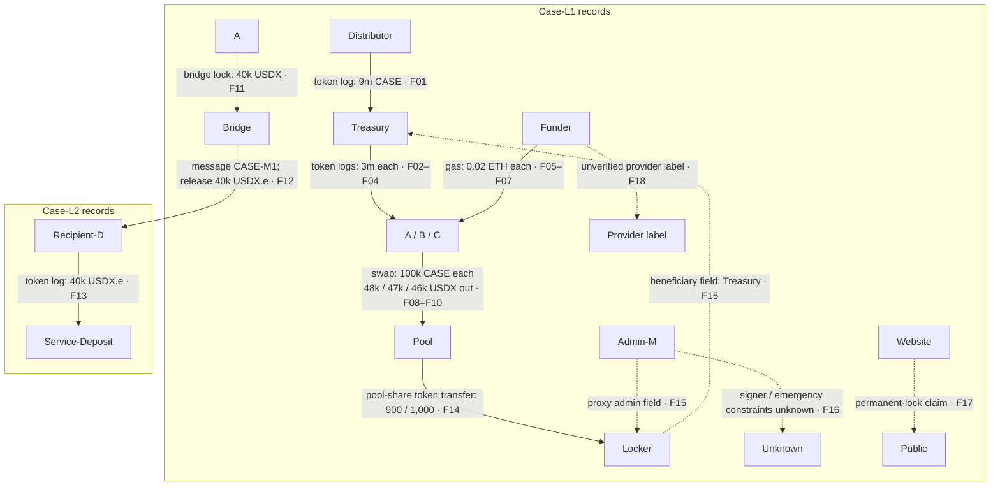

<!-- Existing route retained; the former data lab now belongs to Part 3.
Case observations are synthetic, not allegations about real entities.
Reviewer solutions remain outside the public Handbook. -->

# Week 6 · Part 2 — Entity and fund-flow investigation

> **Core question — which explanation fits these flows, and what could distinguish it from the alternatives?**

A large address splits tokens among new wallets. The flow alone cannot show
whether this is routine or coordinated—or who controls the recipients.

| Term | What it means here |
|---|---|
| **Address** | On-chain identifier; not necessarily a person. |
| **Entity** | Person, organisation or service believed to use/control addresses. |
| **Attribution** | Evidence linking an address to an entity. |
| **Cluster** | Addresses grouped by patterns; shared ownership is unproven. |
| **Counterparty** | Other address or contract in a record. |
| **First funder** | Earliest funder seen in checked records—not necessarily first-ever. |

## The hard skill

**Reconstruct a fund-flow hypothesis, state a competing explanation and
choose the next check that would separate them.**

Use free explorers read-only; no paid account, wallet connection or personal
data is needed.

## Core / reference material

### A repeatable investigation method

**Academy investigation-method schematic.** Record chain, asset/contract,
block/time, amount, sender, recipient and row ID/hash. Separate the transaction
envelope, token logs and internal ETH movements; the same event across tabs is
still one event. Compare clues, alternatives and the next check before stating
confidence.

### Large or repetitive activity does not identify who is behind it

| Signal family | Inspect | Alternative explanation |
|---|---|---|
| Timing / execution | Regular intervals, repeated methods, similar gas/execution patterns | Scheduled treasury service or exchange batching |
| Flow / holding | Same-sized repeated flows, high transaction count with short holding periods | Market making, reward claims or arbitrage |
| Funding / counterparties | Common first ETH funder, repeated recipients, common deposit paths | A shared exchange, relayer, distributor or gas sponsor |

**Market making** means a trader or service regularly buys and sells assets so
other people can trade more easily. This is one way to provide liquidity. A
market maker may earn from the gap between its buy and sell prices or receive
other incentives; different market makers can use different strategies. A
**relayer** forwards a transaction or request for another user; a **gas
sponsor** pays transaction fees for someone else's action. A **distributor**
is a wallet or contract that sends assets to many recipients, for example for
rewards or grants.
Shared funding can therefore come from infrastructure, not shared ownership.
**Exchange batching** groups multiple customer operations into fewer
blockchain transactions instead of sending one for every customer action.

Use at least two signal families. Ten-minute timing plus a high count of those
same events is one clue; pair it with funding or counterparties. An
**externally owned account (EOA)** is controlled by a signing key but may be
automated; one contract can serve many people.

### Investigating a large allocation split

Check source, timing, recipient count/history and claim or vesting calls. Follow
recipients into **decentralised exchange (DEX)** swaps, service deposits,
bridges or holding. A router transfer alone does not prove a sale; inspect
execution and returned asset. Provider labels are leads, not facts. An absence
of direct holder transfers proves neither coordination nor independence;
compare funding, timing, approvals and downstream flows.

### Know where a cross-chain trace stops

Link a source lock, burn or message to destination mint/release by message ID
or bridge evidence, not amount/time alone. Record both chains, hashes and
token representations; addresses may change, and some liquidity-network
bridges have no one-to-one mint. A **custodial service** holds assets for users
and records each customer's balance in its own system. After a deposit reaches
its address, public chain records usually cannot show which customer received
the internal credit. Stop there and write **unknown** unless another reliable
source establishes the next owner or beneficiary.

### A “locked liquidity” badge is a question

Identify the pool and position token: a v2 **liquidity provider (LP) token**
represents a pool share; a v3 **non-fungible token (NFT)** represents a price
range. Check owner, locker, beneficiary, unlock, withdrawal rights and
admin/upgrade powers. LP tokens sent to an inaccessible address (sometimes
called burned liquidity) differ from a releasable lock; neither is the pool's
burn operation, which redeems LP tokens for assets. A project-controlled,
upgradeable locker may still leave control with the project.

**A locked LP position tells you about that position—not all liquidity or
whether the rest of the project can change.**

::: tip Rules to keep while tracing
- **Address ≠ person.**
- **Shared patterns or funding ≠ proven common control.**
- **A missing link stays unknown.**
:::

### Map the supplied observations

**Academy schematic:** synthetic F01–F18 observations on invented Case-L1/2.
Edges show records, not identity or intent; dashed website/provider labels are
not on-chain facts.

F11/F12 share a message ID; F13 does not identify who controls its recipient.
F15 gives beneficiary/admin fields; F16 leaves signer/emergency limits unknown.
Check deployer/treasury funding before calling repeated transfers retail
demand; incentive farming, bots and activity-inflating trades remain
hypotheses.

### Worked observation: first funder

Records show A and B first received gas from F. Shared control is an inference;
F could be an exchange withdrawal service. Check the label source. Result:
**shared funding pattern; control unknown.**

::: details Landscape — sandwich patterns and mixers
A sandwich may bracket a swap and worsen execution; compare pool, direction,
amounts and effects, since ordering alone is insufficient. Mixers weaken
attribution but do not prove intent. Do not identify private people or give
evasion methods.
:::

## Hands-on task

Use **one compact investigation table**, not a report:

1. **Real explorer check (about 5 minutes).** Reopen
   [Part 1's USDC transaction](./part-1-on-chain-data-as-evidence.md#worked-example-the-receipt-is-not-the-instruction).
   Link the initiating address, token/proxy Code page and Transfer log;
   classify them and mark unsupported attribution unknown. No new tracing is
   required.
2. **Case pack (about 20 minutes).** Open the
   <a :href="$withBase('/files/researcher/W6.2-fund-flow-case.csv')" download>synthetic observations CSV</a>
   and <a :href="$withBase('/files/researcher/W6.2-case-notes.md')" download>case notes</a>.
   Aliases and record IDs are invented, not live addresses/transactions.
   Investigate allocation splitting, possible coordination and the LP-lock
   claim. Write **four rows**: records, interpretation, alternative,
   confidence/reason and next check. Use two independent signal families for
   the activity/cluster hypothesis.
3. Include the cross-chain break in one row: distinguish a linked bridge
   message from a later custodial endpoint. Say what remains unknown.

**Out of scope:** proving identity, alleging insider selling/crime, paid tools,
or tracing around privacy protections. **Transfer ≠ economic demand; volume
≠ users; unlock ≠ sale.**

## Evidence required

- Three explorer links/classifications and a dated four-row table citing case
  record IDs. The table contains your conclusion; no additional essay is needed.

## Completion and revision

This Part is worth **100 points**. Completed / approved earns full points;
incomplete or materially incorrect work is returned for revision. There is no
partial-score rubric or separate weekly submission.

To complete, cite records, include an alternative and two signal families, and
state where the evidence stops. You need not identify anyone or prove motive;
**unknown** is acceptable when records do not support more.

::: details Further Exploration — optional, not assessed
Compare two free explorer labels for a public service contract. Who supplied
each label, when was it checked, and what evidence independently supports it?
Do not profile a private individual.
:::

::: details Sources and attribution
- [ethereum.org — Accounts](https://ethereum.org/en/developers/docs/accounts/) — Link, primary technical reference
- [Etherscan — Understanding an Ethereum transaction](https://info.etherscan.com/understanding-an-ethereum-transaction/) — Link, explorer view terminology only
- [ethereum.org — Bridges](https://ethereum.org/en/developers/docs/bridges/) — Link, technical reference for mechanisms and risks
- [ethereum.org — MEV](https://ethereum.org/en/developers/docs/mev/) — Link, technical reference; checked 26 October 2026
- [Uniswap v2 — Pools](https://developers.uniswap.org/docs/protocols/v2/concepts/pools) and [v3 Position manager](https://docs.uniswap.org/contracts/v3/reference/periphery/NonfungiblePositionManager) — Link, protocol references for liquidity-position ownership
- Case pack and hypothesis method — original Academy material; synthetic, with no claims about real owners
:::
