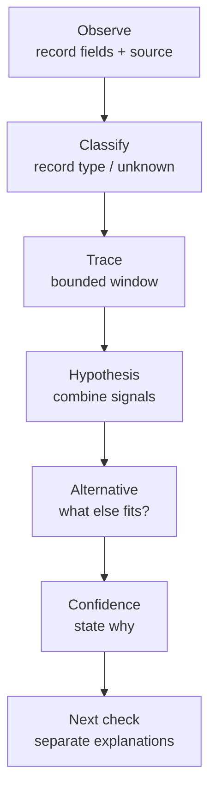
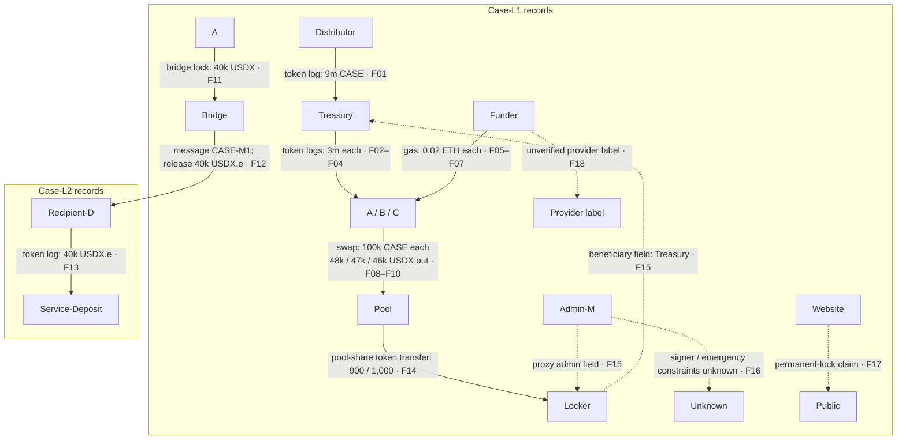

<!-- Existing route retained; the former data lab now belongs to Part 3.
Case observations are synthetic, not allegations about real entities.
Reviewer solutions remain outside the public Handbook. -->

# Week 6 · Part 2 — Entity and fund-flow investigation

> **Core question — which explanation fits these flows, and what could distinguish it from the alternatives?**

A large address splits tokens among new wallets. It could be distribution,
treasury operations, a market maker, coordinated selling or obfuscation. A
flow diagram alone cannot decide. Part 1 taught what the records mean; now
combine signals into a hypothesis without inventing an identity.

An **address** is an on-chain identifier, not a person's name. An **entity**
is the organisation, service or person someone thinks may control or use an
address; **attribution** is the evidence-based link supporting that label.
A **cluster** is a tentative group of addresses linked by observations, not a
proven entity. A **counterparty** is the other address or contract in a
recorded interaction. A **first funder** here means the earliest funder seen
in the queried records—not necessarily the address's first-ever source of
funds.

## The hard skill

**Reconstruct a fund-flow hypothesis, state a competing explanation and
choose the next check that would separate them.**

Work read-only with free explorers and the supplied synthetic case. No paid
forensic platform, account, wallet connection or personal data is required.

## Core / reference material

### A repeatable investigation method

**Academy investigation-method schematic.** Keep chain, asset/contract,
block/time, amount, sender, recipient and a row ID or transaction hash. Separate
the transaction envelope from token logs and internal ETH movements; do not
count one event seen in multiple explorer tabs as extra activity. Combine
independent clues, then name an alternative and evidence that could distinguish
it before calibrating confidence.

### Whale-sized is not human; repetitive is not proven bot ownership

| Signal family | Inspect | Alternative explanation |
|---|---|---|
| Timing / execution | Regular intervals, repeated methods, similar gas/execution patterns | Scheduled treasury service or exchange batching |
| Flow / holding | Same-sized repeated flows, high transaction count with short holding periods | Market making, reward claims or arbitrage |
| Funding / counterparties | Common first ETH funder, repeated recipients, common deposit paths | Shared exchange, relayer, distributor or gas sponsor |

Use **at least two independent signal families** for a tentative activity
classification. Timing and a count of those same timed transactions are
weakly independent at best. A large **externally owned account (EOA)**—an
address controlled by a signing key—can be automated; a contract can serve
many humans. **Address ≠ person.**

### Investigating a large allocation split

Check source, timing, recipient count, amount distribution and recipient
histories. Was there a claim call or known vesting/distributor contract? What
happened next: **decentralised exchange (DEX)** swaps, service deposits,
bridging or holding? A transfer to a router is not proof of a sale without
the execution and assets received. A service label is a provider's
attribution claim, not ground truth; check who supplied it and what supports it.

No direct transfers between top holders does **not** rule out coordination.
Check common first/gas funding, near-synchronous activation, coordinated
interactions, approvals, counterparties and downstream convergence. Common
funding can reflect shared infrastructure. **Correlation ≠ common control;
cluster evidence ≠ proven identity.** Do not publish accusations.

### Cross-chain continuity has gaps

Connect a source lock/burn/message to a destination mint/release using a
message ID or documented bridge evidence, not amount and time alone. Record
both chains, hashes and token representations; addresses may stay the same
or change. Liquidity-network bridges need not expose a neat one-to-one mint.
A custodial exchange may pool many customers' deposits at a shared address;
the public chain may show funds reaching that endpoint without revealing which
internal customer account received credit. Mark that attribution boundary
rather than guessing the next owner.

### A “locked liquidity” badge is a question

Identify the pool and liquidity-position token first: a v2 **liquidity
provider (LP) token** represents a share of pool positions, while a v3
position **non-fungible token (NFT)** represents a specific range and has
different ownership rules.
Inspect owner, locker, unlock time, beneficiary, withdrawal rights and
upgrade/admin power. Sending LP tokens to an inaccessible address (often
called burned liquidity) differs from a
releasable lock. Do not confuse it with the pool's burn operation that redeems
LP tokens for underlying assets. Neither control proves all liquidity or
every project power is locked. A
project-controlled upgradeable locker may not constrain the project as a badge implies.

### Map the supplied observations

The following is an **Academy schematic of the synthetic case records**
F01–F18. Case-L1 and Case-L2 are invented names for the two networks in this
case. Edges identify what each supplied record says; they do not imply
shared control, identity, intent or wrongdoing. The dashed website claim and
provider label are not on-chain facts.

Read the labels literally: the bridge message links the supplied lock and
release records, while the later service deposit does not reveal who controls
the recipient. F15 records a beneficiary and proxy-admin field, but F16 leaves
signer and emergency constraints unknown. Those are observations and gaps;
whether they support a hypothesis is for your table to argue.

Check deployer, treasury and market-maker funding before treating repetitive
small transfers or volume as independent retail demand. Farming, incentives,
bots or wash-like activity are competing hypotheses, not automatic findings.

### Worked observation: first funder

“A and B received their first gas funding from F” is observed in two records.
“A and B share control” is inferred. “F was an exchange withdrawal service”
is an alternative requiring label provenance or service evidence. Medium or
low confidence may be the strongest defensible result.

::: details Landscape — sandwich patterns and mixers
A possible sandwich places a trade before a victim's swap and an offsetting
trade after it, potentially worsening execution. Ordering alone is insufficient:
inspect pool, direction, quantities and effects. This is a recognition pattern,
not instructions to carry it out.

Mixers weaken simple deterministic attribution. A mixer or bridge interaction
does not establish malicious intent. Do not identify private people or
provide evasion methods.
:::

## Hands-on task

Use **one compact investigation table**, not a report:

1. **Real explorer check (about 5 minutes).** Reopen
   [Part 1's USDC transaction](./part-1-on-chain-data-as-evidence.md#worked-example-the-receipt-is-not-the-instruction).
   Link the initiating address, token/proxy Code page and Transfer log.
   Classify those records; flag an unknown rather than forcing an account
   classification from a label. No new tracing or wallet connection is required.
2. **Case pack (about 20 minutes).** Open the
   <a :href="$withBase('/files/researcher/W6.2-fund-flow-case.csv')" download>synthetic observations CSV</a>
   and <a :href="$withBase('/files/researcher/W6.2-case-notes.md')" download>case notes</a>.
   Aliases and record IDs are invented, not live addresses/transactions.
   Investigate allocation splitting, possible coordination and the LP-lock
   claim. Write **four rows**: observed records, interpretation, alternative,
   confidence with reason, next evidence/check. Use two independent signal
   families in your activity/cluster hypothesis.
3. Include the cross-chain break in one row: distinguish a linked bridge
   message from a later custodial endpoint. Say what remains unknown.

**Out of scope:** proving identity, alleging insider selling/crime, paid tools,
or tracing around privacy protections. **Transfer ≠ economic demand; volume
≠ users; unlock ≠ sale.**

## Evidence required

- Three explorer links/classifications and a dated four-row table citing case
  record IDs. The table contains your conclusion; no additional essay is needed.

## Completion and revision

This Part is worth **100 points**. Completed / approved earns full points;
incomplete or materially incorrect work is returned for revision. There is no
partial-score rubric or separate weekly submission.

Complete means every inference names evidence and an alternative, the cluster
claim uses two independent signal families, and lock/cross-chain limitations
remain visible. An honestly bounded conclusion can pass with identity and intent unknown.

::: details Further Exploration — optional, not assessed
Compare two free explorer labels for a public service contract. Who supplied
each label, when was it checked, and what evidence independently supports it?
Do not profile a private individual.
:::

::: details Sources and attribution
- [ethereum.org — Accounts](https://ethereum.org/en/developers/docs/accounts/) — Link, primary technical reference
- [Etherscan — Understanding an Ethereum transaction](https://info.etherscan.com/understanding-an-ethereum-transaction/) — Link, explorer view terminology only
- [ethereum.org — Bridges](https://ethereum.org/en/developers/docs/bridges/) — Link, technical reference for mechanisms and risks
- [ethereum.org — MEV](https://ethereum.org/en/developers/docs/mev/) — Link, technical reference; checked 26 October 2026
- [Uniswap v2 — Pools](https://developers.uniswap.org/docs/protocols/v2/concepts/pools) and [v3 Position manager](https://docs.uniswap.org/contracts/v3/reference/periphery/NonfungiblePositionManager) — Link, protocol references for liquidity-position ownership
- Case pack and hypothesis method — original Academy material; synthetic, with no claims about real owners
:::
