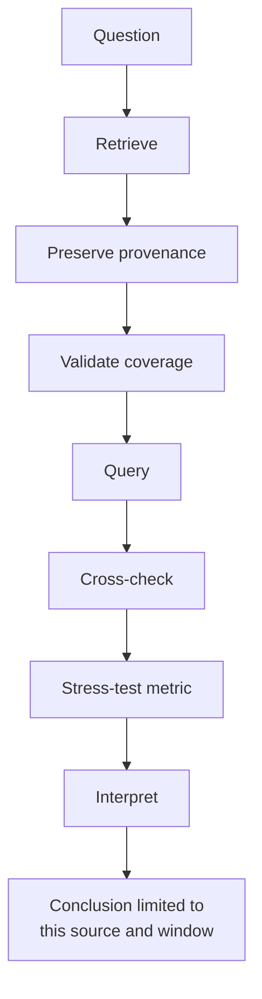

# Week 6 · Part 3 — Querying and measurement design

> **Core question — did reported trading volume rise, and was the rise typical or concentrated in a few days?**

A flow investigation asks what happened in particular records. A measurement
asks what a defined series can support. Retrieval, validation and interpretation
are parts of one analysis, not separate reports.

## The hard skill

**Retrieve an auditable public series, use minimal Structured Query Language
(SQL) to compare consistent windows, and test whether the headline survives
alternative measurements.**

The question is deliberately narrow: **DefiLlama-reported Uniswap daily
decentralised exchange (DEX) volume on Ethereum, in USD, across the last 90 complete
Coordinated Universal Time (UTC) days**. It is not a count of trades, wallets
or people. No account, application programming interface (API) key or wallet
is needed.

## Core / reference material

### A measurement workflow



**Academy workflow schematic:** each step constrains the next. A query cannot
repair a missing date, and a calculated metric cannot support a broader claim
than its source, unit, window and coverage allow.

**Data provenance** is the record of where data came from, when it was
retrieved, what period and scope it covers, and what was done to it before
analysis. Here that includes the endpoint, retrieval time, chain, date range,
and how the data was combined or summarised. Without those details, another
researcher cannot reproduce or challenge the number.

### Retrieve once; preserve the source

The Python file below is a **provided retrieval utility, not a coding
exercise**. It requests the public data, checks that the 90-day series is
complete, and saves the CSV, source snapshot and provenance record for you; you
do not need to edit the file or learn Python.

First check whether Python is available. Open a terminal (a text app for
running commands) or, on Windows, PowerShell / Command Prompt. A command is what
you type; its output is what the computer prints back. Commands run in the
**current folder** — the folder shown by your terminal. After downloading the
script, use `cd` to move into the folder where it was saved. To see the current
folder path, use `pwd` on macOS/Linux or `Get-Location` in PowerShell.

```bash
python3 --version
```

On Windows, use:

```powershell
python --version
```

A version number such as `Python 3.x.x` means the command is available. If the
command is not recognised, do not edit the retrieval utility or install a
third-party package for this task; ask the Education Team for help with the
approved environment or use the clearly dated fallback snapshot below.

Download <a :href="$withBase('/files/researcher/W6.3-free-public-data.py')" download>W6.3-free-public-data.py</a>
into that empty folder. It uses Python 3's standard library. In the same
terminal, after moving into that folder, run:

```bash
python3 W6.3-free-public-data.py
```

On Windows, run:

```powershell
python W6.3-free-public-data.py
```

The terminal should print a `Saved uniswap_ethereum_90days.csv: 90 dates...`
line and a second line naming the provenance and source-snapshot files. You
should see all three files in that folder. If an error appears instead, keep
the message and report it; do not replace missing values with guesses.

It requests data from DefiLlama's free [Uniswap volume endpoint](https://api.llama.fi/summary/dexs/uniswap?dataType=dailyVolume&excludeTotalDataChart=false&excludeTotalDataChartBreakdown=false),
part of its application programming interface (API).
Use the Ethereum entries of `totalDataChartBreakdown`, summed across reported
versions, **not** the all-chain `totalDataChart`.

The outputs are:

- `uniswap_ethereum_90days.csv`: a comma-separated values (CSV) file with 90
  ascending dates, `day_utc` and `volume_usd`;
- `W6.3-source-snapshot.json`: a JavaScript Object Notation (JSON) file with
  the selected Ethereum version values and totals, endpoint, retrieval time,
  chain, unit, method and inclusive dates;
- `W6.3-data-provenance.txt`: the scope, unit, dates and method.

The window ends yesterday UTC. The script rejects missing/duplicate days,
ambiguous chain data and invalid amounts rather than replacing gaps with zero.
Provider revisions can change past values; keep your original snapshot.
If the API is unavailable, record the error and retry; an error alone is not a
completed measurement. The primary task is live retrieval. Use the dated
snapshot below only if the approved environment or public endpoint is
unavailable, and state clearly that you used it.

::: important Dated fallback snapshot, not live data
This fallback was retrieved on **30 October 2026** and covers **1 August to
29 October 2026 UTC**, inclusive. It is a reproducible teaching fallback, not
current live data. Use it only when live retrieval is unavailable, and say so
in your finding.

- <a :href="$withBase('/files/researcher/W6.3-uniswap-ethereum-volume-2026-10-30.csv')" download>Download the 90-day Ethereum volume CSV</a>
- <a :href="$withBase('/files/researcher/W6.3-source-snapshot-2026-10-30.json')" download>Download the selected source snapshot JSON</a>
- <a :href="$withBase('/files/researcher/W6.3-data-provenance-2026-10-30.txt')" download>Download the provenance record</a>
:::

### Just enough SQL

SQL is a language for selecting and summarising rows in a table. DuckDB's
browser shell can query the CSV you add to the current session; this does not
upload it to a database service or write anything to a blockchain.

Open [DuckDB's free web shell](https://shell.duckdb.org/). Your CSV is read in
the browser, without uploading it to a database service. Run `.files add` and
select the CSV, then:

```sql
CREATE TABLE uni AS SELECT * FROM 'uniswap_ethereum_90days.csv';
DESCRIBE uni;
```

Read the first line in three parts:

- `CREATE TABLE uni` makes a table named `uni` for this analysis;
- `SELECT *` takes every column;
- `FROM 'uniswap_ethereum_90days.csv'` reads the rows from the named file.

This converts the CSV into a table SQL can query; it does not upload, modify
or write anything to the blockchain. `DESCRIBE uni` lists the table's column
names and data types; `DATE` is a calendar date and a numeric volume column can
be used in calculations. SQL pieces you need:

| Piece | Cognitive job | Example |
|---|---|---|
| SELECT / FROM | Select columns and the table to read | SELECT day_utc, volume_usd FROM uni |
| WHERE | Keep only rows meeting a condition | WHERE volume_usd > 1000000000 |
| COUNT / MIN / MAX | Count rows or find smallest/largest values | COUNT(DISTINCT day_utc) |
| CASE WHEN | Assign a label when a condition is true | CASE WHEN condition THEN 'first' ELSE 'last' END |
| GROUP BY | Produce one summary per label | GROUP BY period |
| AVG / MEDIAN | Calculate the mean and middle ordered value | AVG(volume_usd), MEDIAN(volume_usd) |

For a source check:

```sql
SELECT COUNT(*) AS rows, COUNT(DISTINCT day_utc) AS dates,
       MIN(day_utc) AS first_day, MAX(day_utc) AS last_day,
       MIN(volume_usd) AS minimum_usd
FROM uni;
```

Both counts must be 90, dates must cover the stated complete window, and
volumes must be non-negative. Spot-check two dates with `WHERE day_utc IN
(DATE 'YYYY-MM-DD', DATE 'YYYY-MM-DD')`, replacing the placeholders. Compare
their values to the snapshot's `ethereum_total_usd`; hand-sum the Ethereum
version entries for one date.

### Worked query: a different question

This example asks weekday versus weekend volume, leaving the first/last
30-day query for you:

```sql
SELECT CASE WHEN dayofweek(day_utc) IN (0, 6)
            THEN 'weekend' ELSE 'weekday' END AS kind,
       COUNT(*) AS days, AVG(volume_usd) AS mean_usd,
       MEDIAN(volume_usd) AS median_usd
FROM uni
GROUP BY kind;
```

The day counts must sum to 90. A weekday/weekend difference describes
reported dollar activity, not how many people trade.

For your first/middle/last comparison, derive boundary dates from your CSV:
first through first + 29 days, then +30 through +59, then +60 through +89.
Use inclusive dates and confirm **30 rows per group**. Do not copy a historical
example's dates into a new download.

### Stress-test the headline

| Metric | Definition / unit | What it tests |
|---|---|---|
| Mean | Total USD / 30 observed days, USD/day | Headline average |
| Median | Middle of the ordered daily values, USD/day | A typical day, less dominated by spikes |
| Top-three share | Sum of busiest three days / window total, % | Concentration in outliers |

For example, daily volumes of **USD 2m, USD 2m, USD 2m, USD 2m and USD 12m**
have a mean of **USD 4m** and a median of **USD 2m**. The one large day pulls
the mean up; the median is the middle observation in this small ordered set.
Neither alone explains why the spike occurred.

For two consistent windows, percentage change in a metric is:

$$
\%\Delta = \left(\frac{x_1}{x_0}-1\right)\times100
$$

$x_0$ is the baseline-window value and $x_1$ is the comparison-window value;
both must use the same unit and metric definition. If $x_0=0$, percentage
change is undefined (report the values rather than dividing by zero).

For a 30-day window, top-three share is:

$$
C_3 =
\frac{V_{(1)}+V_{(2)}+V_{(3)}}{\sum_{i=1}^{30}V_i}
$$

$V_{(1)},V_{(2)},V_{(3)}$ are the three largest observed daily USD volumes in
that window; the denominator is the sum of all 30 daily values. Multiply the
ratio by 100 to report a percentage. If the window total is zero, the share is
undefined. A high $C_3$ means the period's total depends heavily on three
spike days; it does not by itself show manipulation or wash trading.

A **sensitivity check** means measuring the same question in another
reasonable way to see whether the conclusion still holds. Mean, median and
top-three concentration all summarise this same volume series. If only the
mean rises because of a few spike days, the headline may need to be narrower.

Open the CSV in Calc and confirm that the date column and `volume_usd` column
loaded correctly. Put the required formulas in empty cells or a small separate
calculation area. You do not need prior spreadsheet-modelling experience.

In Calc, with CSV headers in row 1 and sorted dates, use:

| Quantity | First 30 (rows 2–31) | Last 30 (rows 62–91) |
|---|---|---|
| Mean | `=AVERAGE(B2:B31)` | `=AVERAGE(B62:B91)` |
| Median | `=MEDIAN(B2:B31)` | `=MEDIAN(B62:B91)` |
| Top-three share | `=(LARGE(B2:B31;1)+LARGE(B2:B31;2)+LARGE(B2:B31;3))/SUM(B2:B31)` | `=(LARGE(B62:B91;1)+LARGE(B62:B91;2)+LARGE(B62:B91;3))/SUM(B62:B91)` |

Adjust argument separators for your spreadsheet locale. Zero window total
makes concentration undefined; zero first mean makes percentage change
undefined. Report either honestly.

**Synthetic interpretation example:** mean rises from USD 8m to USD 10.4m
(+30%); median from USD 7.5m to USD 7.875m (+5%); top-three share rises from
18% to 42% (+24 percentage points). Percentage points are the direct
difference between two percentages: 42% minus 18% is 24 percentage points.
That is not a 24% relative increase. The average rose, but the typical day
changed far less. This does not establish broader adoption.

Choose an interpretation rule **before reading results**: for example,
describe mean growth separately from whether median and concentration agree.
A 10% threshold is a rule you chose for interpreting the result. It is not
statistical proof and it is not a universal industry threshold.

### Confounders that remain

A **confounder** is another factor that could produce the same observed change,
giving you an alternative explanation. If reported DEX volume rises 30%, more
trading may be one explanation. But if token prices also rise, the same number
of tokens traded can produce a higher USD volume; price change is a possible
confounder. Larger trades, incentives, chain migration and provider coverage
can also affect the result. These checks use the same series, so they are not
independent verification of users. Record **source / unit / chain / dates /
retrieval time**, then name what extra data could separate the explanations.

::: details Optional industry-data path — Allium academic access
Allium offers an Explorer for querying on-chain data with SQL and an academic
access programme. Access requires an institutional request and confirmation;
do not assume your university or this cohort is already approved. This is an
optional alternative for learning how to query a provider's schema, not a
replacement for the reproducible DefiLlama-to-CSV workflow or an added task.

If access is available, first inspect what each row and field represents,
record the query and retrieval date, then compare a clearly matched metric
with this Part's DefiLlama series. Different results may reflect different
coverage, schemas or metric definitions; a mismatch is a question to
investigate, not proof that either source is wrong. See [Allium academic
access](https://www.allium.so/use-case/academia).
:::

## Hands-on task

Aim for 60–75 minutes total, including reading. Produce one reproducible
analysis, without an additional report or mandatory chart:

1. Retrieve and validate the 90-day CSV; keep snapshot/provenance. Run the
   coverage query and spot-check two dates, including one version-sum check.
2. Write one `CASE WHEN` / `GROUP BY` query for the first, middle and last
   30 days, returning `COUNT`, `AVG` and `MEDIAN`.
3. Cross-check first/last means in Calc and calculate top-three share for
   those windows. Calculate the percentage change in mean and median; use
   percentage points when comparing concentration.
4. State your interpretation rule, then give a **90-word finding**: numbers,
   scope, whether the typical day agrees, two confounders, and one next check.
   Do not call dollar volume people, demand or independent users.

**Out of scope:** advanced SQL, transaction decoding, price prediction and
requiring both a full measurement memo and a second query assignment.

## Evidence required

- The three data files, SQL with outputs, two source spot-checks and the small
  first/last metric table.
- One finding containing the rule, source, timeframe, units and limitations.

## Completion and revision

This Part is worth **100 points**. Completed / approved earns full points;
incomplete or materially incorrect work is returned for revision. There is no
partial-score rubric or separate weekly submission.

Complete means 90 complete UTC dates, 30 per group, reproducible SQL and
source checks, consistent units, and a conclusion that does not claim more
than USD volume can show. Mean/median agreement is a check, not a required
research result.

::: details Further Exploration — optional, not assessed
Chart the daily series with source and dates. Retrieve the all-chain series
separately or calculate concentration in SQL with a ranking window function.
Neither is required; a JOIN is unnecessary for this single-table question.
:::

::: details Sources and attribution
- [DefiLlama — Public API](https://api-docs.defillama.com/) and [methodology](https://docs.llama.fi/) — Link, independent data provider; derived estimates, not raw chain records
- [Uniswap volume endpoint](https://api.llama.fi/summary/dexs/uniswap?dataType=dailyVolume&excludeTotalDataChart=false&excludeTotalDataChartBreakdown=false) — Link, live data; preserve the retrieval snapshot
- [DuckDB — Web shell](https://shell.duckdb.org/), [SQL](https://duckdb.org/docs/stable/sql/introduction) and [CSV import](https://duckdb.org/docs/stable/data/csv/overview) — Link, tool documentation
- [LibreOffice — Calc](https://books.libreoffice.org/en/) — Link, tool documentation
- [Allium — Academic access](https://www.allium.so/use-case/academia) — Link, optional industry-data path; subject to institutional application and access approval
:::
