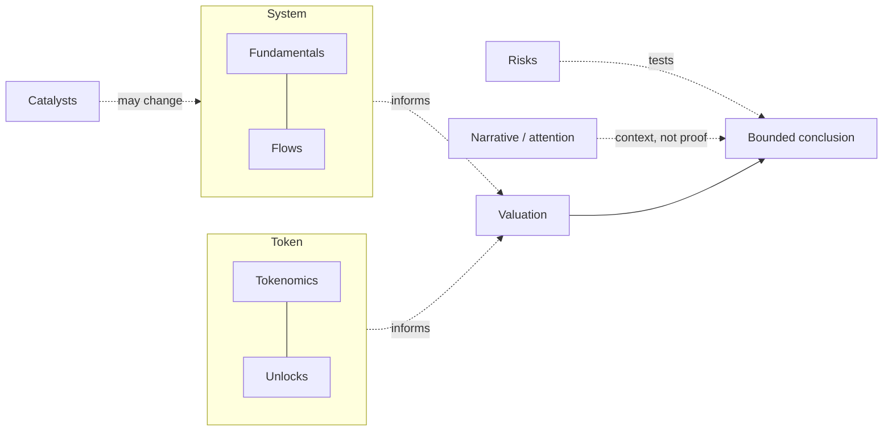
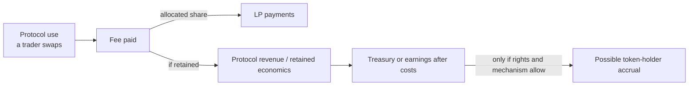
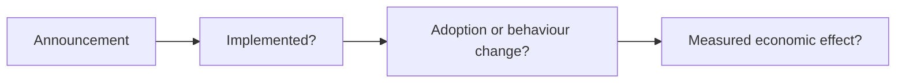

<!-- Original synthetic data, not live valuations or recommendations.
No reviewer solution is published here. Existing route retained. -->

# Week 6 · Part 4 — Token, liquidity and valuation evidence

> **Core question — what makes a valuation comparison meaningful, and what could explain an apparent discount?**

A low multiple can reflect overlooked economics, weak value capture, low float,
fragile liquidity or a bad comparison. Use W5.5 and W6 Parts 2–3 to test what
it means before making a claim.

**Market capitalisation (market cap)** is a token's quoted price multiplied
by a provider's reported circulating supply. It is an estimate of market
value, not cash held by the protocol.

## The hard skill

**Choose a defensible valuation denominator and interpret relative value
alongside token structure, executable liquidity and competing explanations.**

This is economic research methodology. No trade, wallet connection, price
target, portfolio decision or real-money activity is required.

W5P3 introduced DEX and automated market maker (AMM) mechanics; use that
distinction when deciding what a volume, fee or liquidity number represents.

## Core / reference material

### Framework map: eight lenses, selected by the question

| Lens | What you are asking | Useful evidence | Common mistake |
|---|---|---|---|
| **Fundamentals** | What does it do, who uses it, what activity is charged for, and who receives the fees? | Protocol docs, activity, fees and retained revenue under stated definitions | Treating usage or total value locked (TVL)—assets a provider counts as deposited—as revenue |
| **Flows** | What capital, tokens or liquidity entered or left, and where did it go? | Dated bridge flows, issuance/redemption, treasury or exchange movements and liquidity changes | Treating a transfer or unlock as organic demand or a sale |
| **Valuation** | Does the chosen value measure match the economic denominator and period? | Comparable market value, supply basis, fee/revenue definitions and time window | Dividing by TVL or volume as if either were retained earnings |
| **Tokenomics** | How are supply, utility, security, governance and holder rights connected? | Token contracts, protocol terms, fee destinations and enforceable rights | Assuming governance power creates a claim on cash flow |
| **Unlocks** | Who receives newly transferable tokens, when, and relative to float and liquidity? An unlock is the end of a transfer restriction, not proof of a sale. | Dated vesting schedule, recipient, circulating-supply method and market depth | Treating every unlocked token as immediately sold or fully liquid |
| **Catalysts** | What observable change could alter use, cost, value capture or risk? | A defined before/after measure and a dated launch or parameter change | Treating an announcement as evidence that the change worked |
| **Risks** | Which failure could break the thesis, who is exposed, and what signal would show it? | Dependency, permissions, liquidity, oracle and incident evidence | Listing generic risks without a causal path or exposed party |
| **Narrative** | What story attracts attention, and what evidence supports it? | Dated communications, attention measures and independently checked outcomes | Treating attention or a compelling story as economic proof |

The first seven lenses focus mainly on observable system and economic evidence;
**Narrative** asks how market participants interpret it and where attention is
focused. None is perfectly objective: definitions, coverage and interpretation
still require judgment. Not every question needs all eight.

### How the lenses relate

The groups below help organise a question; they are not a mandatory order or a
checklist. Select the lenses that can actually inform the case.

**Academy schematic — a way to organise the lenses, not a fixed research
sequence.** The conclusion should connect relevant evidence and state what
remains unknown.

### 1. Fundamentals — what economic system exists underneath the token?

Before asking whether a token is cheap or expensive, ask whether an economic
system worth valuing exists: what it does, who uses it and what useful activity
results.

For a decentralised exchange (DEX), start with a trade: a trader swaps, pays a
fee, and the protocol's rules allocate that fee. Some may go to liquidity
providers (LPs); some protocol designs may retain a portion. Retained
economics may enter a treasury or support other costs, and only a separate,
credible mechanism might connect them to token holders.

**Academy schematic — a simplified economic path, not a protocol's actual
fee-allocation architecture.** The important distinction is:

**Usage ≠ fees ≠ protocol revenue ≠ earnings ≠ token-holder value accrual.**

| Ask | Evidence to check | Boundary |
|---|---|---|
| What problem is solved, and who uses it? | Official mechanism docs and independently measured activity | Transaction count alone does not show useful activity. |
| What does a user pay, and who receives it? | Fee rules and destinations | Fees paid to LPs or suppliers are not automatically retained by the protocol. |
| What remains after payments and costs? | Defined retained revenue, treasury and distribution rules | TVL is deposited assets under a provider's method, not revenue. |
| Is growth economically meaningful? | Activity definitions and incentive context | Subsidised activity may not persist when incentives change. |

Use [W5P5](../week-5/part-5-token-and-incentive-economics.md) for the full
fee-flow and value-accrual model; here, test whether that chain exists in the
case rather than repeating it.

### 2. Flows — where is capital actually moving?

Fundamentals describe the economic machine; **flows describe where capital,
tokens or liquidity moved during a stated period**. W6P2 traces individual
records; this lens asks what a set of records means at system level.

| Ecosystem / market flows | Protocol / token flows |
|---|---|
| Stablecoin issuance or redemption | Deposits and withdrawals |
| Bridge flows and cross-chain liquidity migration | LP movement and staking / unstaking |
| Institutional or treasury accumulation | Treasury transfers and token issuance / redemption |
| Exchange-traded product flows, where relevant | Exchange deposits and bridge movement |

These are possible questions, not a checklist. Verify asset, chain, direction,
period, labels and coverage before interpreting totals: **bridge inflow ≠
revenue; transfer ≠ organic demand; exchange deposit ≠ confirmed sale; unlock
≠ sale.**

### 3. Valuation — what economic quantity is the market value compared with?

Valuation asks: **how much market value is assigned per unit of a chosen
economic quantity?**

$$
\text{Multiple} =
\frac{\text{Valuation}}{\text{Chosen Economic Denominator}}
$$

The numerator is what is being valued; the denominator is the quantity used
for comparison. For example, **USD 100 million market cap ÷ USD 10 million
comparable annual retained revenue = 10×**: ten units of value per unit of
annual retained revenue. Match currency, period, scope and definitions. This
is a comparison, not a return forecast.

| Comparison | Question it can help ask | Why it is not interchangeable |
|---|---|---|
| Market cap / revenue | How does the currently reported circulating-token value compare with a defined revenue measure? | Supply basis is current reported circulation; “revenue” still needs a recipient and cost definition. |
| FDV / revenue | How does a broader specified supply basis compare with that revenue measure at today's marginal price? | FDV convention varies; it does not mean all tokens will circulate at today's price. |
| Market cap / TVL | How does token market value compare with assets a provider counts as deposited? | TVL is not revenue, earnings or executable liquidity. |

Market cap commonly uses reported circulating supply; fully diluted valuation
(FDV) uses a stated broader supply basis. A simplified relationship is:

$$
\text{Market Cap} = P\times S_{\text{circ}}
\qquad\qquad
\text{FDV} = P\times S_{\text{max}}
$$

Here $P$ is price per token; $S_{\text{circ}}$ is reported circulating
supply; and $S_{\text{max}}$ is maximum supply. The products are in the chosen
currency. State the provider's FDV convention: using today's marginal price
for all maximum supply does not mean all tokens could be sold at that price.
Market cap and FDV answer different supply questions; neither is universally
right.

**Estimated real float** is an analyst's assumption about supply plausibly
tradable soon, not a universal standard; state adjustments and avoid
double-subtraction. Top-holder **addresses** may represent exchanges, bridges,
LPs or many users, so do not assume one address is one person (W6P2).

Executable liquidity asks what a stated-size trade could get now; quote size,
direction, venue, fees and time matter. Daily volume is turnover, not depth.
[W5P3](../week-5/part-3-mechanism-and-market-design.md) teaches the AMM
calculation; here we interpret quotes.

A **premium** is a higher multiple than a valid comparison set; a **discount**
is a lower one. **Premium ≠ automatically expensive; discount ≠ automatically
cheap.** Growth, competitive position, value capture, treasury, liquidity,
incentives, rights, risk and expectations may explain a difference. If
mechanisms or definitions are not comparable, correct arithmetic can still
support a weak conclusion.

| Economic denominator | What it measures | Main boundary |
|---|---|---|
| TVL | Deposited assets under a consistent method | Not revenue; price effects or double-counting can inflate it |
| Fees | User charges under a stated definition | Some or most may go to LPs / suppliers |
| Retained revenue | Economics left or distributed after supplier payments | State recipient and provider convention |
| Earnings / holder accrual | Net economics after costs or actual holder distributions | Not interchangeable; costs and rights may be omitted or change |
| Economic volume | Activity for comparable business models | Incentivised or wash-like flow can inflate it |

Compare like mechanisms, fee recipients, token rights, periods and
definitions. A rollup's transaction fees and a DEX's trading volume are not the
same revenue measure; trailing-12-month and annualised-last-month figures are
not interchangeable without explaining the time basis.

### 4. Tokenomics — if the protocol succeeds, why should the token benefit?

This lens tests the connection between protocol outcomes and the token. A
protocol can become more useful without its token benefiting unless a
credible mechanism links the two.

| Supply / availability | Demand / rights |
|---|---|
| Emissions, minting and burns | Required gas or protocol access |
| Unlocks and circulating supply | Staking / security and collateral |
| Staking or locking; treasury inventory | Fee discounts and enforceable distributions |
| Provider classifications and their date | Governance and other documented rights |

Governance can matter, but it does not automatically create a cash-flow claim
or continuous demand. Check token and governing documents, then connect to
W5P5: **protocol success ≠ token success unless a credible mechanism links
them.**

### 5. Unlocks — what new transferable supply is becoming available?

An **unlock** removes a transfer restriction; it is not evidence of a sale or
intent. Check four things:

| Question | What to compare |
|---|---|
| **How much?** | Reported circulation, estimated float, executable liquidity and relevant turnover; these differ. |
| **Who?** | Team, early investors, treasury, ecosystem or users; category alone does not reveal intent. |
| **When?** | A cliff releases at a point; linear vesting releases over time. Check the dated schedule. |
| **Absorbable?** | Liquidity, turnover, holder concentration and recipient behaviour; historical volume does not guarantee execution. |

There is no universal “large unlock” threshold. Any heuristic depends on the
token's float and market structure. Treat an unlock as a supply event to
investigate, not proof of selling pressure.

### 6. Catalysts — what observable change could materially alter the thesis?

A **catalyst is not simply news**: it is an observable change that could alter
usage, costs, value capture, supply/demand, competition or risk. A product
launch, fee-policy change, integration or governance decision matters only if
it changes implementation or behaviour.

Check each link against a baseline and plausible alternatives. An announcement
without changed behaviour is not demonstrated economic impact; a catalyst may
strengthen, weaken or leave a thesis unchanged. It is not an instruction to buy.

### 7. Risks — what could make the thesis wrong?

A useful risk is more than “smart-contract risk” or “regulation”. Trace:

**Trigger → mechanism → exposed party → economic or thesis impact →
observable evidence.**

For example: an oracle stops updating → collateral may be mispriced → borrowers,
liquidators or suppliers may be exposed. Check update freshness, market depth,
position health and pause/fallback rules. This is a scenario, not a forecast.
W6P5 teaches the full dependency and stress-test method. Here, identify
evidence that would make you reduce confidence in the valuation or value-
accrual thesis.

### 8. Narrative — why is the market paying attention to this now?

A **narrative** is the story market participants use to interpret or focus
attention on a protocol, token or sector (for example, stablecoins, RWA,
AI agents or DePIN). Attention may bring discussion or capital interest and
coincide with demand or valuation, but does not itself change protocol
economics or prove value accrual.

| Fundamentals | Attention | What it can mean |
|---|---|---|
| Weak | Strong | The story may be running ahead of the economics. |
| Improving | Weak | Economics may improve before the market notices. |

Ask what claim is repeated, who makes it and what independent evidence
supports or contradicts it. Attention measures are imperfect; narrative is
context, not economic proof. This is not a trading-entry or exit method.

### Use the lenses together

Relate relevant evidence to one question, state what remains unknown and
identify what could disprove your explanation. No single metric or story
should dominate the conclusion.

### Worked example: eight lenses on fictional AMM Alder

This fictional case is illustrative, not live data or a recommendation.

| Lens | Alder observation | What it means / question remaining |
|---|---|---|
| Fundamentals | USD 20m fees; USD 12m retained under the case definition | Verify definitions and omitted costs. |
| Flows | No dated flow series supplied | Direction is unknown; obtain a scoped series. |
| Valuation | USD 120m cap ÷ USD 12m retained revenue = 10×; Birch = 15× on the same measure | Below this reference, not automatically cheap; test comparability and rights. |
| Tokenomics | No direct holder distribution stated | Verify enforceable rights and other demand mechanisms. |
| Unlocks | 15% of reported circulation unlocks in three months; recipients unknown | Check schedule, float assumptions and market depth. |
| Catalysts | New chain integration announced | Verify deployment, adoption and post-launch economics. |
| Risks | USD 100,000 sale quote is shallow; holder-accrual link unclear | Check executable depth and token rights. |
| Narrative | “AI-powered” attention reported | Attention is not evidence of better use, revenue or accrual. |

**Now combine the lenses.** Alder has stated retained economics but no evidence
that holders receive them. Its 10× multiple is below Birch's reference, but
rights, comparability, the unlock and shallow liquidity remain unresolved; the
integration is not yet a demonstrated economic change. A bounded next check is
to verify token rights and unlock recipients, then compare post-launch retained
economics and executable depth with a dated baseline. Use the lenses to build
one explanation and identify what could disprove it—not to collect eight facts.

## Hands-on task

Use this **synthetic snapshot dated 26 October 2026**. All three fictional
protocols are comparable spot AMMs on Case-L1, with the same trailing-year
definitions and no cross-listed revenue. Values are USD millions unless stated.

| Protocol | Market cap | FDV | TVL | User fees | Retained revenue after LP payments |
|---|---:|---:|---:|---:|---:|
| ORBIT | 410 | 1,000 | 600 | 60 | 12 |
| LANE | 300 | 400 | 450 | 40 | 10 |
| MESH | 240 | 480 | 500 | 50 | 8 |

ORBIT's token is USD 0.50: 820m circulating / 2,000m maximum tokens.
Within reported circulation, 220m strategic tokens and a separate 100m in
delayed withdrawals are assumed unavailable soon. Five addresses hold 200m
of the remainder; common control is unverified. The next 100m unlock is
assumed fully tradable. ORBIT has no direct holder distribution; holders vote
on treasury spending. Comparable rights for LANE/MESH are **unknown**.

A fictional quote snapshot for selling USD 100,000 worth at the marginal
price returns USD 91,000 for ORBIT, USD 98,000 for LANE and USD 97,000 for
MESH, net of fees.
These quotes are not live execution guarantees.

Produce **one calculation/interpretation table**:

1. Choose and defend a denominator from the table. Compute market-cap multiples
   for all three and their mean/median. Identify one apparent premium/discount.
   State whether FDV would change that comparison and why.
2. Estimate ORBIT's real float now and after the unlock, and the five addresses'
   current share of that estimate. Label assumptions; do not call them five people.
3. Give **two explanations** for the apparent valuation difference and the
   evidence needed to discriminate. Connect token rights, unlock/liquidity or
   activity quality to at least one explanation.
4. In **up to 100 words**, state the bounded conclusion, one potential
   fundamental catalyst, a plausible narrative-only explanation, and evidence
   that would invalidate your conclusion. An unknown rights comparison can
   justify withholding a value judgment.

**Out of scope:** price targets, position sizing, trade recommendations,
repeating constant-product maths or pretending these are real protocols.

## Evidence required

- One table containing calculations, assumptions and competing explanations.
- The short conclusion with a next evidence check; no separate investment report.

## Completion and revision

This Part is worth **100 points**. Completed / approved earns full points;
incomplete or materially incorrect work is returned for revision. There is no
partial-score rubric or separate weekly submission.

Complete means a justified denominator, reproducible relative calculations,
labelled float/concentration assumptions, two explanations with discriminating
evidence, and a conclusion that respects unknown rights and liquidity.
A premium is not automatically expensive; a discount is not automatically an opportunity.

::: details Further Exploration — optional, not assessed
Compare a real protocol's fee and revenue definitions across its docs and a
data provider. Date your observations and explain differences before comparing
multiples. A quote may be inspected read-only; do not connect or trade.
:::

::: details Sources and attribution
- [CoinGecko — Supply methodology](https://support.coingecko.com/articles/6758974979-coingecko-supply-methodology) and [FDV](https://www.coingecko.com/learn/what-is-fully-diluted-valuation-fdv-in-crypto) — Link, data-provider definitions
- [DefiLlama — Data definitions](https://docs.llama.fi/analysts/data-definitions) — Link, independent provider methodology; checked 26 October 2026
- [Uniswap — Price impact](https://support.uniswap.org/hc/en-us/articles/8671539602317-What-is-price-impact) — Link, protocol/tool reference
- [Etherscan — Token pages](https://info.etherscan.com/understanding-token-page/) — Link, explorer evidence and labels
- [Arkham — Token pages](https://codex.arkm.com/the-intelligence-platform/token-pages) — Link, commercial intelligence provider; optional reference, not required access
- Peer table, quote snapshot and comparison method — original Academy teaching example
:::
