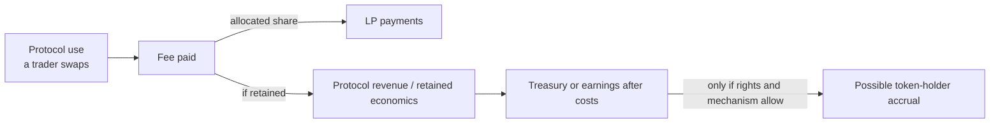
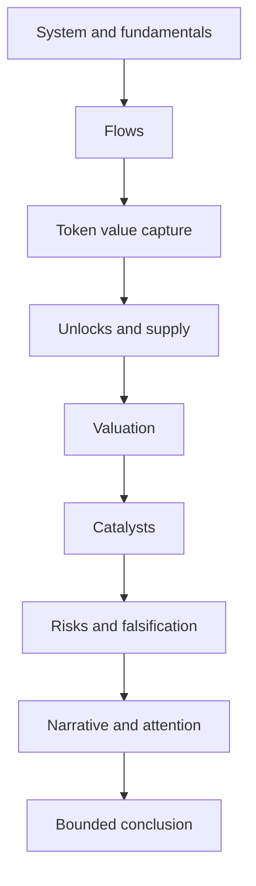

<!-- Original synthetic data, not live valuations or recommendations.
No reviewer solution is published here. Existing route retained. -->

# Week 6 · Part 4 — Token, liquidity and valuation evidence

> **Core question — what makes a valuation comparison meaningful, and what could explain an apparent discount?**

A low multiple can mean overlooked economics, weak value capture, low float,
fragile liquidity or simply an invalid comparison. Use the supply model from
W5.5, the investigation discipline from Part 2 and measurement discipline from
Part 3 to decide what a number means before making a claim.

**Market capitalisation (market cap)** is a token's quoted price multiplied
by a provider's reported circulating supply. It is an estimate of market
value, not cash held by the protocol.

## The hard skill

**Choose a defensible valuation denominator and interpret relative value
alongside token structure, executable liquidity and competing explanations.**

This is economic research methodology. No trade, wallet connection, price
target, portfolio decision or real-money activity is required.

A **decentralised exchange (DEX)** lets users trade through protocol
mechanisms rather than a conventional order-matching company. An **automated
market maker (AMM)** is one DEX design; **liquidity providers (LPs)** supply
assets to its pools. The exact mechanism matters when deciding what a volume,
fee or liquidity number represents.

## Core / reference material

### Framework map: eight lenses, selected by the question

| Lens | What you are asking | Useful evidence | Common mistake |
|---|---|---|---|
| **Fundamentals** | What does it do, who uses it, what activity is charged for, and who receives the fees? | Protocol docs, activity, fees and retained revenue under stated definitions | Treating usage or total value locked (TVL)—assets a provider counts as deposited—as revenue |
| **Flows** | What capital, tokens or liquidity entered or left, and where did it go? | Dated bridge flows, issuance/redemption, treasury or exchange movements and liquidity changes | Treating a transfer or unlock as organic demand or a sale |
| **Valuation** | Does the chosen value measure match the economic denominator and period? | Comparable market value, supply basis, fee/revenue definitions and time window | Dividing by TVL or volume as if either were retained earnings |
| **Tokenomics** | How are supply, utility, security, governance and holder rights connected? | Token contracts, protocol terms, fee destinations and enforceable rights | Assuming governance power creates a claim on cash flow |
| **Unlocks** | Who receives newly transferable tokens, when, and relative to float and liquidity? An unlock is the end of a transfer restriction, not proof of a sale. | Dated vesting schedule, recipient, circulating-supply method and market depth | Treating every unlocked token as immediately sold or fully liquid |
| **Catalysts** | What observable change could alter use, cost, value capture or risk? | A defined before/after measure and a dated launch or parameter change | Treating an announcement as evidence that the change worked |
| **Risks** | Which failure could break the thesis, who is exposed, and what signal would show it? | Dependency, permissions, liquidity, oracle and incident evidence | Listing generic risks without a causal path or exposed party |
| **Narrative** | What story attracts attention, and what evidence supports it? | Dated communications, attention measures and independently checked outcomes | Treating attention or a compelling story as economic proof |

The first seven lenses focus mainly on observable system and economic
evidence. **Narrative** asks how market participants interpret that evidence
and where their attention is focused. This is a useful distinction, not a
claim that the first seven are perfectly objective: definitions, coverage and
interpretation still require judgment.

Not every question needs all eight. They are lenses, not a checklist or score.
The overview is a map; the sections below teach how to use each lens.

### 1. Fundamentals — what economic system exists underneath the token?

Before asking whether a token is cheap or expensive, ask whether there is an
economic system worth valuing. Fundamentals describe the mechanism that
creates useful activity and what happens economically when people use it.

For a decentralised exchange (DEX), start with a trade: a trader swaps, pays a
fee, and the protocol's rules allocate that fee. Some may go to liquidity
providers (LPs); some protocol designs may retain a portion. Retained
economics may enter a treasury or support other costs, and only a separate,
credible mechanism might connect them to token holders.

**Academy schematic — a simplified economic path, not a protocol's actual
fee-allocation architecture.** The important distinction is:

**Usage ≠ fees ≠ protocol revenue ≠ earnings ≠ token-holder value accrual.**

Ask: What problem does the protocol solve? Who uses it, and why? Which
activity is economically meaningful? What does the user pay, who receives
those payments, and what costs sit between fees and retained economics? Does
growth create something economically valuable?

Useful evidence includes official mechanism and fee documentation, measured
activity with a defined method, fee destinations, revenue-recipient rules,
treasury/distribution rules and independently measured usage. A dashboard
metric needs its own definition. **Total value locked (TVL)** is a provider's
measure of assets deposited in a protocol; it is not revenue. Transaction
count does not show whether activity is useful, and subsidised activity may
not persist when incentives change. W5P5 introduced the distinction between
protocol economics and token value capture; use it here rather than assuming
that protocol success automatically benefits the token.

### 2. Flows — where is capital actually moving?

Fundamentals describe the economic machine; **flows describe movement through
it over a stated period**. A flow can involve capital, tokens, liquidity or
claims, at either market/ecosystem level or protocol/token level.

At market or ecosystem level, a researcher might examine stablecoin
issuance/redemption, bridge inflows and outflows, exchange-traded product
flows where relevant, institutional or treasury accumulation, or liquidity
migration between chains. At protocol or token level, examples include
deposits and withdrawals, issuance/redemption, treasury transfers, exchange
deposits, LP inflows/outflows, staking/unstaking and bridge movement. These
are possible questions, not a requirement to measure every category.

W6P2 taught you to trace individual records. This lens asks what a collection
of such records means economically: Did liquidity move into the system or
between its components? Was supply issued or redeemed? Is the observed change
large relative to the relevant base and time window?

Flows establish movement only within the records and labels you can verify.
A bridge inflow is not protocol revenue; a token transfer is not necessarily
organic demand; an exchange deposit does not prove a sale; an unlock proves
that transfer restrictions changed, not that a recipient sold. Check the
asset, chain, direction, period, counterparty labels and missing coverage
before interpreting a total.

### 3. Valuation — what economic quantity is the market value compared with?

Valuation asks: **how much market value is assigned per unit of a relevant
economic quantity?** A multiple makes that comparison explicit:

$$
\text{Multiple} =
\frac{\text{Valuation}}{\text{Chosen Economic Denominator}}
$$

The numerator is what is being valued; the denominator is the economic
quantity chosen for comparison. For example, a market cap of **USD 100
million** divided by **USD 10 million of comparable annual retained revenue**
gives **10×**: ten units of market value per unit of annual retained revenue. The
currency, time period, scope and definitions must match. This is a comparison,
not a forecast of returns.

| Comparison | Question it can help ask | Why it is not interchangeable |
|---|---|---|
| Market cap / revenue | How does the currently reported circulating-token value compare with a defined revenue measure? | Supply basis is current reported circulation; “revenue” still needs a recipient and cost definition. |
| FDV / revenue | How does a broader specified supply basis compare with that revenue measure at today's marginal price? | FDV convention varies; it does not mean all tokens will circulate at today's price. |
| Market cap / TVL | How does token market value compare with assets a provider counts as deposited? | TVL is not revenue, earnings or executable liquidity. |

Market cap is commonly calculated as price multiplied by reported circulating
supply; FDV uses a specified broader supply basis. A simplified relationship
is:

$$
\text{Market Cap} = P\times S_{\text{circ}}
\qquad\qquad
\text{FDV} = P\times S_{\text{max}}
$$

$P$ is the token price in a chosen currency per token; $S_{\text{circ}}$ is
reported circulating supply and $S_{\text{max}}$ is maximum supply, both in
token units. The products are in the chosen currency. For this lesson, use
maximum supply when the source defines FDV that way and state any different
provider convention. FDV uses today's marginal price as a comparison basis;
it does not mean all tokens could be sold at that price. Market cap and FDV
answer different supply questions; neither is universally the right measure.
Fees, retained revenue, earnings, TVL and economic volume also answer
different questions. Choose the denominator that fits the mechanism and
explain what it leaves out.

**Estimated real float** is an analyst's assumption about supply plausibly
tradable soon after specified adjustments, not a universal standard. Avoid
double-subtracting allocations. Top-holder **addresses** can represent
exchanges, bridges, LPs or many users; independence must be justified, not
assumed. Use W6P2's hypothesis standard.

Executable liquidity asks what a stated-size trade could get now: quote size,
direction, venue, fees and time matter. Daily volume is turnover, not depth.
[W5P3](../week-5/part-3-mechanism-and-market-design.md) teaches the AMM
calculation; here we interpret quotes rather than repeat its algebra.

A **premium** means a higher valuation per unit of a chosen denominator than
a valid comparison set. A **discount** means a lower one. These are relative
descriptions: a premium is not automatically expensive, and a discount is
not automatically cheap. Multiples may differ because of expected growth,
competitive position, value capture, treasury, executable liquidity,
incentives, token rights, risk or market expectations. If the comparison set
does not have comparable mechanisms or definitions, the arithmetic may be
correct while the conclusion is not.

| Candidate denominator | What it can help compare | Main boundary |
|---|---|---|
| Total value locked (TVL) | Deposited capital under a consistent methodology | Not revenue; price effects and double-counting can inflate it |
| Fees | User charges under a stated definition | Much may go to suppliers/LPs |
| Revenue | Retained/distributed economics after supplier payments | Define recipient and provider convention |
| Earnings / holder accrual | Net economics after specified costs, or actual holder distributions | Not interchangeable; governance can change rights and costs may be omitted |
| Economic volume / sector metric | Useful activity for comparable business models | Incentivised or wash-like flow can inflate activity |

Use comparable mechanisms, fee recipients, token rights, dates and
definitions. Do not compare a rollup's transaction fees with a DEX's trading
volume as if they were the same revenue. Trailing 12 months and annualised
last month can tell different stories; label extrapolation and avoid
seasonal distortion.

### 4. Tokenomics — if the protocol succeeds, why should the token benefit?

This lens tests the connection between protocol outcomes and the token. A
protocol can become more useful without its token becoming more valuable if
there is no credible mechanism linking the two. **Protocol success ≠ token
success unless a mechanism connects them.**

On the **supply side**, ask how emissions, unlocks, burns, minting, staking or
locking, treasury inventory and circulating/non-circulating classifications
change the amount or availability of tokens. Providers may classify supply
differently, so state whose method and date you use.

On the **demand and rights side**, check whether the token is needed for gas
or protocol access, used in staking/security or collateral, provides a fee
discount, or carries enforceable revenue/distribution rights or governance
rights. Governance may be economically meaningful in some systems, but it
does not automatically create a cash-flow claim or continuous token demand.
Read the token contract and governing documents; a name or marketing phrase
does not establish rights. Connect this lens to W5P5's fee-flow analysis:
first find retained economics, then verify whether and how the token can
benefit.

### 5. Unlocks — what new transferable supply is becoming available?

An **unlock** changes the ability to transfer tokens under a restriction. It
does not establish a sale or the recipient's intention. Ask four questions:

1. **How much?** Compare the amount with reported circulating supply,
   explicitly estimated float, executable liquidity and relevant market
   turnover. These denominators are not interchangeable.
2. **Who receives it?** It may go to a team, early investors, treasury,
   ecosystem incentives or users. Do not infer a selling plan from a category.
3. **When does it become transferable?** Distinguish a one-time cliff from
   linear vesting, which releases tokens over time. Check the schedule and
   date rather than relying on a rounded calendar summary.
4. **Can the market absorb it?** Consider liquidity, turnover, holder
   concentration and evidence about recipient behaviour. A displayed pool
   size or historical volume is not a guarantee of execution at a given size.

There is no universal “large unlock” percentage. Any threshold is a
context-dependent heuristic that needs validation against the token's float,
liquidity and market structure. An unlock is a supply event to investigate,
not proof of selling pressure.

### 6. Catalysts — what observable change could materially alter the thesis?

A **catalyst** is not simply news. It is a change that could affect usage,
revenue, cost, market structure, value capture, token supply/demand,
competitive position or risk. Possible examples include a product launch, a
new chain deployment, a fee-policy or governance-parameter change, a major
integration, a regulatory event or a tokenomics change.

Test the evidence chain:

**Announcement → implementation → adoption or behaviour change → measurable
economic effect.**

Each arrow is a question. Was the feature actually deployed? Did the intended
users adopt it? Did measurable activity or economics change, relative to a
baseline and plausible alternatives? An announced partnership with no
resulting behaviour change is not demonstrated fundamental impact. A
catalyst can strengthen, weaken or leave a thesis unchanged; it is not an
instruction to buy.

### 7. Risks — what could make the thesis wrong?

A useful risk is more than a label such as “smart-contract risk”,
“regulation” or “competition”. Trace a conditional path:

**Trigger → mechanism → exposed party → economic or thesis impact →
observable evidence.**

For example, if a critical oracle stops updating, a lending market may value
collateral incorrectly; borrowers, liquidators, suppliers or the protocol
could be affected in different ways depending on the design. Evidence might
include update freshness, market depth, position health factors and the
protocol's pause or fallback rules. The path is a scenario, not a forecast.

W6P5 develops this into a dependency and stress-test method. Here, ask what
could invalidate the valuation or value-accrual explanation. **The best risk
statement names evidence that would make you reduce confidence in the
thesis.**

### 8. Narrative — why is the market paying attention to this now?

A **narrative** is the story through which market participants currently
interpret or focus attention on a protocol, token or sector. Stablecoins,
real-world assets (RWA), AI agents, privacy, decentralised physical
infrastructure networks (DePIN) and restaking are examples of themes that
may attract attention at different times; their use here does not imply any
particular investment view.

Attention can lead to more discussion, research or capital interest and may
coincide with higher demand or valuation. But narrative does not by itself
change protocol economics or prove token value capture. **Strong narrative,
weak fundamentals:** attention can grow while activity, retained economics or
rights remain weak. **Improving fundamentals, weak narrative:** a system may
improve economically before the wider market pays attention.

Use narrative as context for interpretation: what claim is being repeated,
who is repeating it, and what independent evidence supports or contradicts
it? Attention measures are themselves imperfect. Narrative is not economic
proof and this framework does not teach narrative-trading entry or exit
strategies.

### How the lenses fit together

The framework is not eight independent boxes. A reasonable research path is
to identify the mechanism, find meaningful activity, trace capital, test
whether the token connects to the economics, inspect new supply, choose a
matching valuation, then examine change, failure and market attention:

**Academy schematic — one possible order, not a universal research recipe.**
Not every case needs every lens, and the order may change with the question.
The framework helps prevent one attractive metric or story from dominating
the whole analysis.

### Worked example: eight lenses on fictional AMM Alder

This compact fictional case shows how the lenses relate. Its observations are
illustrative, not live data or recommendations.

| Lens | Alder observation | What it means / question remaining |
|---|---|---|
| Fundamentals | USD 20m annual user fees; USD 8m paid to LPs; USD 12m retained under the case definition | Measurable activity and retained economics; verify how fees and retained amounts are defined and which costs are omitted. |
| Flows | No dated deposit, withdrawal, bridge or treasury-flow series is supplied | Direction of capital is unknown; obtain a scoped series before claiming liquidity is entering or leaving. |
| Valuation | USD 120m market cap ÷ USD 12m retained annual revenue = 10×; fictional Birch is 15× on the same stated measure | Alder is one-third below that reference multiple, not automatically cheap; check mechanism, rights, dates and comparability. |
| Tokenomics | No direct holder distribution is stated | Retained protocol economics may not accrue to the token; inspect enforceable rights and any other demand mechanism. |
| Unlocks | A 15% circulating-supply unlock is due in three months; recipients are not specified | Newly transferable supply may matter; verify recipients, schedule, float assumptions and market depth. |
| Catalysts | A new chain integration is announced | It is a hypothesis to test; check deployment, adoption and post-launch economics rather than the announcement alone. |
| Risks | A USD 100,000 sale quote is shallow, and the link from retained economics to holders is unclear | Liquidity and value capture could weaken the valuation interpretation; test quote depth and token rights. |
| Narrative | “AI-powered” attention is reported | Attention exists in the case, but is not evidence of improved use, revenue or holder accrual. |

**Now combine the lenses.** Alder has measurable fees and retained economics
under the stated definitions, but no supplied evidence shows that holders
receive them. Its 10× multiple is below Birch's 15× reference, while
comparability, holder rights, an upcoming unlock and shallow quoted liquidity
remain material unknowns. The integration is not yet a demonstrated
fundamental change. A bounded next check is to verify unlock recipients and
token rights, then compare post-launch retained economics and executable
quote depth with a dated baseline. The framework is not “collect eight
facts”; it is “build one explanation and identify what could disprove it.”

## Hands-on task

Use this **synthetic snapshot dated 26 October 2026**. All three fictional
protocols are comparable spot AMMs on Case-L1, with the same trailing-year
definitions and no cross-listed revenue. Values are USD millions unless stated.

| Protocol | Market cap | FDV | TVL | User fees | Retained revenue after LP payments |
|---|---:|---:|---:|---:|---:|
| ORBIT | 410 | 1,000 | 600 | 60 | 12 |
| LANE | 300 | 400 | 450 | 40 | 10 |
| MESH | 240 | 480 | 500 | 50 | 8 |

ORBIT's token is USD 0.50: 820m circulating / 2,000m maximum tokens.
Within reported circulation, 220m strategic tokens and a separate 100m in
delayed withdrawals are assumed unavailable soon. Five addresses hold 200m
of the remainder; common control is unverified. The next 100m unlock is
assumed fully tradable. ORBIT has no direct holder distribution; holders vote
on treasury spending. Comparable rights for LANE/MESH are **unknown**.

A fictional quote snapshot for selling USD 100,000 worth at the marginal
price returns USD 91,000 for ORBIT, USD 98,000 for LANE and USD 97,000 for
MESH, net of fees.
These quotes are not live execution guarantees.

Produce **one calculation/interpretation table**:

1. Choose and defend a denominator from the table. Compute market-cap multiples
   for all three and their mean/median. Identify one apparent premium/discount.
   State whether FDV would change that comparison and why.
2. Estimate ORBIT's real float now and after the unlock, and the five addresses'
   current share of that estimate. Label assumptions; do not call them five people.
3. Give **two explanations** for the apparent valuation difference and the
   evidence needed to discriminate. Connect token rights, unlock/liquidity or
   activity quality to at least one explanation.
4. In **up to 100 words**, state the bounded conclusion, one potential
   fundamental catalyst, a plausible narrative-only explanation, and evidence
   that would invalidate your conclusion. An unknown rights comparison can
   justify withholding a value judgment.

**Out of scope:** price targets, position sizing, trade recommendations,
repeating constant-product maths or pretending these are real protocols.

## Evidence required

- One table containing calculations, assumptions and competing explanations.
- The short conclusion with a next evidence check; no separate investment report.

## Completion and revision

This Part is worth **100 points**. Completed / approved earns full points;
incomplete or materially incorrect work is returned for revision. There is no
partial-score rubric or separate weekly submission.

Complete means a justified denominator, reproducible relative calculations,
labelled float/concentration assumptions, two explanations with discriminating
evidence, and a conclusion that respects unknown rights and liquidity.
A premium is not automatically expensive; a discount is not automatically an opportunity.

::: details Further Exploration — optional, not assessed
Compare a real protocol's fee and revenue definitions across its docs and a
data provider. Date your observations and explain differences before comparing
multiples. A quote may be inspected read-only; do not connect or trade.
:::

::: details Sources and attribution
- [CoinGecko — Supply methodology](https://support.coingecko.com/articles/6758974979-coingecko-supply-methodology) and [FDV](https://www.coingecko.com/learn/what-is-fully-diluted-valuation-fdv-in-crypto) — Link, data-provider definitions
- [DefiLlama — Data definitions](https://docs.llama.fi/analysts/data-definitions) — Link, independent provider methodology; checked 26 October 2026
- [Uniswap — Price impact](https://support.uniswap.org/hc/en-us/articles/8671539602317-What-is-price-impact) — Link, protocol/tool reference
- [Etherscan — Token pages](https://info.etherscan.com/understanding-token-page/) — Link, explorer evidence and labels
- [Arkham — Token pages](https://codex.arkm.com/the-intelligence-platform/token-pages) — Link, commercial intelligence provider; optional reference, not required access
- Peer table, quote snapshot and comparison method — original Academy teaching example
:::
