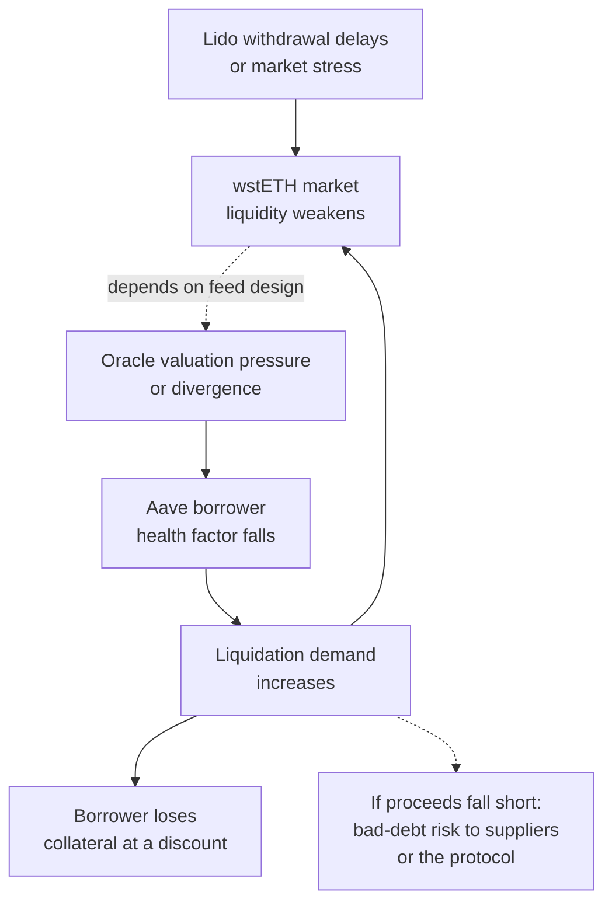

<!--
Author note (Education team): the stress-test inputs are hypothetical, not
live Aave parameters; the arithmetic was rechecked on 21 October 2026. The
model answer and reviewer notes are kept outside the public handbook.
-->

# Week 6 · Part 5 — Dependency, governance and risk

> **Core question — if one dependency fails, how does the damage reach real users?**

In Week 5 Part 6 you identified protocol risks. Now go one level deeper: build a
**causal risk model**. Rather than writing “oracle risk” or “liquidation risk”
as labels, follow a shock through the protocol's dependencies until you can
name *who loses*, *what would be observable* and *where the chain might stop*.

Why it matters: a protocol may function as designed and still transmit losses
from another protocol, a market or an oracle. A risk model shows the path,
not just the list.

::: tip Picture a power grid
A problem at one transformer can cut power to several buildings. The useful
map includes both the wires and the circuit breakers.

Where the picture stops: DeFi stress is adversarial. Arbitrageurs, liquidators
and borrowers adapt, so a causal arrow is a **scenario**, not a certain forecast.
:::

## The hard skill

**Map a dependency chain and stress-test a lending position, separating
trigger, mechanism, exposed party, warning sign and mitigating break.**

After this Part you can:

- draw a dependency graph with at least five nodes;
- compute how an illustrative collateral shock changes an Aave health factor;
- identify first-order losses, possible contagion and the conditions that
  would interrupt it.

## Core / reference material

### Case: wstETH collateral in Aave V3 on Ethereum

Aave lending depends on prices, collateral, loan parameters, liquidators and
market liquidity. As a connection back to Week 5 Part 6, take **Lido's wstETH**, a
wrapped representation of stETH whose token balance does not rebase. Its
redemption and market value may diverge in stress. Aave's health factor uses
**oracle-valued** collateral and debt plus the applicable liquidation threshold.

For one collateral asset, simplified:

`Health factor = (collateral value × liquidation threshold) / debt value`

A position may be liquidated when the health factor drops **below 1**.
Liquidation depends on external actors submitting transactions and available
liquidity to dispose of collateral. Asset-specific risk settings can change;
check the current **Aave reserve / e-mode** configuration rather than
assuming a generic threshold applies to wstETH.

### Worked example: the first shock

**These inputs are hypothetical**, not live Aave parameters or balances:

- One borrower pledges collateral worth **$10,000** at the oracle price.
- They owe **$7,200** of a USD-denominated asset.
- Their effective liquidation threshold is **80%**, assumed only to show the math.

Initial health factor = `$10,000 × 0.80 / $7,200 = 1.111`.

Now imagine the **oracle-valued collateral** falls by **12%**, while the debt
stays $7,200: new collateral `$8,800`; new health factor
`$8,800 × 0.80 / $7,200 ≈ 0.978`.

That crosses the `1` threshold. A liquidator *may* now repay part or all of
eligible debt according to live Aave rules, receiving discounted collateral.
Whether the liquidation is profitable or the borrower becomes bad debt also
depends on gas, liquidator access, available collateral and liquidity. A
**secondary-market stETH discount by itself** does *not* prove that Aave's
oracle collateral value immediately changed by that same amount.

### Risk chain, not risk list

A plausible (not inevitable) path is:

The dotted arrow is **conditional**: a borrower being liquidated is not itself
proof that suppliers incurred a loss.

## Hands-on task

Use the Aave + Lido sources above. Produce a **one-page risk model**:

1. **Draw a dependency map** with at least five labelled nodes, including
   Lido staking/withdrawals, wstETH market liquidity, the Aave price/oracle
   dependency, Aave lending positions, and external liquidators. Label each
   link “because…” and show at least one possible **feedback loop**.
2. **Finish the stress test** for the hypothetical borrower. Calculate the
   health factor after a **5%, 10% and 12%** decline in oracle-valued
   collateral; give the approximate decline at which HF reaches 1. Show your
   working. Keep the 80% threshold visibly marked **illustrative**.
3. **Write a risk table with four rows:**
   **trigger → transmission mechanism → first exposed party → monitorable
   signal → possible breaker/mitigation**. Include one row where an oracle
   misprices assets and one where market liquidity is poor.
4. **Trace one worst-case conditional path** in 5–7 lines. Distinguish
   liquidation loss to a borrower from the additional conditions required
   for actual bad debt to affect a protocol or lenders.
5. **State two unknowns** you must verify before using the model for a real
   position (for example live Aave liquidation threshold/e-mode and oracle
   configuration, depth of executable wstETH/ETH liquidity, debt sizes).

**Out of scope:** advice on a live borrowing position, predicting a depeg,
exploit instructions, and claiming that a hypothetical cascade happened.

## Evidence required

- One labelled dependency graph, stress-test arithmetic and four-row risk table.
- One conditional failure path, two unknowns with sources needed to resolve them.
- Sources labelled **protocol-authored** or **independent/on-chain**.

## Completion and revision

This Part is worth **100 points**. Completed / approved earns the full points;
incomplete or materially incorrect work is returned with feedback for revision.
There is no partial-score rubric.

**Your work is complete when:**

- [ ] five or more dependencies and a feedback loop are shown clearly;
- [ ] all three stress health factors and the HF=1 crossing are correct;
- [ ] oracle price is not confused with a spot-market price;
- [ ] each of four risks names a first loser, observable signal and possible
      control or reason no control is assured;
- [ ] borrower liquidation is distinguished from potential protocol bad debt;
- [ ] unverified live parameters are explicitly identified.

::: details Further exploration — optional, not assessed
- Replace the hypothetical threshold and debt with a public, date-stamped
  sample position and on-chain Aave reserve configuration, then recompute.
- Research how oracle circuits, governance parameter changes or an L2's
  congestion might alter the failure path.
:::

::: details Sources and attribution
- [Aave — Health Factor & Liquidations](https://aave.com/help/borrowing/liquidations) — Link, protocol-authored
- [Aave V3 — Overview](https://www.aave.com/docs/aave-v3/overview) — Link, protocol-authored
- [Aave — Risks](https://www.aave.com/docs/resources/risks) — Link, protocol-authored
- [Aave — Reserve parameters](https://www.aave.com/docs/aave-v3/concepts/reserve) — Link, protocol-authored
- [Lido — wstETH](https://docs.lido.fi/contracts/wsteth/) — Link, protocol-authored
- [Lido — WithdrawalQueueERC721](https://docs.lido.fi/contracts/withdrawal-queue-erc721/) — Link, protocol-authored
:::
