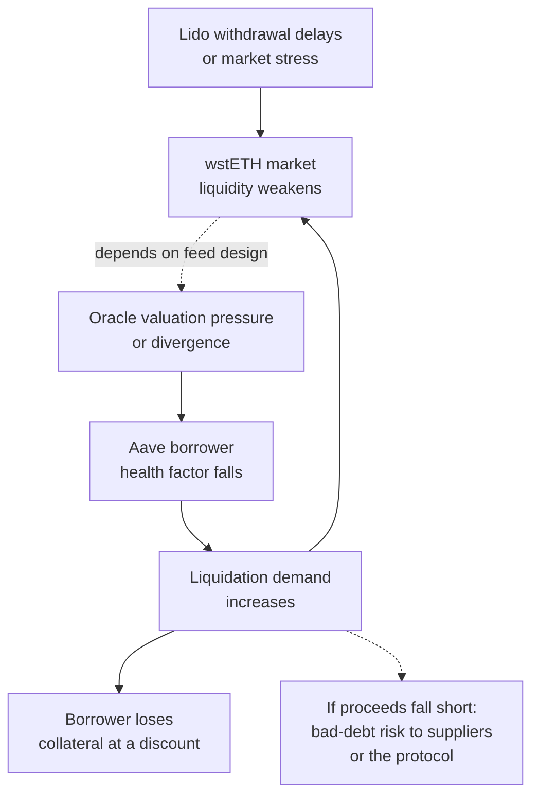

<!--
Author note (Education team): the stress-test inputs are hypothetical, not
live Aave parameters; the arithmetic was rechecked on 21 October 2026. The
model answer and reviewer notes are kept outside the public handbook.
-->

# Week 6 · Part 5 — Dependency, governance and risk

> **Core question — if one dependency fails, how does the damage reach real users?**

In Week 5 Part 6 you identified protocol risks. Now go one level deeper: build a
**causal risk model**. Rather than writing “oracle risk” or “liquidation risk”
as labels, follow a hypothetical sudden change through the protocol's
dependencies until you can name *who loses*, *what would be observable* and
*where the chain might stop*.

A **stress test** is a “what if?” exercise: change an important input by a
hypothetical amount, then recalculate what happens to the system or position.
Here, a **shock** is the hypothetical sudden change, such as a fall in
collateral price. A stress test shows what could happen under that scenario;
it does not predict that the scenario will occur.

Why it matters: a protocol may function as designed and still transmit losses
from another protocol, a market or an oracle. A risk model shows the path,
not just the list.

::: tip Picture a power grid
A problem at one transformer can cut power to several buildings. The useful
map includes both the wires and the circuit breakers.

Where the picture stops: **decentralised finance (DeFi)** stress is
adversarial. Arbitrageurs, liquidators and borrowers adapt, so a causal arrow
is a **scenario**, not a certain forecast.
:::

## The hard skill

**Map a dependency chain and stress-test a lending position, separating
trigger, mechanism, exposed party, warning sign and mitigating break.**

After this Part you can:

- draw a dependency graph with at least five nodes;
- compute how an illustrative collateral shock changes an Aave health factor;
- identify the direct (first-order) loss, possible **contagion** (pressure
  spreading through dependent positions or markets) and conditions that could
  interrupt it.

## Core / reference material

### Case: wstETH collateral in Aave V3 on Ethereum

Aave lending depends on prices, collateral, loan parameters, liquidators and
market liquidity. An **oracle** is the service or mechanism that supplies the
prices the protocol uses for valuation. As a connection back to Week 5 Part 6,
take Lido's **staked ETH (stETH)** and **wrapped staked ETH (wstETH)**: stETH
balances can update as staking rewards or penalties are reflected, while a
wstETH balance stays fixed and its conversion value in stETH changes. That
conversion rate is not a promise of the same market price or immediate
redemption; see [Lido's
token guide](https://docs.lido.fi/guides/lido-tokens-integration-guide/).

The **health factor (HF)** compares safety-adjusted collateral with debt. For
one collateral asset, the simplified model is:

$$
HF_0 = \frac{V_c\times LT}{D}
$$

$V_c$ is the current collateral value in the protocol's valuation currency,
as supplied by its oracle; $LT$ is the **liquidation threshold**, a fraction
of that value the protocol counts toward its liquidation boundary; and $D$
is debt value in the same currency. Multiplying by $LT$ discounts collateral
for risk, so $HF_0$ is unitless. In this model, $HF=1$ is the boundary and a
position with $HF<1$ may become eligible for liquidation under Aave's rules.

To see how an oracle-valued collateral shock changes this simplified model,
let $s$ be the fractional decline (for example, 12% is $0.12$). If debt,
threshold and the single collateral quantity stay fixed, then:

$$
HF(s) = \frac{V_c(1-s)\times LT}{D} = HF_0(1-s)
$$

The model assumes the oracle-valued collateral moves by exactly $s$ while debt
and the threshold do not change. Setting $HF(s)=1$ gives the simplified
boundary shock:

$$
s^*=1-\frac{1}{HF_0}
$$

For the example's starting $HF_0\approx1.111$, this is about a 10% decline:
under these assumptions, $HF$ reaches 1 at that point. This is a sensitivity
calculation, not a liquidation forecast. Real positions can have multiple
assets, accrued interest, changing parameters and different oracle behaviour.

**Efficiency Mode (E-mode)** is an Aave V3 feature that groups eligible,
price-correlated assets under category-specific borrowing and liquidation
parameters. It can increase capital efficiency, but the category and enabled
assets matter; check the current [E-mode configuration](https://aave.com/help/borrowing/e-mode)
and reserve settings rather than assuming a generic threshold applies to
wstETH.

### Worked example: the first shock

**These inputs are hypothetical**, not live Aave parameters or balances:

- One borrower pledges collateral worth **$10,000** at the oracle price.
- They owe **$7,200** of a USD-denominated asset.
- Their effective liquidation threshold is **80%**, assumed only to show the math.

The initial health factor is:

$$
HF_0 = \frac{10{,}000\times0.80}{7{,}200}\approx1.111
$$

Now imagine the **oracle-valued collateral** falls by **12%**, while debt and
the threshold stay fixed. The new health factor is:

$$
HF(0.12) = 1.111\times(1-0.12)\approx0.978
$$

That is below the $HF=1$ boundary. A liquidator *may* now repay part or all of
eligible debt according to live Aave rules, receiving discounted collateral.
Whether the liquidation is profitable or the borrower becomes bad debt also
depends on gas, liquidator access, available collateral and liquidity. A
**secondary-market stETH discount by itself** does *not* prove that Aave's
oracle collateral value immediately changed by that same amount.

### Risk chain, not risk list

A plausible (not inevitable) path is:

The borrower's collateral loss is a **first-order loss**: the direct effect
of the initial liquidation. **Contagion** means a later effect spreads through
another dependent position or market. The dotted arrow is conditional: a
borrower being liquidated is not itself proof that suppliers incurred a loss.

Use earlier Parts to sharpen an arrow, not lengthen a checklist: an upgrade
authority can change accepted logic; an oracle transmits an erroneous price;
a bridge can impair a representation; incentive withdrawal can reduce executable
liquidity. For each, name the affected state or action and then who is exposed.
Governance is an actor with a power and delay, not an all-purpose mitigation.

A **monitorable signal** is an observable measure that could warn that a link
is changing. A **breaker or mitigation** is a control that might interrupt
that path; **residual risk** is what remains even if the control works. No
control guarantees the scenario will stop.

## Hands-on task

Use the Aave + Lido sources above. Produce a **one-page risk model**:

1. **Draw a dependency map** with at least five labelled nodes, including
   Lido staking/withdrawals, wstETH market liquidity, the Aave price/oracle
   dependency, Aave lending positions, and external liquidators. Label each
   link “because…” and show at least one possible **feedback loop**.
2. **Finish the stress test** for the hypothetical borrower. Calculate the
   health factor after a **5%, 10% and 12%** decline in oracle-valued
   collateral; give the approximate decline at which HF reaches 1. Show your
   working. Keep the 80% threshold visibly marked **illustrative**.
3. **Write a risk table with four rows:**
   **trigger → transmission mechanism → first exposed party → monitorable
   signal → possible breaker/mitigation → residual risk**. Include one row where an oracle
   misprices assets and one where market liquidity is poor.
4. **Trace one worst-case conditional path** in 5–7 lines. Distinguish
   liquidation loss to a borrower from the additional conditions required
   for actual bad debt to affect a protocol or lenders.
5. **State two unknowns** you must verify before using the model for a real
   position (for example live Aave liquidation threshold/e-mode and oracle
   configuration, depth of executable wstETH/ETH liquidity, debt sizes).

**Out of scope:** advice on a live borrowing position, predicting a depeg,
exploit instructions, and claiming that a hypothetical cascade happened.

## Evidence required

- One labelled dependency graph, stress-test arithmetic and four-row risk table.
- One conditional failure path, two unknowns with sources needed to resolve them.
- Sources labelled **protocol-authored** or **independent/on-chain**.

## Completion and revision

This Part is worth **100 points**. Completed / approved earns the full points;
incomplete or materially incorrect work is returned with feedback for revision.
There is no partial-score rubric.

**Your work is complete when:**

- [ ] five or more dependencies and a feedback loop are shown clearly;
- [ ] all three stress health factors and the HF=1 crossing are correct;
- [ ] oracle price is not confused with a spot-market price;
- [ ] each of four risks names a first loser, observable signal, possible
      control and residual risk (or why no control is assured);
- [ ] borrower liquidation is distinguished from potential protocol bad debt;
- [ ] unverified live parameters are explicitly identified.

::: details Further exploration — optional, not assessed
- Replace the hypothetical threshold and debt with a public, date-stamped
  sample position and on-chain Aave reserve configuration, then recompute.
- Research how oracle circuits, governance parameter changes or a Layer 2
  (L2) network's congestion might alter the failure path.
:::

::: details Sources and attribution
- [Aave — Health Factor & Liquidations](https://aave.com/help/borrowing/liquidations) — Link, protocol-authored
- [Aave V3 — Overview](https://www.aave.com/docs/aave-v3/overview) — Link, protocol-authored
- [Aave — Risks](https://www.aave.com/docs/resources/risks) — Link, protocol-authored
- [Aave — Reserve parameters](https://www.aave.com/docs/aave-v3/concepts/reserve) — Link, protocol-authored
- [Aave — Efficiency Mode](https://aave.com/help/borrowing/e-mode) — Link, protocol-authored; check the selected market and current category
- [Lido — wstETH](https://docs.lido.fi/contracts/wsteth/) — Link, protocol-authored
- [Lido — Tokens integration guide](https://docs.lido.fi/guides/lido-tokens-integration-guide/) — Link, protocol-authored; stETH rebasing and wstETH balance behaviour
- [Lido — WithdrawalQueueERC721](https://docs.lido.fi/contracts/withdrawal-queue-erc721/) — Link, protocol-authored
:::
