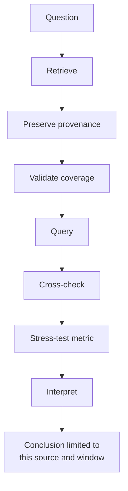

# Week 7 · Part 3 — Querying and measurement design

> **Core question — did reported trading volume rise, and was the rise typical or concentrated in a few days?**

A flow investigation asks what happened in particular records. A measurement
asks what a defined series can support. Retrieval, validation and interpretation
are parts of one analysis, not separate reports.

## The hard skill

**Retrieve an auditable public series, use minimal Structured Query Language
(SQL) to compare consistent windows, and test whether the headline survives
alternative measurements.**

The question is deliberately narrow: **DefiLlama-reported Uniswap daily
decentralised exchange (DEX) volume on Ethereum, in USD, across the last 90 complete
Coordinated Universal Time (UTC) days**. It is not a count of trades, wallets
or people. No account, application programming interface (API) key or wallet
is needed.

## Core / reference material

### A measurement workflow



**Academy workflow schematic:** each step constrains the next. A query cannot
repair a missing date, and a calculated metric cannot support a broader claim
than its source, unit, window and coverage allow.

**Data provenance** is the record of where data came from, when it was
retrieved, what period and scope it covers, and what was done to it before
analysis. Here that includes the endpoint, retrieval time, chain, date range,
and how the data was combined or summarised. Without those details, another
researcher cannot reproduce or challenge the number.

### Retrieve once; preserve the source

The Python file below is a **provided retrieval utility, not a coding
exercise**. It requests the public data, checks that the 90-day series is
complete, and saves the CSV, source snapshot and provenance record for you; you
do not need to edit the file or learn Python.

First check whether Python is available. Open a terminal (a text app for
running commands) or, on Windows, PowerShell / Command Prompt. A command is what
you type; its output is what the computer prints back. Commands run in the
**current folder** — the folder shown by your terminal. After downloading the
script, use `cd` to move into the folder where it was saved. To see the current
folder path, use `pwd` on macOS/Linux or `Get-Location` in PowerShell.

```bash
python3 --version
```

On Windows, use:

```powershell
python --version
```

::: details Expected result
```text
Python 3.12.7
```

Your exact minor version may differ. The important part is that it begins with
`Python 3`.
:::

A version number such as `Python 3.x.x` means the command is available. If the
command is not recognised, do not edit the retrieval utility or install a
third-party package for this task. Use the clearly dated fallback snapshot
below, or consult the linked Python documentation before retrying live retrieval.

Download <a :href="$withBase('/files/researcher/W7.3-free-public-data.py')" download>W7.3-free-public-data.py</a>
into that empty folder. It uses Python 3's standard library. In the same
terminal, after moving into that folder, run:

```bash
python3 W7.3-free-public-data.py
```

On Windows, run:

```powershell
python W7.3-free-public-data.py
```

::: details Expected result
```text
Saved uniswap_ethereum_90days.csv: 90 dates, YYYY-MM-DD to YYYY-MM-DD (UTC)
Saved W7.3-data-provenance.txt and W7.3-source-snapshot.json
Open CSV in LibreOffice Calc to chart daily volume and compare the first and last 30 days.
```

The dates change with the retrieval date. The run creates exactly three files:
the CSV, provenance text and source snapshot. The CSV should contain 90
complete dates. If an error appears instead, keep the message and report it;
do not replace missing values with guesses.
:::

It requests data from DefiLlama's free [Uniswap volume endpoint](https://api.llama.fi/summary/dexs/uniswap?dataType=dailyVolume&excludeTotalDataChart=false&excludeTotalDataChartBreakdown=false),
part of its application programming interface (API).
Use the Ethereum entries of `totalDataChartBreakdown`, summed across reported
versions, **not** the all-chain `totalDataChart`.

The outputs are:

- `uniswap_ethereum_90days.csv`: a comma-separated values (CSV) file with 90
  ascending dates, `day_utc` and `volume_usd`;
- `W7.3-source-snapshot.json`: a JavaScript Object Notation (JSON) file with
  the selected Ethereum version values and totals, endpoint, retrieval time,
  chain, unit, method and inclusive dates;
- `W7.3-data-provenance.txt`: the scope, unit, dates and method.

The window ends yesterday UTC. The script rejects missing/duplicate days,
ambiguous chain data and invalid amounts rather than replacing gaps with zero.
Provider revisions can change past values; keep your original snapshot.
If the API is unavailable, record the error and retry; an error alone is not a
completed measurement. The primary task is live retrieval. Use the dated
snapshot below only if the approved environment or public endpoint is
unavailable, and state clearly that you used it.

::: important Dated fallback snapshot, not live data
This fallback was retrieved on **30 October 2026** and covers **1 August to
29 October 2026 UTC**, inclusive. It is a reproducible teaching fallback, not
current live data. Use it only when live retrieval is unavailable, and say so
in your finding.

- <a :href="$withBase('/files/researcher/W7.3-uniswap-ethereum-volume-2026-10-30.csv')" download>Download the 90-day Ethereum volume CSV</a>
- <a :href="$withBase('/files/researcher/W7.3-source-snapshot-2026-10-30.json')" download>Download the selected source snapshot JSON</a>
- <a :href="$withBase('/files/researcher/W7.3-data-provenance-2026-10-30.txt')" download>Download the provenance record</a>
:::

### Just enough SQL

SQL is a language for selecting and summarising rows in a table. DuckDB's
browser shell can query the CSV you add to the current session; this does not
write anything to a blockchain.

Downloading the CSV to your computer is not enough. DuckDB Web Shell runs
inside the browser and has its own session files, so register the CSV there
before querying it.

Open [DuckDB's free web shell](https://shell.duckdb.org/), then follow these
steps in order. The live script output and the dated fallback have different
filenames, but after registration both use the same SQL below.

#### 1. Add the CSV to the browser session

Click **Import** at the top of the shell, or run `.pick`, then choose the live
`uniswap_ethereum_90days.csv` or the downloaded dated fallback CSV. The shell
should register the selected file in its current session.

#### 2. Confirm DuckDB sees exactly one matching CSV

Run this shell command, then the SQL check:

```text
.files list
```

```sql
SELECT file FROM glob('*uniswap*ethereum*.csv');
```

::: details Expected result
```text
file
uniswap_ethereum_90days.csv
```

The one row may instead be `W7.3-uniswap-ethereum-volume-2026-10-30.csv` or
include a browser suffix such as `(1)`. Exactly one matching CSV should appear
before you continue. Zero matches means it is not registered; more than one
means the session is ambiguous. Start a fresh Web Shell session with **New**,
import only one CSV, and repeat the check. DuckDB's registered filename, not
Finder or Explorer, is the source of truth.
:::

#### 3. Load the one matching file

Only after the check returns exactly one file, run:

```sql
DROP TABLE IF EXISTS uni;
CREATE TABLE uni AS SELECT * FROM read_csv('*uniswap*ethereum*.csv');
DESCRIBE uni;
```

If `CREATE TABLE` reports an error, stop here. The table was not created, so
do not continue to `DESCRIBE uni` or the later queries. Return to steps 1 and
2 and check the registered filename.

::: details Expected result
`DESCRIBE uni` lists fields corresponding to:

```text
day_utc
volume_usd
```

The first field should be date data and the second numeric volume data. DuckDB's
inferred type labels can vary; the important check is that both columns exist
and contain usable date and numeric values.
:::

#### 4. Check the loaded window

Run this before the measurement queries:

```sql
SELECT COUNT(*) AS rows, MIN(day_utc) AS first_day, MAX(day_utc) AS last_day
FROM uni;
```

::: details Expected result
For the bundled fallback:

```text
rows | first_day  | last_day
90   | 2026-08-01 | 2026-10-29
```

With live retrieval, the dates will differ. The row count should still be 90,
and the first and last dates should match the window printed by the retrieval
utility.
:::

::: details If DuckDB says it cannot find the CSV
For an error such as `IO Error: No files found that match the pattern ...`,
DuckDB cannot currently see a registered file matching that name or pattern.
Run `.files list` and repeat the `glob` check above, then import the CSV again
if needed. Renaming a file in Finder or Explorer after it was imported does
not rename the copy already registered in this Web Shell session. Start a
fresh session with **New** and import the renamed file.
:::

The SQL reads the registered CSV into a table named `uni`; it does not upload
the file to a database service or modify the source file. `DESCRIBE uni` lists
the table's column names and data types; `DATE` is a calendar date and a
numeric volume column can be used in calculations. SQL pieces you need:

| Piece | Cognitive job | Example |
|---|---|---|
| SELECT / FROM | Select columns and the table to read | SELECT day_utc, volume_usd FROM uni |
| WHERE | Keep only rows meeting a condition | WHERE volume_usd > 1000000000 |
| COUNT / MIN / MAX | Count rows or find smallest/largest values | COUNT(DISTINCT day_utc) |
| CASE WHEN | Assign a label when a condition is true | CASE WHEN condition THEN 'first' ELSE 'last' END |
| GROUP BY | Produce one summary per label | GROUP BY period |
| AVG / MEDIAN | Calculate the mean and middle ordered value | AVG(volume_usd), MEDIAN(volume_usd) |

For a source check:

```sql
SELECT COUNT(*) AS rows, COUNT(DISTINCT day_utc) AS dates,
       MIN(day_utc) AS first_day, MAX(day_utc) AS last_day,
       MIN(volume_usd) AS minimum_usd
FROM uni;
```

::: details Expected result
For the bundled fallback:

```text
rows:        90
dates:       90
first_day:   2026-08-01
last_day:    2026-10-29
minimum_usd: 214551616.0
```

For live retrieval, both counts must be 90, the dates must match the live
retrieval window, and minimum volume must be non-negative. Live volume values
are not expected to match the dated fallback.
:::

Spot-check two dates with `WHERE day_utc IN
(DATE 'YYYY-MM-DD', DATE 'YYYY-MM-DD')`, replacing the placeholders. Compare
their values to the snapshot's `ethereum_total_usd`; hand-sum the Ethereum
version entries for one date.

### Worked query: a different question

This example asks weekday versus weekend volume, leaving the first/last
30-day query for you:

```sql
SELECT CASE WHEN dayofweek(day_utc) IN (0, 6)
            THEN 'weekend' ELSE 'weekday' END AS kind,
       COUNT(*) AS days, AVG(volume_usd) AS mean_usd,
       MEDIAN(volume_usd) AS median_usd
FROM uni
GROUP BY kind;
```

::: details Expected result
For the bundled fallback, DuckDB 2.0.0 returns values that round to:

```text
kind     | days | mean_usd     | median_usd
weekday  | 64   | 915890531.12 | 818729814.50
weekend  | 26   | 451791272.50 | 415630877.50
```

Live values and weekday/weekend counts may differ with the rolling 90-day
window. The two group counts together should still equal 90.
:::

A weekday/weekend difference describes reported dollar activity, not how many
people trade.

For your first/middle/last comparison, derive boundary dates from your CSV:
first through first + 29 days, then +30 through +59, then +60 through +89.
Use inclusive dates and confirm **30 rows per group**. Do not copy a historical
example's dates into a new download.

::: details Query sanity check
Your result should have three groups: **first**, **middle** and **last**, with
30 days in each group and 90 observations in total. Each group should have one
mean and one median; volume values must be non-negative. If the three group
counts do not add to 90, check your date boundaries before interpreting the
results.
:::

### Stress-test the headline

| Metric | Definition / unit | What it tests |
|---|---|---|
| Mean | Total USD / 30 observed days, USD/day | Headline average |
| Median | Middle of the ordered daily values, USD/day | A typical day, less dominated by spikes |
| Top-three share | Sum of busiest three days / window total, % | Concentration in outliers |

For example, daily volumes of **USD 2m, USD 2m, USD 2m, USD 2m and USD 12m**
have a mean of **USD 4m** and a median of **USD 2m**. The one large day pulls
the mean up; the median is the middle observation in this small ordered set.
Neither alone explains why the spike occurred.

For two consistent windows, percentage change in a metric is:

$$
\%\Delta = \left(\frac{x_1}{x_0}-1\right)\times100
$$

$x_0$ is the baseline-window value and $x_1$ is the comparison-window value;
both must use the same unit and metric definition. If $x_0=0$, percentage
change is undefined (report the values rather than dividing by zero).

For a 30-day window, top-three share is:

$$
C_3 =
\frac{V_{(1)}+V_{(2)}+V_{(3)}}{\sum_{i=1}^{30}V_i}
$$

$V_{(1)},V_{(2)},V_{(3)}$ are the three largest observed daily USD volumes in
that window; the denominator is the sum of all 30 daily values. Multiply the
ratio by 100 to report a percentage. If the window total is zero, the share is
undefined. A high $C_3$ means the period's total depends heavily on three
spike days; it does not by itself show manipulation or wash trading.

A **sensitivity check** means measuring the same question in another
reasonable way to see whether the conclusion still holds. Mean, median and
top-three concentration all summarise this same volume series. If only the
mean rises because of a few spike days, the headline may need to be narrower.

Open the CSV in Calc. The header row should show `day_utc` in column A and
`volume_usd` in column B, with the first data row in row 2. If the import dialog
appears, keep the comma delimiter so the two fields load into separate columns.
Put the required formulas in empty cells or a small separate calculation area.
You do not need prior spreadsheet-modelling experience.

Before calculating, select the header and all 90 observations (`A1:B91`), then
choose **Insert → Chart**. In the Chart Wizard, choose **Line**. On its data
range step, use data series in columns and confirm the first row and first
column are labels. Use `day_utc` for the horizontal-axis labels and `volume_usd`
for the vertical axis. Label the axes **Day (UTC)** and **Daily volume (USD)**.
Give the chart a title such as **Uniswap Ethereum daily volume (USD), [actual
first date] to [actual last date]**, using the dates from your loaded 90-day
window. Keep the DefiLlama source and date window visible in the title or
nearby. Do not add extra chart features.

::: details What success looks like
One line covers all 90 dates in date order from left to right, with USD volume
on the vertical axis. Larger observations appear as peaks relative to other
days. Use the shape to describe whether activity looks broad or concentrated;
the chart does not explain why a change happened.

The bundled fallback has a visible late-window spike. That is why the next step
checks whether the mean, median and top-three concentration tell a similar
story; the spike is a prompt to investigate, not a conclusion.

<figure class="academy-reference-visual academy-reference-visual--wide">
  
  <figcaption>Reference chart using the bundled fallback snapshot retrieved on 30 October 2026, covering 1 August to 29 October 2026 UTC. Source: DefiLlama. If you retrieved live data, your dates, values and shape may differ. This shows the expected chart structure, not a required numerical result.</figcaption>
</figure>
:::

**A summary statistic tells you the level; the raw series shows the shape that
produced it.** Never interpret an average before checking the observations it
summarises. Read the evidence in this order: inspect the series, compare the
mean, check whether the median moves in the same direction, measure the
top-three share, then decide whether those views support the same story.

In Calc, with CSV headers in row 1 and sorted dates, use:

| Quantity | First 30 (rows 2–31) | Last 30 (rows 62–91) |
|---|---|---|
| Mean | `=AVERAGE(B2:B31)` | `=AVERAGE(B62:B91)` |
| Median | `=MEDIAN(B2:B31)` | `=MEDIAN(B62:B91)` |
| Top-three share | `=(LARGE(B2:B31;1)+LARGE(B2:B31;2)+LARGE(B2:B31;3))/SUM(B2:B31)` | `=(LARGE(B62:B91;1)+LARGE(B62:B91;2)+LARGE(B62:B91;3))/SUM(B62:B91)` |

::: details Expected result
The mean and median cells should each show a numeric USD value. Top-three share
should be between 0 and 1 when shown as a decimal, or between 0% and 100% when
formatted as a percentage. Spreadsheet locale may change formula separators,
but not these result types or bounds.
:::

Adjust argument separators for your spreadsheet locale. Zero window total
makes concentration undefined; zero first mean makes percentage change
undefined. Report either honestly.

**Synthetic interpretation example:** mean rises from USD 8m to USD 10.4m
(+30%); median from USD 7.5m to USD 7.875m (+5%); top-three share rises from
18% to 42% (+24 percentage points). Percentage points are the direct
difference between two percentages: 42% minus 18% is 24 percentage points.
That is not a 24% relative increase. The average rose, but the typical day
changed far less. This does not establish broader adoption.

Choose an interpretation rule **before reading results**: for example,
describe mean growth separately from whether median and concentration agree.
A 10% threshold is a rule you chose for interpreting the result. It is not
statistical proof and it is not a universal industry threshold.

### Confounders that remain

A **confounder** is another factor that could produce the same observed change,
giving you an alternative explanation. If reported DEX volume rises 30%, more
trading may be one explanation. But if token prices also rise, the same number
of tokens traded can produce a higher USD volume; price change is a possible
confounder. Larger trades, incentives, chain migration and provider coverage
can also affect the result. These checks use the same series, so they are not
independent verification of users. Record **source / unit / chain / dates /
retrieval time**, then name what extra data could separate the explanations.

::: details Optional industry-data path — Allium academic access
Allium offers an Explorer for querying on-chain data with SQL and may provide
academic access to approved institutions. Availability varies. This is an
optional alternative for learning how to query a provider's schema, not a
replacement for the reproducible DefiLlama-to-CSV workflow or an added task.

If access is available, first inspect what each row and field represents,
record the query and retrieval date, then compare a clearly matched metric
with this Part's DefiLlama series. Different results may reflect different
coverage, schemas or metric definitions; a mismatch is a question to
investigate, not proof that either source is wrong. See [Allium academic
access](https://www.allium.so/use-case/academia).
:::

## Hands-on task

Aim for 60–75 minutes total, including reading. Produce one reproducible
analysis, with one simple line chart as part of the analysis and no additional
report:

1. Retrieve and validate the 90-day CSV; keep snapshot/provenance. Run the
   coverage query and spot-check two dates, including one version-sum check.
2. Write one `CASE WHEN` / `GROUP BY` query for the first, middle and last
   30 days, returning `COUNT`, `AVG` and `MEDIAN`.
3. Plot all 90 daily observations in one line chart in Calc.
4. Cross-check first/last means in Calc and calculate top-three share for
   those windows. Calculate the percentage change in mean and median; use
   percentage points when comparing concentration.
5. State your interpretation rule, then give a **90-word finding**. Say what
   story the mean alone suggests, what the chart's shape suggests, whether the
   median agrees, and whether concentration strengthens or weakens that story.
   Include the direction and size of the change, two plausible confounders and
   one next check, all within the stated source and window. Do not call dollar
   volume people, demand or independent users.

**Out of scope:** advanced SQL, transaction decoding, price prediction and
requiring both a full measurement memo and a second query assignment.

## Evidence required

- The three data files, SQL with outputs, two source spot-checks, the line chart
  with its source/date window and the small first/last metric table.
- One finding containing the rule, source, timeframe, units and limitations.

## Completion and revision

This Part is worth **100 points** in the Academy progression. Academy participants submit it for a binary **Complete** or **Revise** review against the criteria above. Independent readers may use those criteria as a self-check; formal points are tracked through organised Academy participation. There is no partial-score rubric. There is no separate weekly submission.

Complete means 90 complete UTC dates, 30 per group, reproducible SQL and
source checks, consistent units, and a line chart covering the same series. The
finding explains whether the observed change looks broad or spike-driven using
the chart, mean, median and concentration, without claiming more than reported
USD volume can show. The measures need not agree, and no one conclusion is
prescribed.

::: details Further Exploration — optional, not assessed
Retrieve the all-chain series separately or calculate concentration in SQL
with a ranking window function. Neither is required; a JOIN is unnecessary for
this single-table question.
:::

::: details Sources and attribution
- [DefiLlama — Public API](https://api-docs.defillama.com/) and [methodology](https://docs.llama.fi/) — Link, independent data provider; derived estimates, not raw chain records
- [Uniswap volume endpoint](https://api.llama.fi/summary/dexs/uniswap?dataType=dailyVolume&excludeTotalDataChart=false&excludeTotalDataChartBreakdown=false) — Link, live data; preserve the retrieval snapshot
- [DuckDB — Web shell](https://shell.duckdb.org/), [SQL](https://duckdb.org/docs/stable/sql/introduction) and [CSV import](https://duckdb.org/docs/stable/data/csv/overview) — Link, tool documentation
- [LibreOffice — Calc](https://books.libreoffice.org/en/) and [Chart Wizard — Data Range](https://help.libreoffice.org/latest/en-US/text/schart/01/wiz_data_range.html) — Link, tool documentation
- [Allium — Academic access](https://www.allium.so/use-case/academia) — Link, optional industry-data path; availability may be limited to approved institutions
:::
